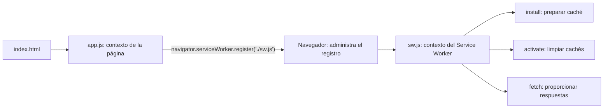

# ServiceWorker — Explicación de app.js y sw.js

Este ejemplo muestra cómo registrar un Service Worker, preparar archivos en caché durante su instalación y limpiar cachés anteriores durante su activación. La parte de interceptación de peticiones intenta consultar la caché antes de recurrir a la red, pero contiene un error con las promesas que se explica más adelante.

La guía describe los archivos actuales de [`ServiceWorker/`](ServiceWorker/), con énfasis en [`app.js`](ServiceWorker/app.js) y [`sw.js`](ServiceWorker/sw.js). El ejemplo corregido de `fetch` aparece únicamente como explicación; los archivos del proyecto conservan su código.

## Archivos y Responsabilidades

| Archivo | Para qué sirve |
|---|---|
| [`index.html`](ServiceWorker/index.html) | Muestra el encabezado `Ciclo de vida`, carga la hoja de estilos y ejecuta `app.js` |
| [`styles.css`](ServiceWorker/styles.css) | Asigna el color `#fc9905` al encabezado `h1` |
| [`app.js`](ServiceWorker/app.js) | Comprueba si existe la API y solicita el registro de `sw.js` |
| [`sw.js`](ServiceWorker/sw.js) | Define el nombre de la caché y los manejadores de `install`, `activate` y `fetch` |

No hay un manifiesto web en esta carpeta. El ejemplo se centra en el Service Worker; su registro por sí solo no configura una PWA instalable completa.

## Dos Contextos de Ejecución



`app.js` se ejecuta como parte de la página. Desde ese contexto utiliza `navigator` para pedirle al navegador que registre otro script.

`sw.js` se ejecuta en el contexto del Service Worker, separado de la interfaz. Su objeto global es `self`, de tipo `ServiceWorkerGlobalScope`; no tiene acceso directo al DOM mediante `document`.

En el archivo aparece este comentario:

```javascript
//Self contexto del hilo primario
```

**Ese comentario es incorrecto para este archivo:** aquí `self` se refiere al contexto del Service Worker, no al hilo principal de la página. Tampoco representa una instancia de una clase escrita por el proyecto. [Uso y contexto de los Service Workers, MDN](https://developer.mozilla.org/en-US/docs/Web/API/Service_Worker_API/Using_Service_Workers).

## app.js: Comprobar y Registrar

El archivo completo contiene:

```javascript
if('serviceWorker' in navigator){
    navigator.serviceWorker.register('./sw.js')
}
```

### `'serviceWorker' in navigator`

El operador `in` comprueba si el objeto `navigator` tiene la propiedad `serviceWorker`. Es una comprobación de disponibilidad de la API antes de utilizarla.

Si la propiedad existe, se ejecuta el registro. Si no existe, este código no hace nada: no tiene un `else` ni muestra un mensaje alternativo.

### `navigator.serviceWorker`

Es el objeto `ServiceWorkerContainer` de la página. Es el punto de acceso a la administración de Service Workers desde ese contexto; no es el contenido de `sw.js` ni la caché.

### `.register('./sw.js')`

Solicita crear o actualizar el registro asociado con ese script. La ruta es relativa a la URL base de la página. Como `index.html`, `app.js` y `sw.js` están juntos, `./sw.js` apunta al archivo del mismo directorio.

El método devuelve una **promesa que resuelve a un `ServiceWorkerRegistration`**. El código actual no recoge ese resultado con `.then()` ni maneja errores con `.catch()`.

El alcance predeterminado corresponde al directorio del script registrado. Por ejemplo, si el script está en `/ServiceWorker/sw.js`, su alcance predeterminado es `/ServiceWorker/`. Registrar un script no significa que ya haya terminado de instalarse o que controle inmediatamente la página abierta. [API de `register()`, MDN](https://developer.mozilla.org/en-US/docs/Web/API/ServiceWorkerContainer/register).

La página debe servirse desde un contexto seguro, como HTTPS o `http://localhost`. Abrir `index.html` mediante `file://` no proporciona el entorno necesario para este registro.

## Qué Objetos y Valores Intervienen

El proyecto no utiliza `new` para crear estos objetos. El navegador proporciona los objetos globales y los eventos; otras operaciones entregan objetos o valores como resultado.

| Nombre en el código | Qué es | Qué representa |
|---|---|---|
| `navigator` | Objeto del navegador en la página | Acceso a capacidades del entorno |
| `navigator.serviceWorker` | `ServiceWorkerContainer` | Administración del registro desde la página |
| `self` | `ServiceWorkerGlobalScope` | Contexto global donde se ejecuta `sw.js` |
| `caches` | Objeto `CacheStorage` | Acceso a las cachés con nombre del origen |
| `CACHE_NAME` | Constante de tipo cadena | Nombre de la caché que el ejemplo quiere conservar |
| `event` en `install` y `activate` | Evento con capacidad de extender su duración | Permite asociar tareas mediante `waitUntil()` |
| `cacheCreado` | Objeto `Cache` recibido en el callback | Caché abierta por `caches.open()` |
| `keys` | Arreglo de cadenas | Nombres de las cachés existentes, no nombres de archivos |
| `cacheName` | Parámetro de una función | Nombre que se está revisando durante `keys.map()` |
| `event` en `fetch` | `FetchEvent` | Petición interceptada y mecanismo para responderla |
| `event.request` | Objeto `Request` | Petición que se está atendiendo |
| `event.request.url` | Cadena con la URL | Dirección que se imprime en la consola |
| Promesas | Objetos que representan resultados asíncronos | Apertura, descarga, búsqueda o eliminación todavía en curso |

`cacheCreado` es un nombre elegido por quien escribió el callback. No asegura que la caché sea nueva: `open()` también puede devolver una existente.

## sw.js: Nombre de la Caché

```javascript
const CACHE_NAME = 'v1_cache_10A';
```

Esta cadena identifica un contenedor de recursos. Se utiliza para abrirlo durante `install` y para distinguirlo de los demás durante `activate`.

El prefijo `v1` es una convención de versionado del ejemplo, no una instrucción especial del navegador. Cambiarlo modifica el script y permite preparar una caché con otro nombre cuando se instala la actualización. El contenido no se actualiza automáticamente por el simple hecho de que un archivo como `styles.css` haya cambiado en el servidor.

## Evento install: Preparar los Archivos

El manejador actual es:

```javascript
self.addEventListener('install', (event)=>{
    console.log('Service Worker instalado');

    event.waitUntil(
        caches.open(CACHE_NAME)
        .then((cacheCreado)=>{
            return cacheCreado.addAll(
                [
                    '/',
                    '/index.html',
                    '/styles.css',
                    '/app.js'
                ]
            )
        })
    );
});
```

### `self.addEventListener('install', callback)`

Registra una función que el navegador ejecutará durante la instalación de esa versión. Llamar a `addEventListener` prepara la escucha; no equivale a invocar manualmente la instalación desde `app.js`.

El `console.log` se ejecuta al entrar al manejador, **antes de que termine la descarga de los archivos**. Ver el texto `Service Worker instalado` en consola no confirma por sí solo que la preparación de la caché haya terminado correctamente.

### `caches.open(CACHE_NAME)`

Abre la caché con ese nombre o la crea si no existe. Devuelve una promesa que se resuelve con un objeto `Cache`.

### `.then((cacheCreado) => ...)`

La función de `.then()` se ejecuta cuando la apertura termina correctamente. Su parámetro `cacheCreado` permite operar sobre ese contenedor concreto.

No es una pausa de todo JavaScript: la continuación se ejecuta cuando está disponible el resultado asíncrono.

### `cacheCreado.addAll([...])`

Descarga los recursos indicados y almacena sus peticiones y respuestas en la caché. Esto es **precaching**: preparar archivos antes de necesitarlos en una visita posterior.

| Ruta | Recurso solicitado |
|---|---|
| `/` | Página de la raíz del servidor |
| `/index.html` | Documento HTML en la raíz |
| `/styles.css` | Hoja de estilos en la raíz |
| `/app.js` | Script de la página en la raíz |

`/` y `/index.html` son URLs distintas, aunque el servidor pueda responder con el mismo documento. `sw.js` no está en esta lista: el navegador administra su descarga y registro mediante el ciclo de vida del Service Worker.

`addAll()` devuelve una promesa. Si una descarga falla, por ejemplo con un 404, la operación se rechaza. [API de `addAll()`, MDN](https://developer.mozilla.org/en-US/docs/Web/API/Cache/addAll).

### Por Qué Se Escribe `return cacheCreado.addAll(...)`

Ese `return` conecta la promesa de descarga con la promesa de `.then()`. Así, la cadena no termina simplemente cuando se abrió el contenedor, sino cuando también terminó la preparación de sus archivos.

### `event.waitUntil(...)`

Asocia la cadena de promesas a la instalación. El navegador espera su resultado antes de considerar completada esa fase; si se rechaza, la instalación falla y esa nueva versión se descarta. No bloquea el hilo de la interfaz. [API de `waitUntil()`, MDN](https://developer.mozilla.org/en-US/docs/Web/API/ExtendableEvent/waitUntil).

```text
install
    → abrir v1_cache_10A
    → recibir el objeto Cache
    → descargar y guardar los cuatro recursos
    → completar la promesa entregada a waitUntil
```

### Qué Implican las Rutas que Empiezan con `/`

Las rutas de la lista parten de la **raíz del origen**, no necesariamente de la carpeta donde está `sw.js`.

Si el proyecto se abre en `http://localhost:8080/ServiceWorker/`, `/app.js` apunta a `http://localhost:8080/app.js`, no a `http://localhost:8080/ServiceWorker/app.js`. Puede producirse un 404 o guardarse un recurso diferente si existe algo en esa raíz.

Para estudiar este código sin cambiar sus rutas, sirve la propia carpeta `ServiceWorker` como raíz del servidor, como se muestra al final de la guía.

## Evento activate: Limpiar Otros Contenedores

```javascript
self.addEventListener('activate', (event)=>{
    console.log('Service Worker activado');
    event.waitUntil(
        caches.keys()
        .then((keys)=>{
            return Promise.all(
                keys.map(
                    (cacheName) => {
                        if(cacheName !== CACHE_NAME){
                            return caches.delete(cacheName);
                        }
                    }
                )
            )
        })
    );
});
```

### `caches.keys()`

Devuelve una promesa que resuelve con los nombres de los contenedores existentes. No devuelve los archivos almacenados dentro de ellos.

Por ejemplo, `keys` podría contener:

```javascript
['v0_cache_10A', 'v1_cache_10A']
```

### `keys.map((cacheName) => ...)`

Recorre cada nombre y construye un arreglo con los resultados del callback. En este caso, el resultado es una promesa de eliminación para cada nombre distinto del actual.

La comparación `cacheName !== CACHE_NAME` conserva `v1_cache_10A`. Para ese elemento el callback no entra al `if` y devuelve `undefined`.

### `caches.delete(cacheName)`

Elimina el contenedor completo con ese nombre. Devuelve una promesa cuyo resultado booleano indica si se eliminó una caché existente.

La condición no filtra por un prefijo del proyecto: elimina **cualquier caché con otro nombre accesible en ese origen**. Si se sirven varios ejercicios en el mismo origen, también puede borrar sus contenedores. Esa es la conducta concreta de este manejador.

### `Promise.all(...)`

Reúne las operaciones del arreglo y devuelve una promesa que espera a que todas se completen correctamente. También admite valores como el `undefined` del contenedor conservado; ese elemento no genera una eliminación.

`Promise.all` es un método estático del objeto incorporado `Promise`; `map` es un método del arreglo `keys`. No son métodos de la caché.

El `return` enlaza la limpieza con `.then()`, y `waitUntil()` conecta esa cadena con la activación. Así se prepara el almacenamiento antes de atender los eventos funcionales que dependen de esa activación. [Uso de `waitUntil()` en activación, MDN](https://developer.mozilla.org/en-US/docs/Web/API/ExtendableEvent/waitUntil).

```text
activate
    → obtener nombres de cachés
    → conservar CACHE_NAME
    → eliminar los demás contenedores
    → esperar a que terminen las eliminaciones
```

## Evento fetch: Atender una Petición

El código actual contiene:

```javascript
self.addEventListener('fetch', (event)=>{
    console.log('Fetch', event.request.url);
    event.respondWith(
        caches.match(event.request) || fetch(event.request)
    )
});
```

Este evento permite intervenir en peticiones de páginas controladas por el Service Worker, como la navegación o las solicitudes de hojas de estilos y scripts. No intercepta indiscriminadamente toda la navegación del navegador.

### `event.request` y `event.request.url`

`event.request` representa la petición. El código la utiliza para buscar una respuesta compatible en caché o para realizar la solicitud de red.

Su propiedad `.url` se utiliza únicamente en `console.log` para identificar qué dirección se está solicitando.

### `event.respondWith(...)`

Permite proporcionar la respuesta a la petición interceptada. Recibe un objeto `Response` o una promesa que termine entregando uno. Si la promesa entrega `undefined`, no hay una respuesta válida y la petición falla. [API de `respondWith()`, MDN](https://developer.mozilla.org/en-US/docs/Web/API/FetchEvent/respondWith).

### `caches.match(event.request)`

Busca una respuesta almacenada que corresponda a la petición. Como se llama sobre `caches`, la búsqueda se realiza entre los contenedores disponibles; no está restringida a `CACHE_NAME`.

Devuelve inmediatamente una **promesa**. Más adelante, esa promesa entrega una `Response` si encuentra coincidencia o `undefined` si no la encuentra. [API de `CacheStorage.match()`, MDN](https://developer.mozilla.org/en-US/docs/Web/API/CacheStorage/match).

### `fetch(event.request)`

Realiza la solicitud mediante la API Fetch y devuelve una promesa de respuesta de red. La intención del ejemplo es ejecutarla cuando la caché no tenga el recurso.

### El Error del Operador `||`

La expresión actual es:

```javascript
caches.match(event.request) || fetch(event.request)
```

`||` evalúa su lado izquierdo inmediatamente. Allí encuentra un objeto `Promise`, que es verdadero al evaluarse como condición, incluso si después termina entregando `undefined`.

Por cortocircuito, **`fetch(event.request)` no se ejecuta**. El código no espera al resultado de la búsqueda para decidir.

| Situación | Resultado del código actual |
|---|---|
| El recurso existe en caché | La promesa entrega la respuesta almacenada |
| El recurso no existe en caché | La promesa entrega `undefined`; la petición falla y no se intenta la red |

Por ello, este manejador intenta representar una estrategia Cache First, pero todavía no implementa correctamente su respaldo de red. Es un problema de flujo asíncrono, no un error de sintaxis.

### Cómo Se Esperaría el Resultado Antes de Decidir

Este es un **ejemplo de corrección para estudiar**; no es el contenido actual de `sw.js`:

```javascript
self.addEventListener('fetch', (event) => {
    event.respondWith(
        caches.match(event.request).then((respuestaCache) => {
            return respuestaCache || fetch(event.request);
        })
    );
});
```

Dentro de `.then()`, `respuestaCache` ya es el resultado de la búsqueda. Ahora sí se puede decidir: devolver la respuesta si existe o pedirla a la red si falta.

Esta variante consulta primero caché y después red, pero **no guarda automáticamente las respuestas nuevas de red**. Para eso sería necesaria otra operación de almacenamiento, ausente en este ejemplo.

## Cómo Se Relacionan Registro, Instalación, Activación y Control

| Momento | Qué ocurre en este proyecto |
|---|---|
| Primera carga de la página | Se descargan HTML, CSS y `app.js`; este último solicita el registro |
| Instalación de una versión | El navegador ejecuta el manejador `install` y se prepara la caché |
| Activación | Se ejecuta la limpieza de los demás contenedores |
| Página bajo control | Sus peticiones pueden ser atendidas por el manejador `fetch` |
| Actualización del script | La nueva versión se instala; si hay una anterior controlando páginas, normalmente queda en espera antes de activarse |

No hay llamadas a `self.skipWaiting()` ni a `self.clients.claim()`. Por eso no se fuerza saltar la espera de una actualización ni adoptar inmediatamente la primera página que ya estaba abierta. En una primera visita sin controlador, una navegación posterior, como una recarga después de activarse el worker, permite que la página quede controlada. [Control y actualización de clientes, MDN](https://developer.mozilla.org/en-US/docs/Web/API/Service_Worker_API/Using_Service_Workers).

No se comunican estos archivos mediante llamadas directas a una función de `sw.js`: `app.js` solicita el registro y el navegador dispara los eventos del worker.

## Diferencia entre los Métodos que Reciben Promesas

| Operación | Qué coordina |
|---|---|
| `event.waitUntil(promesa)` | Duración y resultado de tareas asociadas a `install` o `activate` |
| `event.respondWith(promesaDeRespuesta)` | Respuesta de una petición interceptada en `fetch` |
| `promesa.then(callback)` | Continuación que utiliza un resultado asíncrono cuando llega |
| `Promise.all(arreglo)` | Finalización conjunta de varias operaciones |

Aunque las cuatro intervienen en trabajo asíncrono, tienen responsabilidades diferentes. Preparar una caché durante la instalación no es lo mismo que entregar una respuesta a una petición concreta.

## Ejecutar y Relacionar el Código con lo que Se Observa

Desde esta carpeta de `Apuntes`, sirve `ServiceWorker` como raíz del servidor:

```bash
cd ServiceWorker
python -m http.server 8080
```

Abre `http://localhost:8080`. Así, las rutas `/index.html`, `/styles.css` y `/app.js` coinciden con los archivos del ejercicio.

En las herramientas de desarrollo del navegador, observa el registro, los mensajes de consola y el contenedor `v1_cache_10A`. Espera a que el worker termine su instalación y activación antes de comprobar el comportamiento de una página controlada.

Con el código actual, un recurso almacenado puede responder desde caché; uno que falte no usará el respaldo de red debido al `||` explicado. Ver archivos almacenados no demuestra que ese respaldo funcione.

Para relacionar esta inspección con las herramientas del navegador, consulta [Tema 2.3 - Chrome DevTools como Centro de Mando PWA](../../contexto-general/Tema%202.3%20-%20Chrome%20DevTools%20como%20Centro%20de%20Mando%20PWA.md).

## Preguntas de Repaso

1. ¿Qué diferencia hay entre el contenedor `caches` y el objeto `cacheCreado`?
2. ¿Por qué se devuelve la promesa de `addAll()` dentro de `.then()`?
3. ¿`caches.keys()` enumera recursos o contenedores?
4. ¿Qué cachés elimina la condición de `activate`?
5. ¿Por qué una promesa no puede utilizarse como si ya fuera el resultado de la búsqueda?
6. ¿Registrar el worker significa que la página abierta ya está controlada?
