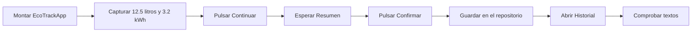

# Dependencies - Pruebas y Dependencias de EcoTrack

Esta guía estudia las pruebas existentes en [`dependencies/`](dependencies/), las herramientas declaradas en su [`pubspec.yaml`](dependencies/pubspec.yaml) y su relación con el flujo Registro → Resumen → Historial.

**Lectura previa:** [Dependencies - Arquitectura y flujo de EcoTrack](Dependencies%20-%20Arquitectura%20y%20flujo%20de%20EcoTrack.md).

El proyecto contiene **tres casos unitarios, cuatro casos de interfaz y un caso de integración**. Los siete casos de la suite de `test/` pasan. La prueba de integración se ejecuta por separado y mantiene una diferencia en el nombre de laboratorio esperado, explicada más adelante.

---

## Tabla de Contenidos

1. [Qué se prueba en cada nivel](#1-qué-se-prueba-en-cada-nivel)
2. [Dependencias de pubspec.yaml](#2-dependencias-de-pubspecyaml)
3. [Organización e imports](#3-organización-e-imports)
4. [Cómo leer una prueba](#4-cómo-leer-una-prueba)
5. [Pruebas unitarias de reglas](#5-pruebas-unitarias-de-reglas)
6. [Pruebas de interfaz](#6-pruebas-de-interfaz)
7. [Herramientas de WidgetTester](#7-herramientas-de-widgettester)
8. [Prueba de integración](#8-prueba-de-integración)
9. [Inyección de dependencias y aislamiento](#9-inyección-de-dependencias-y-aislamiento)
10. [Diferencias entre las expectativas y el código](#10-diferencias-entre-las-expectativas-y-el-código)
11. [Cómo ejecutar las pruebas](#11-cómo-ejecutar-las-pruebas)
12. [Cómo interpretar un fallo](#12-cómo-interpretar-un-fallo)
13. [Cobertura actual y ejercicios](#13-cobertura-actual-y-ejercicios)
14. [Verificación realizada](#14-verificación-realizada)
15. [Preguntas de repaso](#15-preguntas-de-repaso)

---

## 1. Qué Se Prueba en Cada Nivel

| Nivel | Pregunta que responde | Qué participa en este proyecto | Archivo |
|---|---|---|---|
| Unitaria | ¿La regla devuelve el resultado esperado para una entrada? | Métodos de `ReglaConsumo` y `ReglaCorreo` | [`test/unitarias/reglas_test.dart`](dependencies/test/unitarias/reglas_test.dart) |
| Interfaz o widget | ¿La pantalla muestra mensajes y navega según lo capturado? | `RegistroPage`, formulario, reglas y navegación hacia Resumen | [`test/interfaz/registro_page_test.dart`](dependencies/test/interfaz/registro_page_test.dart) |
| Integración | ¿Cooperan los componentes durante un recorrido de la aplicación? | `EcoTrackApp`, Registro, Resumen, repositorio e Historial | [`integration_test/guardar_y_ver_historial_test.dart`](dependencies/integration_test/guardar_y_ver_historial_test.dart) |

Flutter distingue estos tres alcances: función o clase, widget y aplicación completa o una parte importante de ella. [Descripción oficial de los tipos de pruebas](https://docs.flutter.dev/testing/overview).

Una prueba de widget también puede atravesar varios componentes: las de este proyecto llaman a las reglas y algunas navegan al resumen. No se clasifican únicamente por cuántas clases tocan. La prueba de integración prepara el binding de integración y se ejecuta sobre una plataforma de destino.

---

## 2. Dependencias de pubspec.yaml

### Nombre y requisito del SDK

El archivo declara:

```yaml
name: dpendencies

environment:
  sdk: ^3.13.4
```

El requisito de Dart admite versiones desde `3.13.4` hasta antes de `4.0.0`. El nombre **`dpendencies`** determina el prefijo de los imports propios del proyecto. La carpeta `dependencies` y el título de la aplicación pueden tener otros nombres.

### Paquetes relacionados con las pruebas

El bloque de desarrollo contiene:

```yaml
dev_dependencies:
  flutter_test:
    sdk: flutter
  integration_test:
    sdk: flutter
  flutter_lints: ^6.0.0
```

| Dependencia | Para qué sirve | Dónde se usa |
|---|---|---|
| `flutter_test` | Proporciona `test`, `group`, `expect`, matchers y herramientas para probar widgets como `testWidgets` y `WidgetTester` | Los tres archivos de pruebas |
| `integration_test` | Prepara la ejecución de las pruebas de integración con Flutter y una plataforma de destino | El archivo de `integration_test/` |
| `flutter_lints` | Conjunto de reglas para el análisis estático | [`analysis_options.yaml`](dependencies/analysis_options.yaml), mediante `include: package:flutter_lints/flutter.yaml` |

`flutter_lints` no ejecuta escenarios ni sustituye las assertions. Es una herramienta de calidad del código utilizada por el analizador.

`sdk: flutter` indica que los dos primeros paquetes se obtienen del SDK de Flutter instalado. No es una versión descargada independientemente con una restricción como `^6.0.0`.

Se declaran en `dev_dependencies` porque apoyan el desarrollo y las pruebas. En `dependencies` están `flutter` y `cupertino_icons`, que corresponden a la aplicación. Esta separación está explicada en la [referencia de pubspec de Dart](https://dart.dev/tools/pub/pubspec).

### Campo adicional en la raíz

El archivo también tiene este bloque inmediatamente después de `environment`, al nivel raíz:

```yaml
integration_test:
  sdk: flutter
```

Ese campo aislado no declara una dependencia de Pub. La declaración efectiva es la que aparece **dentro de `dev_dependencies`**. El bloque raíz es redundante para resolver el paquete; no hace falta agregar otra dependencia para compensarlo.

### Qué aporta pubspec.lock

[`pubspec.lock`](dependencies/pubspec.lock) registra las versiones resueltas. En este proyecto:

- `flutter_test` e `integration_test` aparecen con origen `sdk` y versión de paquete `0.0.0`; ese valor no es la versión del SDK de Flutter.
- `flutter_lints` está resuelto en `6.0.0`.
- `test_api` y `matcher` llegan como dependencias transitivas, no como declaraciones directas del proyecto.

No se declara `mockito`, `mocktail` ni un contenedor de inyección. Las pruebas usan los constructores normales y el repositorio en memoria ya implementado.

---

## 3. Organización e Imports

```text
dependencies/
├── lib/
│   ├── dominio/consumo.dart
│   ├── datos/consumo_repositorio.dart
│   ├── presentacion/
│   └── main.dart
├── test/
│   ├── unitarias/reglas_test.dart
│   └── interfaz/registro_page_test.dart
├── integration_test/
│   └── guardar_y_ver_historial_test.dart
├── pubspec.yaml
└── pubspec.lock
```

Las funciones de pruebas se importan con:

```dart
import 'package:flutter_test/flutter_test.dart';
```

La integración agrega:

```dart
import 'package:integration_test/integration_test.dart';
```

Los componentes de la aplicación deben localizarse mediante su nombre de paquete, por ejemplo:

```dart
import 'package:dpendencies/dominio/consumo.dart';
```

La ruta después de `package:dpendencies/` corresponde al contenido de `lib/`. No se escribe `lib` en el import.

El archivo unitario importa `package:dpendencies/dominio/consumo.dart`, de acuerdo con el nombre declarado en `pubspec.yaml`. Así, las pruebas utilizan las reglas de esta aplicación. La ubicación de otra aplicación en una carpeta vecina no la convierte automáticamente en una dependencia de Pub.

---

## 4. Cómo Leer una Prueba

Una prueba puede estudiarse en tres partes:

1. **Preparar:** construir los objetos y establecer los datos iniciales.
2. **Actuar:** llamar al método o simular la acción del usuario.
3. **Comprobar:** comparar lo ocurrido con el resultado esperado.

En una regla pequeña, actuar y comprobar pueden aparecer en la misma línea:

```dart
test('Validar litros: rechazar no positivos y valores desde el tope', () {
  expect(ReglaConsumo.validarLitros(0), isNotNull);
});
```

| Elemento | Función |
|---|---|
| `main()` | Declara los grupos y casos que el ejecutor descubrirá |
| `group` | Organiza casos relacionados; no es por sí mismo un caso de prueba |
| `test` | Declara un caso que puede comprobar lógica sin montar widgets |
| `testWidgets` | Declara un caso que recibe un `WidgetTester` |
| Texto del caso | Describe lo que se espera; no ejecuta ninguna comprobación por sí solo |
| `expect(actual, matcher)` | Comprueba el resultado real con un criterio |

### Matchers utilizados

| Matcher | Qué comprueba |
|---|---|
| `isNull` | Que el resultado sea `null` |
| `isNotNull` | Que el resultado no sea `null` |
| `isTrue` / `isFalse` | Que el resultado booleano sea verdadero o falso |
| `findsOneWidget` | Que el finder encuentre exactamente un widget |
| `findsNothing` | Que el finder no encuentre widgets |

En estas reglas, `isNotNull` indica que se produjo **algún mensaje de error**. No comprueba el texto exacto. En las pruebas de interfaz sí hay comprobaciones que buscan una cadena concreta.

---

## 5. Pruebas Unitarias de Reglas

Archivo: [`reglas_test.dart`](dependencies/test/unitarias/reglas_test.dart).

Hay dos grupos y tres casos. Sus assertions llaman directamente a las reglas, sin `MaterialApp`, navegación ni repositorio.

### Grupo: Historia Registrar consumo

#### Caso 1: rechazo y rango de litros

| Entrada | Expectativa escrita | Resultado del código de `dependencies` |
|---:|---|---|
| `0` | `isNotNull` | Devuelve mensaje de error |
| `-3` | `isNotNull` | Devuelve mensaje de error |
| `-1` | `isNotNull` | Devuelve mensaje de error |
| `1000` | `isNull` | Devuelve `null`: está por debajo de 10000 |
| `1001` | `isNull` | Devuelve `null`: también está dentro del rango válido |
| `9999` | `isNull` | Devuelve `null`: está inmediatamente debajo del tope |
| `10000` | `isNotNull` | Devuelve mensaje de error: el tope es exclusivo |
| `10001` | `isNotNull` | Devuelve mensaje de error: supera el tope |

El dominio declara `topeLitros = 10000.0` y rechaza valores **mayores o iguales** a ese tope. Para valores finitos, el rango aceptado es **`0 < litros < 10000`**. Por eso `1001` se comprueba con `isNull` y `10000` con `isNotNull`.

La prueba incluye estas comprobaciones del rango y su límite superior:

```dart
expect(ReglaConsumo.validarLitros(1001), isNull);
expect(ReglaConsumo.validarLitros(9999), isNull);
expect(ReglaConsumo.validarLitros(10000), isNotNull);
expect(ReglaConsumo.validarLitros(10001), isNotNull);
```

Probar un valor debajo del tope, el tope exacto y uno superior permite detectar una comparación equivocada, por ejemplo usar `>` en lugar de `>=`. El límite del dominio se mantiene en 10000; las expectativas de la prueba corresponden a esa regla.

#### Caso 2: energía no positiva

Comprueba `validarKwh(-1)` y `validarKwh(0)` con `isNotNull`. Ambos valores se rechazan.

Este caso **no prueba el límite superior de energía**. Por eso no descubre que `validarKwh` compara con `topeLitros` en lugar de `topeKwh`.

### Grupo: Historia Registrar correo

El tercer caso espera:

| Entrada | Expectativa |
|---|---|
| `alex@utez.edu.mx` | `isTrue` |
| `alex@gmail.com` | `isFalse` |
| `@utez.edu.mx` | `isFalse` |

`ReglaCorreo` aplica `trim().toLowerCase()` y comprueba el sufijo y la longitud. Los tres ejemplos son compatibles con esa implementación.

Son pruebas del dominio; no demuestran que exista una pantalla de correo. Las pantallas actuales solo capturan laboratorio, litros y energía.

---

## 6. Pruebas de Interfaz

Archivo: [`registro_page_test.dart`](dependencies/test/interfaz/registro_page_test.dart).

### Preparación común

```dart
Widget pantalla() => MaterialApp(
  home: RegistroPage(repositorio: MemoriaConsumoRepository()),
);
```

`MaterialApp` proporciona el entorno de Material y navegación que usa la pantalla. Cada llamada a `pantalla()` construye un repositorio nuevo, y cada caso monta esa pantalla con `pumpWidget`.

### Los cuatro casos existentes

| Caso | Preparación y acción | Qué comprueba realmente |
|---|---|---|
| Litros vacíos | Escribe `3` en kWh y pulsa Continuar | Aparece `Escribe litros` y no se encuentra `ResumenPage` |
| Litros en cero | Escribe `0` litros y `3` kWh; pulsa Continuar | Aparece `los litros deben ser mayores que cero` y no se encuentra `ResumenPage` |
| Datos válidos | Escribe `100` litros y `3` kWh; pulsa Continuar | No encuentra tres mensajes de error; no contiene una assertion que exija encontrar Resumen |
| Navegación válida | Escribe `5` litros y `3` kWh; pulsa Continuar | Encuentra `ResumenPage` y busca la ausencia de dos cadenas de error |

### Un caso explicado paso a paso

```dart
await tester.pumpWidget(pantalla());
await tester.enterText(find.byKey(const Key('campoKwh')), '3');
await tester.tap(find.text('Continuar'));
await tester.pumpAndSettle();

expect(find.text('Escribe litros'), findsOneWidget);
expect(find.byType(ResumenPage), findsNothing);
```

1. Monta el formulario con estado inicial.
2. Llena solo energía; los litros quedan vacíos.
3. Simula el botón que ejecuta `_continuar()`.
4. Procesa los cambios visuales derivados de la validación.
5. Comprueba el mensaje y que la navegación no haya mostrado Resumen.

Esta prueba recorre presentación → conversión → regla → mensaje. Es más amplia que llamar directamente a `validarLitros(null)`.

### Qué significa que pase

La tercera prueba tiene un título que dice que aparece Resumen, pero su cuerpo solo comprueba ausencia de mensajes. Puede dejar pasar una regresión que impida navegar sin mostrar errores. La cuarta tiene una comprobación positiva de `ResumenPage`, que sí verifica esa parte.

Las comprobaciones deben leerse en el cuerpo del caso. El nombre de la prueba y los comentarios no amplían lo que `expect` verifica.

---

## 7. Herramientas de WidgetTester

| Herramienta | Uso en el proyecto |
|---|---|
| `pumpWidget(widget)` | Monta el árbol inicial que se probará |
| `enterText(finder, texto)` | Introduce texto en un campo encontrado |
| `tap(finder)` | Simula un toque sobre un widget |
| `pumpAndSettle()` | Procesa frames hasta que no queden frames programados |
| `find.byKey(Key(...))` | Localiza los campos mediante una identidad estable |
| `find.text(...)` | Busca texto con coincidencia exacta |
| `find.byType(ResumenPage)` | Localiza widgets del tipo indicado |

Las claves están en [`registro_page.dart`](dependencies/lib/presentacion/registro_page.dart): `campoLitros` y `campoKwh`. Permiten localizar los campos aunque existan varios `TextFormField`.

### pumpAndSettle y await

Una acción como tocar un botón no significa que ya haya terminado la animación de navegación. Por eso las pruebas esperan antes de buscar los resultados.

`pumpAndSettle` procesa frames y microtareas hasta estabilizar la interfaz; puede agotar su tiempo si hay animaciones que nunca terminan. No es una garantía general de que cualquier operación de red haya finalizado. [Comportamiento de pumpAndSettle](https://api.flutter.dev/flutter/flutter_test/WidgetTester/pumpAndSettle.html).

`await` espera los `Future` de estas operaciones; no implica crear un hilo por cada instrucción. Sin las esperas, una assertion podría ejecutarse antes de que se refleje la acción.

### Exactitud de los textos

`find.text('Escribe litros')` y `find.text('Escribe los litros')` buscan cadenas diferentes. También importan mayúsculas, acentos, espacios y el punto medio de `12.5 L · 3.2 kWh`.

Una búsqueda de ausencia de un mensaje mal escrito puede pasar aunque el mensaje real sí esté presente. Por eso conviene combinar comprobaciones negativas con evidencia positiva del estado esperado.

---

## 8. Prueba de Integración

Archivo: [`guardar_y_ver_historial_test.dart`](dependencies/integration_test/guardar_y_ver_historial_test.dart).

### Binding de integración

Antes de declarar el caso se ejecuta:

```dart
IntegrationTestWidgetsFlutterBinding.ensureInitialized();
```

Esto prepara el entorno de integración para Flutter. El caso sigue utilizando `testWidgets`, `WidgetTester` y `expect`; la diferencia está en la configuración y el alcance de la aplicación que se ejercita. [Pruebas de integración de Flutter](https://docs.flutter.dev/testing/integration-tests).

### Aplicación completa con almacenamiento limpio

```dart
await tester.pumpWidget(
  EcoTrackApp(repsitorio: MemoriaConsumoRepository()),
);
```

Se construye `EcoTrackApp` directamente. No se llama a `main()` para que la prueba pueda elegir el repositorio. El parámetro `repsitorio` se escribe así porque es el nombre que tiene el constructor actual.

### Recorrido ejecutado



Las assertions finales son:

```dart
expect(find.text('Historial'), findsOneWidget);
expect(find.text('Lab Química'), findsOneWidget);
expect(find.text('12.5 L · 3.2 kWh'), findsOneWidget);
```

Comprueban el título y dos datos visibles del registro. El recorrido también necesita que funcionen la validación, el guardado, la consulta y la navegación para llegar a esas comprobaciones.

**Diferencia actual:** el laboratorio que selecciona la pantalla por defecto es `lab Quimica`, pero la prueba busca `Lab Química`. Son cadenas distintas. El comentario de la prueba tampoco cambia el primer valor de la lista del dominio.

La integración utiliza almacenamiento en memoria: no verifica escritura en disco, una API externa ni que los registros sobrevivan al reinicio de la app.

---

## 9. Inyección de Dependencias y Aislamiento

En estas pruebas, la inyección consiste en suministrar el repositorio al constructor:

```text
Prueba → nuevo MemoriaConsumoRepository → pantalla o EcoTrackApp
```

Dentro de un caso, las pantallas comparten esa instancia. Entre casos, construir otra permite empezar con una lista vacía.

Esto ofrece dos beneficios:

- **Aislamiento de datos:** un registro de una ejecución no debe convertirse en la preparación oculta de otra.
- **Control de la dependencia:** la prueba decide qué objeto recibe el componente.

`MemoriaConsumoRepository` es una implementación real que también utiliza `main()`. No es un mock creado por una biblioteca. El proyecto tampoco utiliza `setUp` o `tearDown`: la preparación está dentro de cada caso o de la función `pantalla()`.

El contrato permitiría suministrar una implementación de prueba que devolviera errores o respuestas específicas. Eso es una posibilidad de la arquitectura, no una clase que ya exista en el proyecto.

---

## 10. Diferencias entre las Expectativas y el Código

| Ubicación | Diferencia | Consecuencia para estudiar las pruebas |
|---|---|---|
| Regla de kWh | Compara con `topeLitros` aunque declara `topeKwh = 500` | Probar solo cero y negativos no detecta el error del límite superior |
| Tercer caso de interfaz | El título promete Resumen, pero solo hay comprobaciones de ausencia | Pasar ese caso no prueba por sí solo la navegación |
| Cuarto caso de interfaz | Busca la ausencia de `Escribe los litros` y `Los litros deben de ser mayores que cero` | Esas cadenas no son los mensajes exactos de las reglas; su ausencia aporta poca evidencia |
| Integración | Busca `Lab Química`; la lista empieza con `lab Quimica` | La comprobación exacta del laboratorio es incompatible con los datos actuales |

Para resolver un fallo hay que comparar **requisito → implementación → expectativa**. Modificar el resultado esperado sin esa revisión puede ocultar un error del programa; modificar la regla solo para satisfacer una expectativa equivocada también puede introducirlo.

El import utilizado para acceder a las reglas del proyecto es:

```dart
import 'package:dpendencies/dominio/consumo.dart';
```

---

## 11. Cómo Ejecutar las Pruebas

### Preparar el proyecto

Desde la raíz del repositorio, en PowerShell:

```powershell
cd ".\10-10mo-cuatrimestre\Desarrollo-movil-integral\Unidad 2\Apuntes\dependencies"
flutter --version
flutter pub get
```

Los comandos siguientes se ejecutan desde esa carpeta, donde se encuentra `pubspec.yaml`. Compruebe que el Dart incluido en Flutter cumpla el requisito del proyecto.

`flutter pub get` resuelve los paquetes y genera la configuración local. Si `.dart_tool/package_config.json` procede de otro equipo, sus rutas pueden no existir; regenerarlo permite usar el SDK y la caché locales.

### Todas las pruebas de test/

```bash
flutter test
```

Este comando descubre las pruebas de `test/`. No ejecuta automáticamente el recorrido de `integration_test/` como parte de esa misma selección.

La suite actual ejecuta los tres casos unitarios y los cuatro de interfaz; los siete pasan. El caso de integración no forma parte de esta selección.

### Unitarias e interfaz por separado

```bash
flutter test test/unitarias/reglas_test.dart
flutter test test/interfaz/registro_page_test.dart
```

Para filtrar por el nombre de un caso o grupo:

```bash
flutter test test/interfaz/registro_page_test.dart --plain-name "Con litros en cero"
```

### Integración sobre un dispositivo

Consulte los destinos disponibles:

```bash
flutter devices
```

Seleccione el identificador de un dispositivo o emulador disponible:

```bash
flutter test integration_test/guardar_y_ver_historial_test.dart -d ID_DEL_DISPOSITIVO
```

`ID_DEL_DISPOSITIVO` es un marcador que debe reemplazarse. Para escritorio Windows, con su entorno de compilación instalado, el destino es:

```bash
flutter test integration_test/guardar_y_ver_historial_test.dart -d windows
```

La integración compila y ejecuta la app en la plataforma seleccionada. Necesita las herramientas de esa plataforma, además del SDK de Flutter.

### Análisis estático y cobertura

```bash
flutter analyze
```

El análisis detecta problemas de código y aplica los lints configurados; no sustituye la ejecución de escenarios.

Para generar cobertura de las pruebas de `test/`, una vez resueltos sus problemas:

```bash
flutter test --coverage
```

La salida habitual se guarda en `coverage/lcov.info`. Las líneas ejecutadas ayudan a localizar zonas sin probar, pero un porcentaje alto no demuestra que las assertions sean suficientes. La tercera prueba de interfaz ilustra esa diferencia.

---

## 12. Cómo Interpretar un Fallo

| Salida o situación | Qué revisar primero |
|---|---|
| `Couldn't resolve the package` | Que el nombre del import coincida con `pubspec.yaml` o con una dependencia declarada |
| `Undefined name 'ReglaConsumo'` después del error anterior | Puede ser una consecuencia del import fallido, no la ausencia de la clase en `lib/` |
| Un `expect` recibe `null` y esperaba `isNotNull` | La entrada, el límite de la regla y el significado de su valor de retorno |
| `findsOneWidget` encuentra cero widgets | Texto exacto, pantalla actual, claves, navegación y esperas |
| `pumpAndSettle timed out` | Animaciones continuas o cambios que siguen programando frames |
| No hay dispositivo o falla la compilación de Windows | Entorno de la plataforma; el escenario puede no haber empezado |
| Un test pasa, pero la funcionalidad sigue mal | Si las assertions exigen la evidencia correcta o solo comprueban ausencias |

Una falla de compilación impide ejecutar el caso. Una falla de assertion indica que sí se alcanzó una comprobación y el resultado no coincidió. Una limitación del entorno de integración debe distinguirse de ambas.

---

## 13. Cobertura Actual y Ejercicios

Los archivos actuales cubren ejemplos de reglas, validación de formulario y un recorrido de registro. Todavía no tienen casos específicos para:

- Entrada nula y fracciones positivas menores que un litro.
- Límite declarado de energía y su comparación con la constante correcta.
- Normalización de correo con espacios o mayúsculas.
- `MetaSemenal`, incluyendo el punto exacto del 80 %.
- Repositorio vacío, varios guardados y lista de consulta no modificable.
- Historial vacío, error de consulta o espera de carga.
- Captura con coma decimal.
- Un error durante `guardar` y la navegación posterior.

Ejercicios para practicar sin confundirlos con pruebas ya implementadas:

1. Explique por qué `9999`, `10000` y `10001` tienen expectativas distintas en la prueba de litros; después proponga un caso con una fracción positiva.
2. Escriba una assertion positiva para exigir que el tercer caso de interfaz llegue a Resumen.
3. Compare los mensajes de error escritos en el cuarto caso con los que devuelve el dominio.
4. Verifique dos registros usando una misma instancia y explique qué cambia si utiliza otra.
5. Diseñe una prueba que detecte el uso incorrecto de `topeLitros` dentro de `validarKwh`.

---

## 14. Verificación Realizada

La revisión utilizó Flutter `3.47.5` y Dart `3.13.4`. Se regeneró la configuración local de paquetes con la caché disponible mediante `flutter pub get --offline`.

| Comprobación | Resultado |
|---|---|
| `flutter test --no-pub --reporter expanded` | Pasaron los siete casos: tres unitarios y cuatro de interfaz, incluyendo el rango válido y el rechazo del tope de litros |
| `flutter test --no-pub test/interfaz/registro_page_test.dart --reporter expanded` | Pasaron los cuatro casos de interfaz |
| `flutter test --no-pub integration_test/guardar_y_ver_historial_test.dart -d windows --reporter expanded` | La app compiló y el caso falló al buscar `Lab Química`, que difiere del laboratorio real `lab Quimica` |

`--no-pub` evita volver a resolver paquetes en cada ejecución una vez preparado el entorno. En la integración pasó la comprobación del título `Historial`; la siguiente assertion falló por el laboratorio y la comprobación posterior de las cantidades no llegó a ejecutarse. Esto distingue un fallo de expectativa de un fallo de compilación o de ausencia de dispositivo.

El import unitario utiliza el paquete correcto, `dpendencies`. La prueba de litros acepta `1001` y verifica el rechazo de `10000` y `10001`, de acuerdo con la regla existente. La comprobación de integración corresponde a su ejecución anterior; la diferencia del laboratorio sigue documentada y no se modifica con este ajuste del rango de litros.

---

## 15. Preguntas de Repaso

1. ¿Qué diferencia existe entre una prueba unitaria, una de widget y una de integración?
2. ¿Por qué `flutter_test` e `integration_test` están en `dev_dependencies`?
3. ¿Por qué el bloque `integration_test` de la raíz no declara una dependencia?
4. ¿Cuál es el nombre que deben utilizar los imports de este proyecto?
5. ¿Qué comprueba `isNotNull` y qué no comprueba sobre un mensaje?
6. ¿Por qué `validarLitros(1001)` devuelve `null`, pero `validarLitros(10000)` devuelve un mensaje de error?
7. ¿Cómo puede pasar un caso de kWh aunque el límite superior esté mal implementado?
8. ¿Qué aportan `MaterialApp` y las claves de los campos en una prueba de interfaz?
9. ¿Cuándo hay que procesar nuevos frames antes de comprobar la pantalla?
10. ¿Por qué la ausencia de errores no demuestra por sí sola que ocurrió la navegación?
11. ¿Qué configura `IntegrationTestWidgetsFlutterBinding`?
12. ¿Por qué la integración construye `EcoTrackApp` y le entrega un repositorio nuevo?
13. ¿Qué diferencia hay entre un repositorio en memoria y un mock?
14. ¿La prueba de integración demuestra persistencia después de reiniciar la aplicación?
15. ¿Qué se debe revisar antes de cambiar una assertion que falla?
