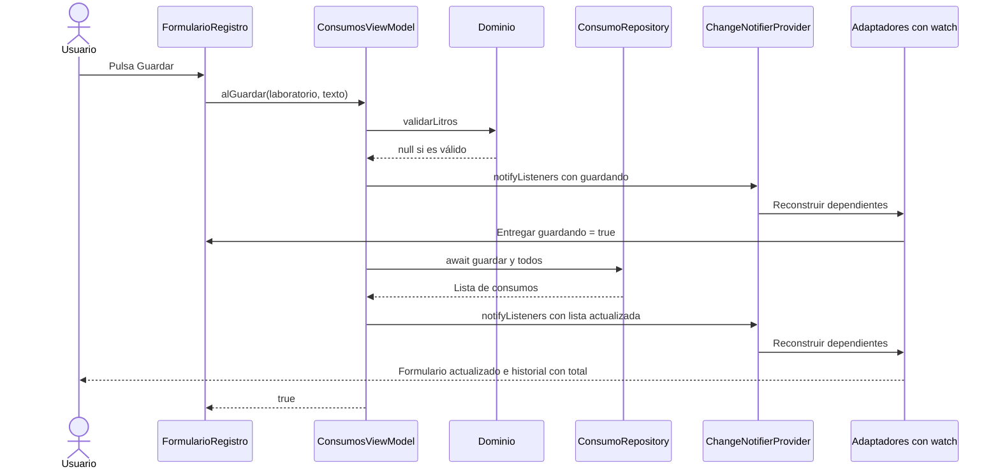
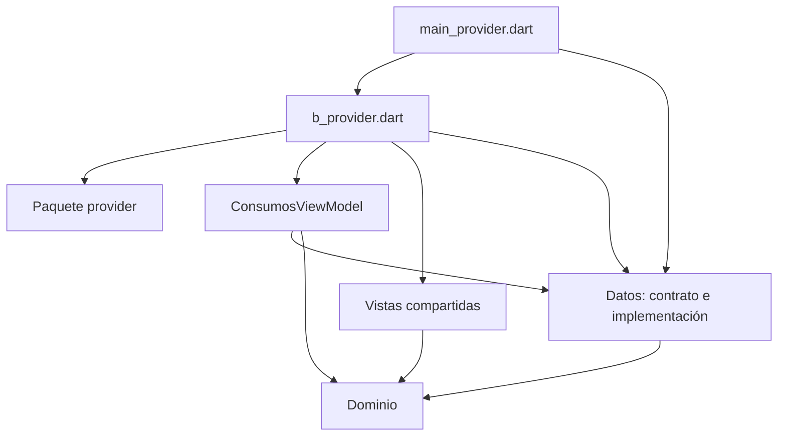

# Ecotrack_estado — Provider e Inyección de Dependencias

Esta guía explica la variante del paquete **`provider`** de [`ecotrack_estado/`](ecotrack_estado/). Conserva el mismo `ConsumosViewModel` basado en ChangeNotifier; cambia cómo se crea, se comparte, se observa y se libera dentro del árbol de widgets.

Lecturas relacionadas: [ChangeNotifier y Observer](Ecotrack_estado%20-%20ChangeNotifier%20y%20Observer.md), [Riverpod y Notifier](Ecotrack_estado%20-%20Riverpod%20y%20Notifier.md) y [Pruebas](Ecotrack_estado%20-%20Pruebas%20de%20las%20tres%20variantes.md).

---

## Qué Arquitectura y Mecanismos Se Utilizan

La organización sigue siendo por capas, con una separación de estilo **MVVM**:

```text
Vista → acción del ViewModel → regla de dominio → repositorio
Vista ← nuevo estado del ViewModel ← resultado del repositorio
```

En esta variante se combinan:

| Concepto | Implementación |
|---|---|
| Repository | `ConsumoRepository`, implementado por `MemoriaConsumoRepository` |
| Inyección por constructor | El repositorio se entrega a `AppProvider` y después a `ConsumosViewModel` |
| Distribución de dependencias por árbol | `ChangeNotifierProvider` expone el ViewModel a los descendientes |
| Notificación de cambios, estilo Observer | `notifyListeners` avisa a Provider y este actualiza a quienes usan `watch` |
| Adaptación a la vista | `RegistroProvider` e `HistorialProvider` traducen el ViewModel a parámetros de los widgets compartidos |

**Provider es una biblioteca de gestión y distribución de dependencias, no otra capa de negocio.** La validación y el guardado siguen en el ViewModel y el repositorio.

---

## Archivos que Participan

| Archivo | Función |
|---|---|
| [`main_provider.dart`](ecotrack_estado/lib/main_provider.dart) | Elegir el repositorio concreto y construir `AppProvider` |
| [`variantes/b_provider.dart`](ecotrack_estado/lib/variantes/b_provider.dart) | Montar `ChangeNotifierProvider` y obtener el ViewModel desde las vistas adaptadoras |
| [`consumos_view_model.dart`](ecotrack_estado/lib/presentacion/consumos_view_model.dart) | Conservar estado y coordinar la acción `guardar` |
| [`vistas.dart`](ecotrack_estado/lib/presentacion/vistas.dart) | Formulario, lista y selección de pestaña |
| [`consumo.dart`](ecotrack_estado/lib/dominio/consumo.dart) | Entidad, laboratorios y regla de validación |
| [`consumo_repository.dart`](ecotrack_estado/lib/datos/consumo_repository.dart) | Contrato e implementación del almacenamiento |
| [`pubspec.yaml`](ecotrack_estado/pubspec.yaml) | Declarar `provider: ^6.1.5+1` como dependencia de la aplicación |

[`pubspec.lock`](ecotrack_estado/pubspec.lock) resuelve `provider` en `6.1.5+1`. ChangeNotifier sigue procediendo del SDK de Flutter.

---

## Construcción: del Repositorio al Provider

La entrada de esta variante ejecuta:

```dart
void main() {
  runApp(AppProvider(repositorio: MemoriaConsumoRepository()));
}
```

`AppProvider` recibe el contrato:

```dart
final ConsumoRepository repositorio;
```

Su árbol comienza con:

```dart
return ChangeNotifierProvider(
  create: (_) => ConsumosViewModel(repositorio),
  child: MaterialApp(
    // DosPantallas y los adaptadores de Registro e Historial.
  ),
);
```

`create` indica cómo construir el ViewModel. Por defecto, Provider lo crea cuando se solicita por primera vez y administra su liberación cuando deja de pertenecer al árbol. Las reconstrucciones que conservan ese mismo elemento proveedor reutilizan el objeto; no se crea un ViewModel nuevo en cada `watch`. [Documentación de provider](https://pub.dev/packages/provider/versions/6.1.5%2B1).

El árbol relevante es:

```text
AppProvider(repositorio)
└── ChangeNotifierProvider<ConsumosViewModel>
    └── MaterialApp
        └── DosPantallas
            ├── RegistroProvider
            │   └── FormularioRegistro
            └── HistorialProvider
                └── ListaHistorial
```

El proveedor queda por encima de ambas pestañas. Así, ambas encuentran la misma instancia del tipo solicitado dentro de ese ámbito.

---

## Cómo Se Obtiene el ViewModel

### RegistroProvider

```dart
final vm = context.watch<ConsumosViewModel>();

return FormularioRegistro(
  alGuardar: vm.guardar,
  error: vm.error,
  guardando: vm.guardando,
);
```

`watch` hace dos cosas: obtiene el objeto disponible para ese contexto y registra que este widget depende de sus notificaciones.

El formulario continúa recibiendo un callback y dos valores. No utiliza `context.watch`, no importa el repositorio y no sabe que existe Provider.

### HistorialProvider

```dart
final consumos = context.watch<ConsumosViewModel>().consumos;
return ListaHistorial(consumos: consumos);
```

El adaptador toma la lista publicada por el ViewModel y se la pasa a la vista de historial. No consulta `repositorio.todos()` desde `build`.

### watch, read y select

| Operación de provider | Significado | Uso real en este proyecto |
|---|---|---|
| `context.watch<T>()` | Obtener el objeto y escuchar sus cambios | Registro e Historial |
| `context.read<T>()` | Obtener el objeto sin suscribir al widget | No se utiliza en los cuerpos de estas vistas |
| `context.select<T, R>(...)` | Escuchar una parte seleccionada del valor | No se utiliza |

Estas operaciones pertenecen al paquete `provider`, importado como `package:provider/provider.dart`. Su documentación diferencia la lectura con y sin escucha. [Lectura de valores con provider](https://pub.dev/packages/provider/versions/6.1.5%2B1#reading-a-value).

Aunque un comentario menciona `watch/read`, la implementación actual utiliza `watch`. `alGuardar: vm.guardar` entrega una referencia al método del objeto obtenido; no llama a `guardar` durante la construcción del widget.

Extraer `.consumos` después de `watch` tampoco equivale a usar `select`: el adaptador escucha al ViewModel completo y puede reconstruirse por cambios de `error` o `guardando`.

---

## Flujo de Guardado y Reconstrucción

### Captura válida

1. El usuario escribe litros y elige laboratorio en `FormularioRegistro`.
2. El botón llama a `_guardar`, que espera el callback `alGuardar`.
3. Ese callback es `vm.guardar`.
4. El ViewModel normaliza el texto y llama a `validarLitros` del dominio.
5. Si es válido, asigna `guardando = true`, limpia `error` y ejecuta `notifyListeners()`.
6. `ChangeNotifierProvider` recibe la notificación y los widgets que usan `watch` reconstruyen con ese estado.
7. El ViewModel espera `guardar(Consumo)` y luego `todos()` sobre el repositorio.
8. Asigna la lista consultada a `consumos`, cambia `guardando` a `false` y vuelve a notificar.
9. Registro reconstruye el botón habilitado e Historial recibe la lista nueva.
10. `guardar` devuelve `true`; el formulario limpia el texto y muestra **Consumo guardado** si sigue montado.

### Captura inválida

El ViewModel asigna el mensaje a `error`, notifica y devuelve `false`. Provider permite que ese mensaje llegue al parámetro `error` del formulario y a `InputDecoration.errorText`. No se llama al repositorio.

No hay un `FormState.validate()` en este flujo: el campo compartido es un `TextField`, y la validación está coordinada por el ViewModel al guardar.

### Secuencia



Provider distribuye y propaga los cambios; no valida los litros ni guarda registros por cuenta propia.

---

## Dirección de las Dependencias

Las flechas representan dependencias de código, no el orden en que se producen los avisos:



También existen las dependencias de Flutter para los widgets y para ChangeNotifier. La diferencia principal es que `b_provider.dart` importa la biblioteca `provider`; el dominio, el repositorio y el ViewModel no necesitan importar esa biblioteca.

Hay tres niveles de conocimiento:

- `FormularioRegistro` conoce datos de entrada y el callback `alGuardar`.
- `RegistroProvider` conoce cómo obtener un `ConsumosViewModel` del árbol.
- `ConsumosViewModel` conoce el contrato de almacenamiento y la regla del dominio.

El repositorio no importa la interfaz. El dominio no importa al ViewModel ni a Provider.

El contrato sigue ubicado junto a su implementación en `datos/consumo_repository.dart`. Usar una variable abstracta no convierte ese import en una dependencia física hacia `dominio`.

---

## Estado Local, Compartido y Derivado

Provider no sustituye todo `setState`:

| Dato | Mecanismo |
|---|---|
| Texto de litros | `TextEditingController` del formulario |
| Laboratorio seleccionado | Campo del `State` y `setState` |
| Pestaña seleccionada | `_indice` y `setState` dentro de `DosPantallas` |
| Lista, error y guardado | `ConsumosViewModel` expuesto por Provider |
| Total de litros | `fold` calculado por `ListaHistorial` a partir de la lista |

`IndexedStack` conserva los widgets de ambas pestañas. El historial muestra el estado ya publicado; cambiar de pestaña no crea otro repositorio ni dispara un guardado.

La misma regla del dominio acepta valores finitos de litros en **`0 < litros <= 10000`**. El ViewModel publica la lista después de guardar; no implementa una carga inicial desde un repositorio previamente poblado.

---

## Quién Libera el ViewModel

En la variante manual, el `State` de la aplicación llama a `_vm.dispose()`. En esta variante, `ChangeNotifierProvider(create: ...)` administra el objeto que crea y su `dispose`. [API de ChangeNotifierProvider](https://pub.dev/documentation/provider/latest/provider/ChangeNotifierProvider-class.html).

Por eso `AppProvider` puede ser `StatelessWidget` sin un método propio de limpieza del ViewModel. El controlador de texto continúa siendo responsabilidad del `State` del formulario.

`create` corresponde a la creación de un objeto nuevo. Si se quisiera exponer un ChangeNotifier ya creado y administrado por otra pieza, habría que revisar la opción `.value` y quién es su propietario. Esa situación no es la construcción utilizada aquí.

---

## Sustituir la Fuente de Datos

La sustitución conserva este recorrido:

```text
AppProvider(repositorio: otroRepositorio)
  → create: ConsumosViewModel(otroRepositorio)
    → mismas vistas y mismo callback guardar
```

Las pruebas entregan `RepositorioEspia`, que implementa `ConsumoRepository`, en lugar del repositorio en memoria. No cambian `RegistroProvider`, `HistorialProvider` ni el formulario para realizar esa comprobación.

La sustitución se realiza antes de montar la app. Este ejemplo no utiliza `ProxyProvider` ni actualiza dinámicamente el repositorio de un ViewModel que ya fue creado.

---

## Comparación con la Variante Manual

| Aspecto | ChangeNotifier manual | Provider en este proyecto |
|---|---|---|
| Gestor de estado | `ConsumosViewModel` | El mismo `ConsumosViewModel` |
| Aviso | `notifyListeners()` | El mismo `notifyListeners()` |
| Construcción del ViewModel | Campo `late final` del `State` | Callback `create` |
| Entrega a los adaptadores | Parámetro `vm` | Búsqueda por tipo desde `BuildContext` |
| Escucha | `ListenableBuilder` | `context.watch` |
| Liberación | `dispose` del estado propietario | `ChangeNotifierProvider` |
| Repositorio y dominio | Compartidos | Compartidos |

La ventaja que se estudia es evitar pasar el ViewModel por cada constructor intermedio. El objeto sigue existiendo y sigue necesitando un ámbito común para quienes lo utilizan.

---

## Ejecución y Preguntas de Repaso

Desde la carpeta `ecotrack_estado`:

```bash
flutter pub get
flutter run -t lib/main_provider.dart
```

Si se ejecuta simplemente `flutter run`, se utiliza la variante manual de `main.dart`.

1. ¿Qué cambió respecto a ChangeNotifier manual y qué se conservó?
2. ¿Por qué el proveedor debe estar por encima de Registro e Historial?
3. ¿Qué hace `watch` además de devolver el objeto?
4. ¿Las vistas compartidas necesitan importar `provider`?
5. ¿Se utiliza `read` realmente en esta implementación?
6. ¿Por qué Provider no constituye una nueva capa de negocio?
7. ¿Quién libera el ViewModel creado con `create`?
8. ¿Por qué compartir un proveedor no implica almacenamiento permanente?
9. ¿Qué componente decide que cero litros es un error?

Continúe con [Riverpod y Notifier](Ecotrack_estado%20-%20Riverpod%20y%20Notifier.md) para estudiar cómo se separan el gestor y el objeto de estado.
