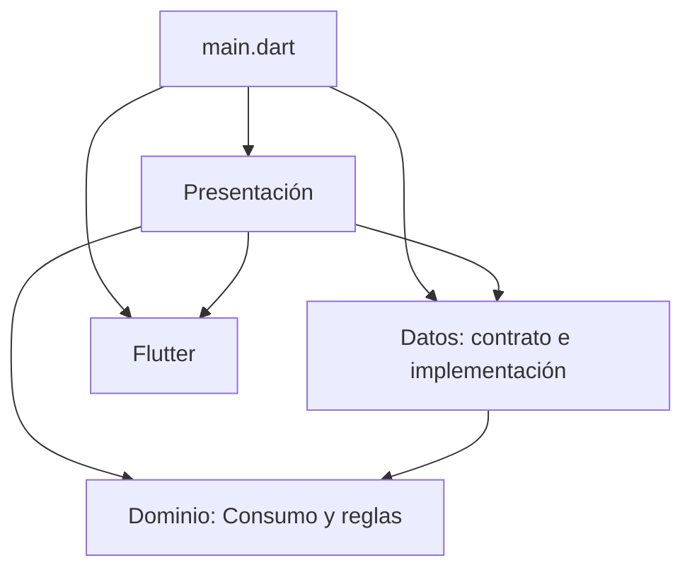
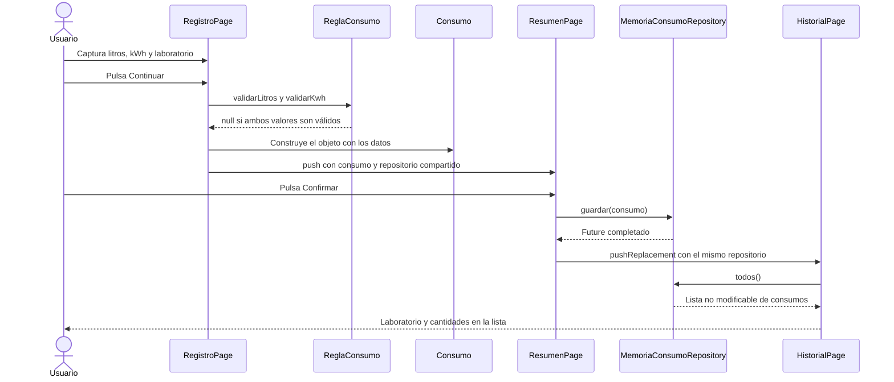

# Dependencies - Arquitectura y Flujo de Componentes de EcoTrack

Esta guía estudia la aplicación de [`dependencies/`](dependencies/): un formulario para registrar consumo de agua y energía, una pantalla de confirmación y un historial. Su objetivo es entender las responsabilidades de cada componente, cómo recibe sus dependencias y qué ocurre desde que el usuario captura un dato hasta que se muestra el registro guardado.

La carpeta contenedora se llama `proyecto - dependencies`, el código está en `dependencies/`, el nombre del paquete Dart es **`dpendencies`** y la clase principal es **`EcoTrackApp`**. Los imports `package:dpendencies/...` utilizan el nombre de [`pubspec.yaml`](dependencies/pubspec.yaml), no el nombre de la carpeta.

**Continuación:** [Dependencies - Pruebas y dependencias de EcoTrack](Dependencies%20-%20Pruebas%20y%20dependencias%20de%20EcoTrack.md).

---

## Tabla de Contenidos

1. [Arquitectura utilizada](#1-arquitectura-utilizada)
2. [Mapa de archivos y responsabilidades](#2-mapa-de-archivos-y-responsabilidades)
3. [Dominio y reglas](#3-dominio-y-reglas)
4. [Patrón Repository](#4-patrón-repository)
5. [Inyección de dependencias por constructor](#5-inyección-de-dependencias-por-constructor)
6. [Dirección de las dependencias](#6-dirección-de-las-dependencias)
7. [Estado local del formulario](#7-estado-local-del-formulario)
8. [Flujo de captura y validación](#8-flujo-de-captura-y-validación)
9. [Flujo de confirmación y guardado](#9-flujo-de-confirmación-y-guardado)
10. [Consulta del historial](#10-consulta-del-historial)
11. [Navegación y comunicación entre pantallas](#11-navegación-y-comunicación-entre-pantallas)
12. [Recorrido completo](#12-recorrido-completo)
13. [Qué permite probar esta organización](#13-qué-permite-probar-esta-organización)
14. [Detalles del comportamiento actual](#14-detalles-del-comportamiento-actual)
15. [Preguntas de repaso](#15-preguntas-de-repaso)

---

## 1. Arquitectura Utilizada

La organización del código corresponde a una **arquitectura por capas**, con **separación de responsabilidades**, **patrón Repository** e **inyección manual de dependencias por constructor**.

| Concepto | Cómo aparece en esta aplicación |
|---|---|
| Presentación | Widgets, formulario, navegación y representación de resultados |
| Dominio | Objeto `Consumo` y reglas escritas en Dart sin importar Flutter |
| Datos | Contrato del repositorio e implementación que conserva registros en memoria |
| Repository | Las pantallas guardan y consultan mediante `ConsumoRepository` |
| Inyección por constructor | Cada pantalla recibe el repositorio desde quien la construye |
| Polimorfismo | Un parámetro de tipo `ConsumoRepository` recibe una instancia de `MemoriaConsumoRepository` |
| Composición de la aplicación | `main()` crea la implementación concreta y la entrega a `EcoTrackApp` |

La clasificación se obtiene de los archivos y sus imports. **No hay una implementación completa de Clean Architecture ni una capa de ViewModels que permita describirla como MVVM.** Las pantallas coordinan directamente la validación, el acceso al repositorio y la navegación; no existen clases de casos de uso, controladores de aplicación o servicios intermedios.

La documentación de Flutter recomienda separar responsabilidades y utilizar inyección de dependencias para facilitar el mantenimiento y las pruebas. La forma concreta de este proyecto es una versión pequeña basada en constructores, sin un contenedor de inyección. [Recomendaciones de arquitectura de Flutter](https://docs.flutter.dev/app-architecture/recommendations).

---

## 2. Mapa de Archivos y Responsabilidades

```text
dependencies/
├── lib/
│   ├── main.dart
│   ├── dominio/
│   │   └── consumo.dart
│   ├── datos/
│   │   └── consumo_repositorio.dart
│   └── presentacion/
│       ├── registro_page.dart
│       ├── resumen_page.dart
│       └── historial_page.dart
├── test/
│   ├── unitarias/reglas_test.dart
│   └── interfaz/registro_page_test.dart
├── integration_test/guardar_y_ver_historial_test.dart
└── pubspec.yaml
```

| Archivo | Componentes | Responsabilidad |
|---|---|---|
| [`main.dart`](dependencies/lib/main.dart) | `main`, `EcoTrackApp` | Construir las dependencias y abrir la pantalla inicial |
| [`consumo.dart`](dependencies/lib/dominio/consumo.dart) | `Consumo`, `ReglaConsumo`, `ReglaCorreo`, `MetaSemenal`, `laboratrio` | Representar datos y expresar reglas |
| [`consumo_repositorio.dart`](dependencies/lib/datos/consumo_repositorio.dart) | `ConsumoRepository`, `MemoriaConsumoRepository` | Definir y resolver el guardado y la consulta |
| [`registro_page.dart`](dependencies/lib/presentacion/registro_page.dart) | `RegistroPage`, `_RegistroPageState` | Capturar datos, validarlos y construir un `Consumo` |
| [`resumen_page.dart`](dependencies/lib/presentacion/resumen_page.dart) | `ResumenPage` | Mostrar los datos y guardarlos al confirmar |
| [`historial_page.dart`](dependencies/lib/presentacion/historial_page.dart) | `HistorialPage` | Consultar y mostrar la lista de consumos |

---

## 3. Dominio y Reglas

### Consumo: los datos que viajan entre componentes

```dart
class Consumo {
  const Consumo({
    required this.laboratorio,
    required this.litros,
    required this.kwh,
  });

  final String laboratorio;
  final double litros;
  final double kwh;
}
```

Un `Consumo` reúne el laboratorio y las cantidades capturadas. Sus atributos son `final`: después de construirlo no se les pueden asignar otros valores. El constructor `const` permite crear instancias constantes cuando sus argumentos también lo permiten.

**El constructor no valida los rangos.** La pantalla llama a las reglas antes de construir el objeto; si otra parte del programa construye un `Consumo` directamente, puede suministrar valores inválidos.

### ReglaConsumo: funciones sin interfaz

`validarLitros` y `validarKwh` reciben un `double?` y devuelven un `String?`:

- Una cadena significa que existe un error y contiene el mensaje que mostrará el formulario.
- `null` significa que la validación acepta el valor.

Ejemplo real de conexión entre presentación y dominio:

```dart
validator: (v) => ReglaConsumo.validarLitros(_numero(v ?? '')),
```

Flutter proporciona el texto; la pantalla lo convierte a número; la regla decide si lo acepta; Flutter muestra el mensaje devuelto.

### Otros elementos del dominio

| Elemento | Qué hace | Uso actual |
|---|---|---|
| `laboratrio` | Lista constante de nombres de laboratorio | La utiliza el selector de `RegistroPage` |
| `ReglaCorreo.esInstitucional` | Aplica `trim`, convierte a minúsculas y comprueba el sufijo `@utez.edu.mx` y una longitud mayor a 12 | Se utiliza en las pruebas unitarias; no hay un campo de correo en estas pantallas |
| `MetaSemenal.seAcerca` | Devuelve `true` al alcanzar o superar el 80 % de `litrosMeta` | Está definida, pero no se utiliza en el flujo ni en las pruebas existentes |

Los nombres `laboratrio` y `MetaSemenal` se muestran tal como están en el código para facilitar su búsqueda. La regla del correo comprueba sufijo y longitud; no implementa una validación completa de la sintaxis de un correo.

---

## 4. Patrón Repository

El repositorio concentra las operaciones para conservar y recuperar consumos. El archivo de datos contiene dos piezas distintas.

### Contrato: qué operaciones existen

```dart
abstract class ConsumoRepository {
  Future<void> guardar(Consumo consumo);
  Future<List<Consumo>> todos();
}
```

Una clase abstracta define lo que una implementación debe ofrecer. Aquí no especifica dónde se guardan los registros.

| Método | Entrada | Resultado |
|---|---|---|
| `guardar` | Un `Consumo` | Un `Future<void>` que permite esperar a que termine el guardado |
| `todos` | Ninguna | Un `Future` cuyo resultado es una lista de consumos |

El contrato asíncrono permite que una futura implementación realice operaciones de disco o red sin cambiar la firma que utilizan las pantallas. Esas implementaciones no existen actualmente.

### Implementación: cómo se resuelven las operaciones

```dart
class MemoriaConsumoRepository implements ConsumoRepository {
  final List<Consumo> _consumos = [];

  @override
  Future<void> guardar(Consumo consumo) async => _consumos.add(consumo);

  @override
  Future<List<Consumo>> todos() async => List.unmodifiable(_consumos);
}
```

`implements` obliga a cumplir el contrato. El guardado agrega un objeto a una lista; la consulta devuelve una lista no modificable con los registros de ese momento. El consumidor no puede agregar o eliminar elementos de esa lista para alterar el almacenamiento interno.

El guion bajo de `_consumos` hace privado el identificador dentro de su biblioteca Dart. La interfaz pública para trabajar con los registros son los métodos del repositorio.

El almacenamiento vive en la instancia de `MemoriaConsumoRepository`. **No hay base de datos, archivo ni API remota:** al crear otra instancia del repositorio se obtiene una lista vacía, y los datos no sobreviven al reinicio de la aplicación.

---

## 5. Inyección de Dependencias por Constructor

Una dependencia es un objeto que otro componente necesita para trabajar. `ResumenPage` necesita guardar, e `HistorialPage` necesita consultar; ambas reciben un repositorio.

### Dónde se crea

En [`main.dart`](dependencies/lib/main.dart):

```dart
void main() {
  runApp(EcoTrackApp(repsitorio: MemoriaConsumoRepository()));
}
```

`main()` decide qué implementación se utilizará y la construye. Este punto se conoce como **raíz de composición**: conecta los componentes de la aplicación.

### Cómo llega a las pantallas

La cadena de entrega es:

```text
main() crea MemoriaConsumoRepository
    → EcoTrackApp(repsitorio: instancia)
        → RegistroPage(repositorio: instancia)
            → ResumenPage(repositorio: instancia, consumo: datos)
                → HistorialPage(repositorio: instancia)
```

El acceso directo al historial también recibe la misma instancia desde `RegistroPage`.

El parámetro de `EcoTrackApp` se llama **`repsitorio`**, con esa escritura. En las pantallas se llama **`repositorio`**. Son nombres de parámetros distintos; el objeto que se pasa entre ellos es el mismo.

```dart
final ConsumoRepository repositorio;
```

Esta declaración indica que la pantalla necesita un objeto que cumpla el contrato. No necesita construir `MemoriaConsumoRepository` ni conocer la lista `_consumos`.

### Por qué importa compartir la instancia

Si el resumen guardara en un repositorio y el historial recibiera uno recién creado, el historial estaría vacío. El flujo funciona porque quien guarda y quien consulta trabajan con **la misma instancia**.

La aplicación no implementa un Singleton: el repositorio se comparte pasándolo explícitamente. Tampoco utiliza `Provider`, Riverpod o `get_it`; la inyección se realiza con constructores normales de Dart.

---

## 6. Dirección de las Dependencias

Hay que distinguir **dependencias de código**, **objetos entregados por constructor** y **orden de llamadas durante la ejecución**.

### Dependencias de código: qué importa cada capa

Las flechas del siguiente diagrama significan «importa o utiliza tipos de»:



| Componente | Dependencias relevantes |
|---|---|
| Dominio | No importa presentación, datos ni Flutter |
| Datos | Importa `Consumo` del dominio |
| Presentación | Importa dominio, el contrato desde datos y widgets de Flutter |
| `main.dart` | Importa la pantalla inicial, el repositorio y Flutter |

Las pantallas también importan otras pantallas para construir las rutas de navegación.

### Dependencia de una abstracción

En ejecución, `ResumenPage` llama a `guardar` sobre una variable de tipo `ConsumoRepository`. Dart despacha esa llamada a `MemoriaConsumoRepository.guardar`, porque ese es el objeto concreto recibido.

```text
ResumenPage → ConsumoRepository.guardar(consumo)
                         ↓ implementación recibida
              MemoriaConsumoRepository.guardar(consumo)
```

Esto permite sustituir la implementación por otra que cumpla el contrato.

### Alcance real de la separación

El contrato y su implementación están juntos en `datos/consumo_repositorio.dart`. Por tanto, aunque las pantallas usan el **tipo abstracto**, su import sigue apuntando a una biblioteca de la capa de datos.

En una separación más estricta de estilo Clean Architecture, el contrato podría ubicarse en el dominio y la implementación en datos. Eso sería una reorganización posterior: **no es la dirección física de imports que tiene este proyecto**. También faltaría una capa de casos de uso si se quisiera separar de las pantallas la coordinación de las operaciones.

---

## 7. Estado Local del Formulario

`RegistroPage` es un `StatefulWidget` porque conserva datos que cambian durante la captura. `_RegistroPageState` mantiene:

| Elemento | Función |
|---|---|
| `_formKey` | Permite acceder al estado de `Form` y ejecutar sus validadores |
| `_litros` | Controlador del texto del campo de litros |
| `_kwh` | Controlador del texto del campo de energía |
| `_laboratorio` | Nombre seleccionado en el desplegable |

`onChanged` utiliza `setState` para actualizar el laboratorio. Los `TextEditingController` mantienen el texto de los campos y se liberan en `dispose()` cuando se destruye el estado de la pantalla.

Este es **estado local de interfaz**. La lista de consumos pertenece al repositorio y tiene otra responsabilidad: conservar los registros durante la vida de la instancia compartida.

`ResumenPage` e `HistorialPage` son `StatelessWidget`. Esto no impide utilizar operaciones asíncronas: `FutureBuilder`, que está dentro del historial, administra su propia interacción con el `Future`.

---

## 8. Flujo de Captura y Validación

Al pulsar **Continuar**, ocurre lo siguiente:

1. `FilledButton` llama a `_continuar()`.
2. `_formKey.currentState!.validate()` ejecuta los validadores de los campos.
3. `_numero()` limpia el texto, sustituye coma decimal por punto e intenta convertirlo mediante `double.tryParse`.
4. Cada validador pasa el número, o `null` si no se pudo convertir, a `ReglaConsumo`.
5. Si alguna regla devuelve un mensaje, el formulario es inválido y `_continuar` termina con `return`.
6. Si todas aceptan, la pantalla construye un `Consumo`.
7. `Navigator.push` abre `ResumenPage`, entregándole el consumo y el repositorio.

Ejemplo de conversión:

```text
" 12,5 " → trim → "12,5" → replaceAll → "12.5" → tryParse → 12.5
"abc"    → tryParse → null → mensaje de dato faltante
```

Los operadores `!` de los números se aplican después de validar el formulario. No convierten un valor inválido en válido: afirman que el resultado no será nulo debido a la validación previa.

**Continuar todavía no guarda.** Solo crea el objeto y permite revisarlo en el resumen.

---

## 9. Flujo de Confirmación y Guardado

`ResumenPage` recibe el objeto y muestra sus tres atributos. Cuando se pulsa **Confirmar**, `_confirmar(context)` ejecuta:

```dart
await repositorio.guardar(consumo);
if (!context.mounted) return;
Navigator.pushReplacement(
  context,
  MaterialPageRoute(
    builder: (_) => HistorialPage(repositorio: repositorio),
  ),
);
```

El orden importa:

1. Se solicita el guardado.
2. `await` espera su finalización antes de navegar.
3. `context.mounted` comprueba que el contexto siga montado después de la espera.
4. `pushReplacement` sustituye la ruta del resumen por el historial.
5. El historial recibe el mismo repositorio en el que acaba de guardarse el consumo.

No hay un valor de respuesta que se entregue del historial al resumen. La comunicación se hace por los argumentos del constructor y por el repositorio compartido.

---

## 10. Consulta del Historial

[`HistorialPage`](dependencies/lib/presentacion/historial_page.dart) utiliza:

```dart
FutureBuilder<List<Consumo>>(
  future: repositorio.todos(),
  builder: (context, snapshot) {
    final consumos = snapshot.data ?? const [];
    // Construcción del contenido a partir de consumos.
  },
)
```

`todos()` devuelve un `Future`. `FutureBuilder` proporciona un `snapshot` con el resultado de esa operación y reconstruye su contenido cuando corresponde. [API de FutureBuilder](https://api.flutter.dev/flutter/widgets/FutureBuilder-class.html).

La pantalla representa los resultados así:

- Si la lista está vacía, muestra **Sin registros**.
- Por cada `Consumo`, crea un `ListTile`.
- El título es `c.laboratorio`.
- El subtítulo utiliza el formato `${c.litros} L · ${c.kwh} kWh`.

Para un consumo de `12.5` litros y `3.2` kWh, el subtítulo será `12.5 L · 3.2 kWh`.

Esta consulta no es una suscripción a cambios: el repositorio no expone un `Stream` ni notifica modificaciones. El historial consulta al construir su `FutureBuilder`.

---

## 11. Navegación y Comunicación entre Pantallas

```text
Registro --Continuar válido / push--> Resumen
Resumen --Confirmar / pushReplacement--> Historial
Registro --icono Historial / push--> Historial
```

| Acción | Qué se entrega | Qué se conserva en la pila |
|---|---|---|
| Registro → Resumen | Repositorio y consumo capturado | Registro queda debajo de Resumen |
| Resumen → Historial | Repositorio con el nuevo registro | Historial sustituye al Resumen; Registro sigue debajo |
| Registro → Historial | Repositorio | Registro queda debajo de Historial |

Volver desde el historial lleva al registro en este flujo. Abrir el historial desde el icono no registra automáticamente lo que esté escrito en el formulario.

---

## 12. Recorrido Completo



Si la validación falla, el recorrido termina en Registro con mensajes de error. Si el usuario no confirma, el consumo no llega a la lista del repositorio.

---

## 13. Qué Permite Probar Esta Organización

La separación permite elegir cuánto del sistema participa en cada prueba:

- **Reglas:** llamar directamente a `ReglaConsumo` o `ReglaCorreo`, sin montar una pantalla.
- **Interfaz:** construir `RegistroPage` dentro de `MaterialApp` y entregarle un repositorio nuevo.
- **Integración:** construir `EcoTrackApp` con un repositorio nuevo y recorrer Registro → Resumen → Historial.

En las pruebas se utiliza la misma implementación en memoria que usa la aplicación. No hay una biblioteca de mocks ni un repositorio falso exclusivo de las pruebas.

Crear un repositorio nuevo para cada escenario evita heredar registros de otra prueba. Este beneficio proviene de recibir las dependencias por constructor.

Los casos concretos, sus assertions y sus diferencias con el código se estudian en la [guía de pruebas](Dependencies%20-%20Pruebas%20y%20dependencias%20de%20EcoTrack.md).

---

## 14. Detalles del Comportamiento Actual

Estos puntos ayudan a estudiar lo que realmente ejecuta el código:

| Punto | Comportamiento actual |
|---|---|
| Tope de litros | Se rechaza `litros >= 10000`; el rango ordinario aceptado es mayor que 0 y menor que 10000 |
| Tope de energía | Existe `topeKwh = 500`, pero `validarKwh` compara por error con `topeLitros`; actualmente no aplica el límite 500 |
| Laboratorio inicial | La lista `laboratrio` empieza con el texto exacto `lab Quimica` |
| Espera y errores del historial | `snapshot.data ?? []` representa ambos casos inicialmente sin datos; no hay ramas separadas para carga y error |
| Creación del Future | `repositorio.todos()` se invoca en `build`; una reconstrucción puede repetir la consulta. Flutter recomienda obtener el Future antes de `build` cuando se necesita conservar la misma operación |
| Validación del objeto | El repositorio guarda el `Consumo` que recibe; no vuelve a ejecutar las reglas |
| Confirmación | El botón no se bloquea mientras espera ni hay manejo local del error de guardado |

La observación sobre el ciclo del `Future` se apoya en las [indicaciones de FutureBuilder](https://api.flutter.dev/flutter/widgets/FutureBuilder-class.html). Con la lista en memoria la consulta es pequeña; un almacenamiento remoto haría más importante distinguir estados y controlar cuándo se consulta.

Estas observaciones permiten distinguir la arquitectura implementada de las mejoras que aún podrían aplicarse.

---

## 15. Preguntas de Repaso

1. ¿Qué responsabilidad pertenece a presentación, cuál a dominio y cuál a datos?
2. ¿Qué diferencia hay entre `ConsumoRepository` y `MemoriaConsumoRepository`?
3. ¿Quién construye la implementación concreta y quién la recibe?
4. ¿Por qué el resumen y el historial necesitan compartir la misma instancia?
5. ¿Una dependencia por constructor equivale a utilizar un Singleton?
6. ¿Por qué un tipo abstracto no significa que el contrato esté físicamente en el dominio?
7. ¿Qué significa que un validador devuelva `null`?
8. ¿En qué momento se construye el `Consumo` y en cuál se guarda?
9. ¿Qué ocurriría si se navegara antes de esperar `guardar`?
10. ¿Qué hace `pushReplacement` con la ruta de Resumen?
11. ¿Por qué un `StatelessWidget` puede contener un `FutureBuilder`?
12. ¿Los registros sobreviven al reinicio de la aplicación?
13. ¿Qué reglas del dominio todavía no se usan desde las pantallas?
14. ¿Por qué `validarKwh(600)` no aplica actualmente el tope declarado de 500?

Para comprobar su comprensión, explique sin mirar el código este recorrido: **capturar → convertir → validar → construir el objeto → revisar → guardar → consultar → mostrar**.

[Volver al índice de Dependencies](README.md).
