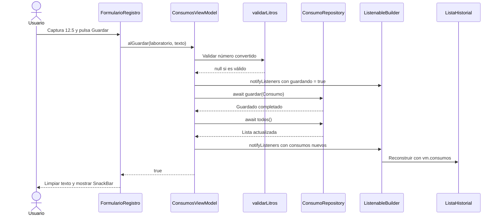
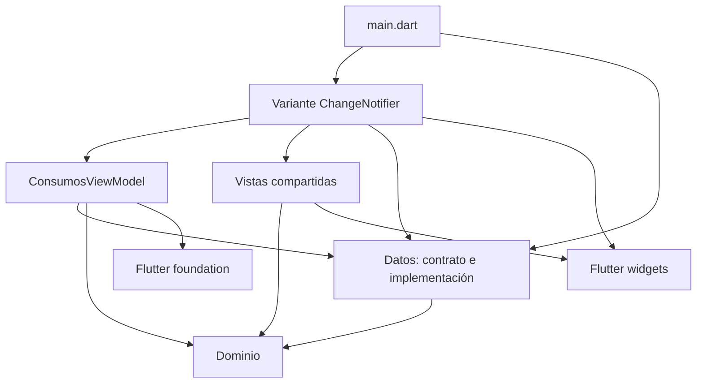

# Ecotrack_estado — ChangeNotifier y Patrón Observer

El proyecto [`ecotrack_estado/`](ecotrack_estado/) implementa el mismo registro de consumo de agua mediante tres formas de gestionar y compartir estado: **ChangeNotifier**, **Provider** y **Riverpod**. Esta guía explica la primera, ejecutada desde [`lib/main.dart`](ecotrack_estado/lib/main.dart).

Las tres variantes comparten dominio, repositorio y widgets visuales. Son tres implementaciones de gestión de estado sobre una organización por capas; no tres patrones arquitectónicos excluyentes. En esta variante se combinan una separación **de estilo MVVM**, **Repository**, **inyección por constructor** y el mecanismo de notificación del patrón **Observer**.

Guías relacionadas: [Provider e inyección](03%20-%20Ecotrack_estado%20-%20Provider%20e%20inyecci%C3%B3n%20de%20dependencias.md), [Riverpod y Notifier](04%20-%20Ecotrack_estado%20-%20Riverpod%20y%20Notifier.md) y [Pruebas de las tres variantes](06%20-%20Ecotrack_estado%20-%20Pruebas%20de%20las%20tres%20variantes.md).

---

## Mapa del Proyecto y Responsabilidades

| Pieza | Archivo | Responsabilidad |
|---|---|---|
| Entrada | [`main.dart`](ecotrack_estado/lib/main.dart) | Construir el repositorio concreto y entregarlo a la aplicación |
| Dominio | [`dominio/consumo.dart`](ecotrack_estado/lib/dominio/consumo.dart) | Entidad `Consumo`, laboratorios y regla `validarLitros` |
| Datos | [`datos/consumo_repository.dart`](ecotrack_estado/lib/datos/consumo_repository.dart) | Contrato e implementación de almacenamiento |
| ViewModel | [`presentacion/consumos_view_model.dart`](ecotrack_estado/lib/presentacion/consumos_view_model.dart) | Validar, coordinar el guardado y publicar estado compartido |
| Adaptación a ChangeNotifier | [`variantes/a_change_notifier.dart`](ecotrack_estado/lib/variantes/a_change_notifier.dart) | Crear el ViewModel y conectar sus notificaciones con los widgets |
| Vistas compartidas | [`presentacion/vistas.dart`](ecotrack_estado/lib/presentacion/vistas.dart) | Capturar texto, representar error y lista, y cambiar de pestaña |

### Separación de estilo MVVM

- **Modelo:** los consumos, sus reglas y las operaciones del repositorio.
- **Vista:** los widgets que muestran el formulario y el historial.
- **ViewModel:** `ConsumosViewModel`, que expone `consumos`, `error`, `guardando` y la acción `guardar`.

Los widgets visuales reciben valores y callbacks. El ViewModel transforma una acción de la vista en operaciones de dominio y datos, y avisa cuando el estado que presenta cambia.

No hay una capa independiente de casos de uso. El contrato del repositorio está en `datos`, por lo que esta distribución tampoco corresponde a una separación estricta de Clean Architecture.

---

## Qué Es Estado en Esta Aplicación

Hay que distinguir dónde vive cada dato:

| Clase de dato | Propietario | Ejemplo |
|---|---|---|
| Estado local del formulario | `_FormularioRegistroState` | Texto de `_litros` y laboratorio seleccionado |
| Estado local de navegación | `_DosPantallasState` | `_indice`, que selecciona Registro o Historial |
| Estado compartido de presentación | `ConsumosViewModel` | `consumos`, `error` y `guardando` |
| Datos almacenados durante la sesión | `MemoriaConsumoRepository` | Lista privada `_consumos` |
| Dato derivado | `ListaHistorial.build` | Suma de litros de los consumos recibidos |
| Configuración constante | Dominio | `laboratoriosUtez` |

La lista del repositorio es la fuente de los registros guardados. `vm.consumos` es la lista que se vuelve a consultar para presentar esos registros; el total se calcula al dibujar y no se almacena como otra variable compartida.

`IndexedStack` mantiene las dos vistas en el árbol y cambia cuál se muestra. Pulsar **Historial** modifica `_indice`; no vuelve a guardar ni consulta directamente el repositorio.

---

## Repository: Contrato e Implementación

El contrato define las operaciones que utilizará el ViewModel:

```dart
abstract class ConsumoRepository {
  Future<void> guardar(Consumo consumo);
  Future<List<Consumo>> todos();
}
```

`MemoriaConsumoRepository` implementa ese contrato con una lista:

```dart
Future<void> guardar(Consumo consumo) async => _consumos.add(consumo);

Future<List<Consumo>> todos() async => List.unmodifiable(_consumos);
```

`todos` devuelve una lista no modificable de los registros de ese momento. El contrato es asíncrono, aunque el almacenamiento actual sea una lista en memoria.

Una nueva instancia del repositorio empieza vacía. Los datos no se guardan en disco ni sobreviven a un reinicio de la aplicación.

---

## Construcción e Inyección por Constructor

La entrada crea la implementación concreta:

```dart
void main() {
  runApp(AppChangeNotifier(repositorio: MemoriaConsumoRepository()));
}
```

`AppChangeNotifier` recibe un `ConsumoRepository`. Su estado crea el ViewModel mediante:

```dart
late final _vm = ConsumosViewModel(widget.repositorio);
```

La inicialización es diferida: se realiza al acceder por primera vez a `_vm`. Como es un campo `final` del objeto `State`, las reconstrucciones normales de ese mismo estado reutilizan la instancia; no se construye un ViewModel nuevo en cada llamada a `build`.

Después se entrega el mismo objeto a los dos adaptadores:

```dart
registro: RegistroCN(vm: _vm),
historial: HistorialCN(vm: _vm),
```

```text
main
  └── MemoriaConsumoRepository
        └── AppChangeNotifier
              └── ConsumosViewModel
                    ├── RegistroCN
                    └── HistorialCN
```

Este dibujo representa objetos entregados, no una cadena de imports. Compartir la misma instancia del ViewModel permite que Registro e Historial observen la misma lista de presentación.

La aplicación no necesita un Singleton: la identidad compartida se consigue pasando explícitamente el objeto.

---

## Observer: Quién Avisa y Quién Escucha

`ConsumosViewModel extends ChangeNotifier`. La clase base proporciona el mecanismo para registrar listeners y avisarles con `notifyListeners`. Los adaptadores utilizan `ListenableBuilder` para reconstruir su contenido cuando reciben el aviso. [API de ChangeNotifier](https://api.flutter.dev/flutter/foundation/ChangeNotifier-class.html).

| Papel del mecanismo Observer | Componente real |
|---|---|
| Objeto observado | Una instancia de `ConsumosViewModel` |
| Aviso de cambio | `notifyListeners()` |
| Suscripción desde la interfaz | `ListenableBuilder(listenable: vm, ...)` |
| Contenido reconstruido | El formulario o la lista que devuelve cada `builder` |

En Registro:

```dart
return ListenableBuilder(
  listenable: vm,
  builder: (context, _) => FormularioRegistro(
    alGuardar: vm.guardar,
    error: vm.error,
    guardando: vm.guardando,
  ),
);
```

En Historial:

```dart
return ListenableBuilder(
  listenable: vm,
  builder: (context, _) => ListaHistorial(consumos: vm.consumos),
);
```

Cambiar un campo del ViewModel no produce por sí solo el aviso. El código debe llamar a `notifyListeners` después de modificar el estado. El `ListenableBuilder` reconstruye su subárbol al escuchar esa notificación. [API de ListenableBuilder](https://api.flutter.dev/flutter/widgets/ListenableBuilder-class.html).

`notifyListeners` tampoco vuelve a consultar automáticamente el repositorio: esa consulta está escrita expresamente dentro de `guardar`.

---

## Flujo al Pulsar Guardar

### Desde el formulario al ViewModel

`FormularioRegistro` conserva el texto en un controlador. Su callback no conoce el repositorio ni ChangeNotifier:

```dart
final Future<bool> Function(String laboratorio, String litros) alGuardar;
```

El adaptador le entrega el método `vm.guardar`. Al pulsar el botón, el formulario ejecuta:

```dart
final ok = await widget.alGuardar(_laboratorio, _litros.text);
if (!ok || !mounted) return;
_litros.clear();
ScaffoldMessenger.of(context)
    .showSnackBar(const SnackBar(content: Text('Consumo guardado')));
```

El `bool` indica si se completó el guardado. El formulario mantiene el texto cuando recibe `false`; cuando recibe `true`, limpia el campo y muestra el aviso si sigue montado.

### Validación y cambio de estado

`ConsumosViewModel.guardar` realiza este recorrido:

1. Quita espacios, convierte coma decimal en punto y llama a `double.tryParse`.
2. Invoca la función `validarLitros` del dominio.
3. Si obtiene un error, actualiza `error`, notifica y devuelve `false` sin llamar al repositorio.
4. Si es válido, pone `guardando = true` y `error = null`, y notifica.
5. Crea el `Consumo` y espera `repositorio.guardar`.
6. Espera `repositorio.todos` y reemplaza `consumos` por la lista consultada.
7. Pone `guardando = false`, notifica y devuelve `true`.

| Momento | `error` | `guardando` | `consumos` |
|---|---|---|---|
| Inicial | `null` | `false` | Lista vacía |
| Validación inválida | Mensaje de dominio | Normalmente `false` | Conserva los registros anteriores |
| Guardado válido en curso | `null` | `true` | Conserva la lista anterior mientras espera |
| Guardado completado | `null` | `false` | Resultado actualizado de `todos()` |

El botón queda desactivado cuando `guardando` llega como `true`, porque la vista asigna `onPressed: null`. La ruta inválida solo actualiza `error`; no es un reinicio general del estado.

### Regla exacta de este proyecto

`validarLitros` rechaza `null`, cero, negativos y valores **mayores** que `10000`. Para valores finitos, el rango válido es **`0 < litros <= 10000`**: el propio `10000` se acepta porque la comparación utiliza `>`, no `>=`.

El primer laboratorio es `Lab Química`. Aquí se registra únicamente agua: la entidad contiene `laboratorio` y `litros`.

---

## Secuencia de Comunicación



El historial ya dispone de la lista actualizada al cambiar de pestaña. El cambio de pestaña y el cambio del consumo son estados distintos.

---

## Dirección de las Dependencias de Código

En el siguiente diagrama, una flecha significa «importa o utiliza tipos de»:



Las vistas compartidas no importan al ViewModel ni al repositorio: reciben datos y callbacks. Los adaptadores `RegistroCN` e `HistorialCN` sí conocen al ViewModel, y `AppChangeNotifier` recibe el contrato del repositorio.

El ViewModel depende del **tipo abstracto** `ConsumoRepository`; su import apunta físicamente a la carpeta `datos`, donde también está la implementación. La abstracción reduce el acoplamiento con el almacenamiento concreto, pero no mueve el contrato al dominio.

La dependencia de código apunta desde el ViewModel hacia el contrato. Durante la ejecución, la llamada se resuelve en `MemoriaConsumoRepository`, y las notificaciones vuelven hacia la vista. Las llamadas y los avisos no cambian la dirección de los imports.

---

## Creación y Liberación de Recursos

`_AppChangeNotifierState` crea el ViewModel y lo libera en `dispose()`:

```dart
@override
void dispose() {
  _vm.dispose();
  super.dispose();
}
```

El formulario libera su `TextEditingController` por separado. `dispose()` del ViewModel libera su mecanismo de notificación; no equivale a borrar una base de datos.

Esta construcción supone que el repositorio recibido permanece estable durante la vida del estado de `AppChangeNotifier`. Cambiar el parámetro del widget manteniendo el mismo `State` no recrearía el campo `late final _vm` automáticamente.

---

## Ejecución y Límites de la Implementación

Desde `proyecto - ecotrack_estado/ecotrack_estado`, esta variante es la entrada predeterminada:

```bash
flutter pub get
flutter run
```

Para estudiar el alcance del ejemplo:

- El ViewModel empieza vacío y consulta el repositorio después de guardar; no carga registros previos al construirse.
- No existe `try/catch/finally` en `guardar`. Si el repositorio lanza una excepción, el método no garantiza restablecer `guardando` a `false`.
- `consumos`, `error` y `guardando` son campos públicos mutables. Modificarlos desde fuera podría saltarse los avisos, aunque las vistas actuales los modifican mediante `guardar`.
- No se utiliza una selección de campos: ambos adaptadores escuchan las notificaciones del mismo ViewModel.

Estas características no impiden estudiar Observer; delimitan lo que implementa el ejemplo frente a un gestor con carga inicial, estados de error de almacenamiento o mayor encapsulamiento.

## Preguntas de Repaso

1. ¿Qué estado pertenece al formulario y cuál al ViewModel?
2. ¿Quién crea el repositorio, quién crea el ViewModel y quién libera este último?
3. ¿Por qué deben compartir el mismo `_vm` Registro e Historial?
4. ¿Qué diferencia hay entre cambiar `consumos` y llamar a `notifyListeners`?
5. ¿El listener consulta el repositorio o solo reconstruye con los datos recibidos?
6. ¿Por qué el total es un dato derivado?
7. ¿En qué se distingue la dirección del import de la dirección de una notificación?
8. ¿Qué ocurre con `10000` litros en este proyecto?
9. ¿Por qué esta implementación permite sustituir el repositorio en una prueba?

Continúe con [Provider e inyección de dependencias](03%20-%20Ecotrack_estado%20-%20Provider%20e%20inyecci%C3%B3n%20de%20dependencias.md) para estudiar cómo se distribuye el mismo ViewModel mediante el árbol de widgets.

[Comparativa general de las variantes](01%20-%20Ecotrack_estado%20-%20Comparativa%20de%20gesti%C3%B3n%20de%20estado.md).

[Volver al índice de Ecotrack_estado](README.md).
