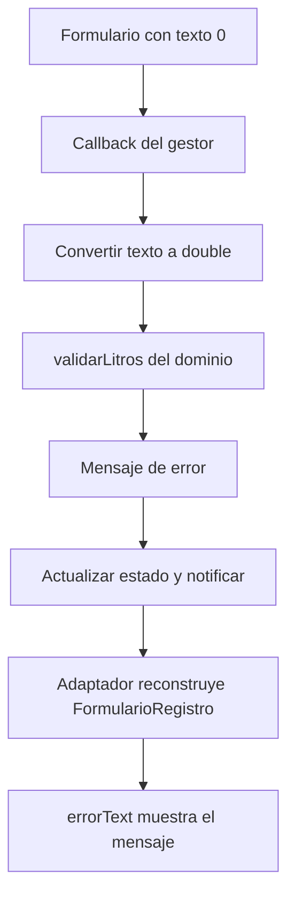

# Ecotrack_estado — Pruebas de las Tres Variantes

Esta guía explica cómo [`test/criterios_test.dart`](ecotrack_estado/test/criterios_test.dart) comprueba el comportamiento de ChangeNotifier, Provider y Riverpod utilizando los mismos pasos y expectativas.

El archivo declara tres escenarios dentro de un recorrido por tres variantes: **3 variantes × 3 escenarios = 9 casos ejecutados**. Todos son **pruebas de widgets** escritas con `testWidgets`.

Guías de arquitectura: [ChangeNotifier y Observer](02%20-%20Ecotrack_estado%20-%20ChangeNotifier%20y%20Observer.md), [Provider e inyección](03%20-%20Ecotrack_estado%20-%20Provider%20e%20inyecci%C3%B3n%20de%20dependencias.md) y [Riverpod y Notifier](04%20-%20Ecotrack_estado%20-%20Riverpod%20y%20Notifier.md).

---

## Qué Se Quiere Comprobar

Los escenarios comparan tres criterios:

| Criterio | Pregunta de estudio | Evidencia que busca el caso |
|---|---|---|
| Dato compartido | ¿Lo guardado desde Registro llega a Historial? | El historial muestra `Total: 12.5 L` |
| Sustitución | ¿Puedo entregar otra implementación del repositorio sin cambiar las vistas? | El repositorio espía recibe exactamente un consumo con `12.5` litros |
| Capas | ¿La decisión de la regla del dominio llega a la interfaz? | Con cero litros aparece `Los litros deben ser mayores que cero` |

Las mismas expectativas se aplican a las tres formas de conectar el estado. Esto permite comprobar resultados equivalentes sin exigir que su implementación interna sea idéntica.

### Alcance real de estas pruebas

Se monta el árbol de la aplicación con `WidgetTester`, se introduce texto y se simulan acciones. Aunque los escenarios atraviesan formulario, gestor, repositorio e historial, **no están configurados como pruebas de integración sobre un dispositivo**: no hay un directorio `integration_test/`, una dependencia `integration_test` ni su binding en este proyecto.

Tampoco hay casos unitarios independientes que invoquen directamente `validarLitros`, el ViewModel o el Notifier. La validación se ejercita a través del botón y de la interfaz. Flutter diferencia las pruebas unitarias, de widgets y de integración por su alcance y entorno. [Tipos de pruebas en Flutter](https://docs.flutter.dev/testing/overview).

---

## Dependencias de pubspec.yaml

El proyecto se identifica como `ecotrack_estado` en [`pubspec.yaml`](ecotrack_estado/pubspec.yaml). Por eso sus imports propios comienzan con `package:ecotrack_estado/`.

Los bloques relevantes son:

```yaml
environment:
  sdk: ^3.13.3

dependencies:
  flutter:
    sdk: flutter
  flutter_riverpod: ^3.4.3
  provider: ^6.1.5+1

dev_dependencies:
  flutter_test:
    sdk: flutter
  flutter_lints: ^6.0.0
```

| Dependencia | Uso |
|---|---|
| `flutter` | Widgets de la aplicación y tipos utilizados al montarla en las pruebas |
| `provider` | Construcción de la variante `AppProvider` y sus lecturas con `context.watch` |
| `flutter_riverpod` | Construcción de la variante Riverpod y `ProviderScope` con overrides en los tests |
| `flutter_test` | `testWidgets`, `group`, `WidgetTester`, finders, `expect` y matchers |
| `flutter_lints` | Reglas del análisis estático activadas en [`analysis_options.yaml`](ecotrack_estado/analysis_options.yaml) |

Provider y Riverpod son dependencias de la aplicación, no herramientas exclusivas de las pruebas. `flutter_test` se obtiene del SDK y pertenece al bloque de desarrollo. `flutter_lints` ayuda a analizar el código; no ejecuta estos escenarios.

El [`pubspec.lock`](ecotrack_estado/pubspec.lock) registra las versiones resueltas. No se declara `mockito` o `mocktail`: el doble de pruebas se escribe manualmente como una implementación del contrato.

---

## Construcción de las Tres Aplicaciones

El archivo de pruebas define un mapa de fábricas:

```dart
final variantes = <String, Widget Function(ConsumoRepository)>{
  'A · ChangeNotifier': (repo) => AppChangeNotifier(repositorio: repo),
  'B · provider': (repo) => AppProvider(repositorio: repo),
  'B · riverpod': (repo) => ProviderScope(
    overrides: [repositorioProvider.overrideWithValue(repo)],
    child: const AppRiverpod(),
  ),
};
```

`Widget Function(ConsumoRepository)` significa que cada valor del mapa es una función: recibe un repositorio y devuelve el widget con el que se monta esa variante.

| Variante | Cómo llega el repositorio al gestor |
|---|---|
| ChangeNotifier | La fábrica lo entrega a `AppChangeNotifier`; su estado construye `ConsumosViewModel(repo)` |
| Provider | La fábrica lo entrega a `AppProvider`; el `create` de `ChangeNotifierProvider` construye `ConsumosViewModel(repo)` |
| Riverpod | La fábrica monta un `ProviderScope` que sustituye `repositorioProvider`; `ConsumosNotifier.guardar` obtiene ese repositorio con `ref.read` |

Los tests construyen las aplicaciones directamente. No llaman a los tres `main`, porque necesitan elegir qué repositorio se utiliza en cada ejecución.

### Cómo se generan los nueve casos

```dart
for (final MapEntry(key: nombre, value: crear) in variantes.entries) {
  group(nombre, () {
    // Un testWidgets de dato compartido.
    // Un testWidgets de sustitución.
    // Un testWidgets de propagación del error de dominio.
  });
}
```

El patrón de `MapEntry` extrae la clave en `nombre` y la función en `crear`. `group` organiza la salida de la consola por variante.

El archivo contiene tres declaraciones de `testWidgets`, pero el bucle las registra para cada una de las tres entradas. Por eso el total no es tres, sino nueve.

---

## Preparar, Actuar y Comprobar

Cada escenario sigue esta estructura:

1. **Preparar:** crear un repositorio nuevo y montar la app de la variante.
2. **Actuar:** escribir litros, guardar y, cuando corresponde, cambiar a Historial.
3. **Comprobar:** verificar el texto visible o el dato recibido por el espía.

Herramientas utilizadas:

| Herramienta | Función concreta |
|---|---|
| `tester.pumpWidget(...)` | Montar la aplicación que devuelve la fábrica |
| `find.byKey(const Key('litros'))` | Localizar el campo de texto compartido |
| `tester.enterText(...)` | Introducir `12.5` o `0` |
| `find.text('Guardar')` | Localizar el botón por su texto |
| `tester.tap(...)` | Simular el toque de botón o pestaña |
| `tester.pumpAndSettle()` | Procesar los frames programados hasta estabilizar la interfaz |
| `expect(...)` | Ejecutar una comprobación |
| `findsOneWidget` | Exigir exactamente una coincidencia visible para el finder |

La clave `litros` está definida en el `TextField` de [`FormularioRegistro`](ecotrack_estado/lib/presentacion/vistas.dart). Como se reutiliza el mismo formulario, el test utiliza el mismo finder para todas las variantes.

`find.text` compara cadenas exactas. El total incluye mayúscula, un decimal, un espacio y la unidad: `Total: 12.5 L`.

---

## El Helper guardarYVerHistorial

```dart
Future<void> guardarYVerHistorial(WidgetTester tester) async {
  await tester.enterText(find.byKey(const Key('litros')), '12.5');
  await tester.tap(find.text('Guardar'));
  await tester.pumpAndSettle();
  await tester.tap(find.text('Historial'));
  await tester.pumpAndSettle();
}
```

Este helper reúne las acciones repetidas en los dos primeros escenarios:

1. Captura `12.5` litros.
2. Pulsa Guardar, que llama al callback del formulario.
3. Espera los cambios de estado y de interfaz.
4. Selecciona la pestaña Historial.
5. Espera su representación antes de continuar con las assertions.

El selector de laboratorio no se cambia: utiliza el primer valor, `Lab Química`.

El helper **no contiene assertions**. Ejecutar sus pasos sin errores no equivale a comprobar todos los datos del registro; cada escenario agrega después su propia verificación.

`pumpAndSettle` procesa frames y microtareas pendientes hasta que no quedan frames programados. Es útil para las actualizaciones y animaciones de estos casos, pero no sustituye un control explícito de cualquier operación externa que se agregue en el futuro. [API de pumpAndSettle](https://api.flutter.dev/flutter/flutter_test/WidgetTester/pumpAndSettle.html).

---

## Caso Dato Compartido

Preparación y acción:

```dart
await tester.pumpWidget(crear(MemoriaConsumoRepository()));
await guardarYVerHistorial(tester);
```

Comprobación:

```dart
expect(find.text('Total: 12.5 L'), findsOneWidget);
```

### Recorrido por cada variante

| Variante | Desde Guardar hasta la lista |
|---|---|
| ChangeNotifier | `vm.guardar` → repositorio → `vm.consumos` → `notifyListeners` → `ListenableBuilder` |
| Provider | `vm.guardar` → repositorio → `vm.consumos` → `notifyListeners` → provider → widgets con `watch` |
| Riverpod | `notifier.guardar` → repositorio leído del provider → nuevo `EstadoConsumos` → consumidores con `ref.watch` |

En los tres casos, el adaptador entrega una lista a `ListaHistorial`. Este widget calcula:

```dart
final total = consumos.fold<double>(0, (s, c) => s + c.litros);
```

Y lo presenta con `toStringAsFixed(1)`. La assertion confirma que la captura llega al total visible tras cambiar de pestaña.

### Qué no exige esta assertion

No comprueba explícitamente el nombre del laboratorio, el número de filas del historial, el texto del SnackBar o el contenido del campo después de limpiar. Tampoco utiliza varios registros para verificar una suma acumulada.

---

## Caso Sustitución y Repositorio Espía

El doble de pruebas está declarado en el mismo archivo:

```dart
class RepositorioEspia implements ConsumoRepository {
  final List<Consumo> recibidos = [];

  @override
  Future<void> guardar(Consumo consumo) async => recibidos.add(consumo);

  @override
  Future<List<Consumo>> todos() async => List.of(recibidos);
}
```

Cumple el mismo contrato que el repositorio de la aplicación, pero expone la lista `recibidos` para inspeccionar los consumos entregados al método `guardar`.

Es un **doble manual con comportamiento de almacenamiento y observación**, utilizado como espía. No necesita generación de código ni una biblioteca de mocks. `List.of` devuelve una copia modificable para la consulta; la assertion inspecciona `recibidos`, no esa copia.

El caso prepara y utiliza el espía:

```dart
final espia = RepositorioEspia();
await tester.pumpWidget(crear(espia));
await guardarYVerHistorial(tester);

expect(espia.recibidos.single.litros, 12.5);
```

`single` exige que exista exactamente un elemento: si hay cero o más de uno, la prueba falla al obtenerlo. Después, `expect` compara sus litros con `12.5`.

### Sustitución con constructor

ChangeNotifier y Provider reciben `espia` mediante el constructor de su aplicación. El ViewModel utiliza su tipo abstracto y llama a los métodos del objeto recibido.

### Sustitución con override

Riverpod lo entrega mediante:

```dart
overrides: [repositorioProvider.overrideWithValue(espia)]
```

En el código real del mapa, el parámetro se llama `repo`; al ejecutar este caso, ese parámetro contiene `espia`. El Notifier obtiene el valor reemplazado cuando lee `repositorioProvider`. [Overrides de Riverpod](https://riverpod.dev/docs/concepts2/overrides).

La prueba demuestra que puede cambiarse la implementación del contrato sin editar las pantallas. No demuestra que una base de datos o una API remota funcionen: el doble también guarda en memoria.

El helper abre el historial, pero este caso no contiene una assertion sobre el texto del total. Tampoco registra un contador específico de llamadas a `todos()` ni comprueba sus argumentos, porque ese método no recibe ninguno.

---

## Caso Capas y Propagación del Error

Este caso utiliza un repositorio en memoria nuevo e introduce cero:

```dart
await tester.pumpWidget(crear(MemoriaConsumoRepository()));
await tester.enterText(find.byKey(const Key('litros')), '0');
await tester.tap(find.text('Guardar'));
await tester.pumpAndSettle();

expect(
  find.text('Los litros deben ser mayores que cero'),
  findsOneWidget,
);
```

El recorrido esperado es:



En ChangeNotifier y Provider, el mensaje se asigna a `vm.error` y se publica con `notifyListeners`. En Riverpod, se asigna un nuevo `EstadoConsumos` con el mensaje.

### Alcance del criterio Capas

El nombre del caso expresa una intención de diseño, pero la assertion es **de comportamiento**: comprueba que el error llegue a la vista.

No inspecciona imports, carpetas o reglas de arquitectura. Por sí sola no demuestra que una pantalla nunca importe un repositorio ni que el contrato esté ubicado en dominio. Esas propiedades se verifican leyendo las dependencias del código, como hacen las guías de arquitectura.

Tampoco exige que el repositorio haya recibido cero llamadas en esta ruta. El código evita el guardado cuando la regla falla, pero una comprobación explícita de esa propiedad requeriría inspeccionar un espía en un caso inválido.

---

## Aislamiento entre Casos

Cada caso crea un repositorio nuevo. La fábrica construye una app con un ViewModel nuevo o un ámbito Riverpod nuevo.

```text
Caso 1 → repositorio y gestor de esa ejecución
Caso 2 → otro repositorio y gestor
Caso 3 → otro repositorio y gestor
```

Por eso el caso de dato compartido puede esperar un total de `12.5` sin depender de lo que haya guardado otra prueba. No existe una lista estática del test compartida entre escenarios.

En Riverpod, la definición global del provider permanece igual, pero sus valores se administran dentro del contenedor del `ProviderScope` que se monta para cada caso. Declarar un provider global no elimina el aislamiento de ámbitos.

El archivo no usa `setUp` o `tearDown` propios. La preparación está dentro de cada callback y en las fábricas; el ciclo de montaje de las pruebas y los widgets administra sus recursos.

---

## Cómo Ejecutar las Pruebas

Desde la raíz del repositorio, en PowerShell:

```powershell
cd ".\10-10mo-cuatrimestre\Desarrollo-movil-integral\Unidad 2\Apuntes\proyecto - ecotrack_estado\ecotrack_estado"
flutter pub get
flutter test
```

`flutter pub get` debe generar la configuración local con el SDK y la caché de su equipo. Los archivos copiados de `.dart_tool` pueden contener rutas de otra computadora y no deben utilizarse como configuración portable.

Para ejecutar específicamente este archivo:

```bash
flutter test test/criterios_test.dart
```

Para ver cada nombre y su resultado:

```bash
flutter test test/criterios_test.dart --reporter expanded
```

Para ejecutar el criterio de dato compartido en las tres variantes:

```bash
flutter test test/criterios_test.dart --plain-name "Dato compartido"
```

Para filtrar todos los criterios del grupo ChangeNotifier:

```bash
flutter test test/criterios_test.dart --plain-name "A · ChangeNotifier"
```

Para analizar el código y, por separado, generar cobertura:

```bash
flutter analyze
flutter test --coverage
```

El análisis estático no sustituye los tests. La cobertura indica qué líneas se ejecutaron, pero no si las assertions comprobaron todos los requisitos importantes.

Estas pruebas de widgets pueden ejecutarse sin seleccionar un teléfono o emulador. Los comandos `flutter run`, `flutter run -t lib/main_provider.dart` y `flutter run -t lib/main_riverpod.dart` sirven para abrir las aplicaciones manualmente, no para seleccionar automáticamente una variante dentro de este archivo de tests.

---

## Resultado Verificado

Se ejecutó:

```bash
flutter test --no-pub --reporter expanded
```

Con Flutter `3.47.5` y Dart `3.13.4`, tras resolver las dependencias del proyecto, **pasaron los nueve casos**:

| Variante | Dato compartido | Sustitución | Capas |
|---|---|---|---|
| ChangeNotifier | Pasó | Pasó | Pasó |
| Provider | Pasó | Pasó | Pasó |
| Riverpod | Pasó | Pasó | Pasó |

`--no-pub` evita repetir la resolución de paquetes una vez preparado el entorno. La salida final fue `All tests passed!`. No fue necesario cambiar el código de la aplicación ni sus pruebas para obtener este resultado.

---

## Qué Falta Cubrir y Cómo Estudiarlo

Los nueve casos demuestran los criterios descritos para esos datos. No constituyen una comprobación completa de todas las reglas y transiciones.

Ejercicios posibles, todavía no implementados:

- Probar `validarLitros` directamente con `null`, cero, negativos, `10000` y un valor superior. En este proyecto, el propio `10000` se acepta.
- Verificar que `12,5` se convierta en `12.5` y que se eliminen espacios exteriores.
- Guardar varios registros y comprobar su suma y sus filas.
- Comprobar el laboratorio enviado al repositorio.
- Verificar que un dato inválido no invoque `guardar`.
- Introducir un error y después una captura válida para comprobar que se limpia el mensaje.
- Utilizar un repositorio con respuesta controlada para observar `guardando` y el botón desactivado antes de completar el `Future`.
- Simular excepciones de almacenamiento y definir el comportamiento esperado; los gestores actuales no tienen una ruta completa de recuperación de ese error.

Como el archivo agrupa tres variantes, un nuevo escenario colocado dentro del mismo bucle se registraría tres veces. Es útil conservar pasos comunes cuando el comportamiento esperado también es común.

## Preguntas de Repaso

1. ¿Por qué hay nueve casos si el archivo solo contiene tres declaraciones de `testWidgets`?
2. ¿Qué recibe y qué devuelve cada fábrica del mapa `variantes`?
3. ¿Cómo llega el espía al ViewModel en las dos primeras variantes?
4. ¿Cómo llega al Notifier en Riverpod?
5. ¿Qué comprueba `.single` antes de comparar los litros?
6. ¿El helper contiene assertions?
7. ¿Por qué ver el total correcto no verifica todas las propiedades del consumo?
8. ¿Qué demuestra el caso Capas y qué no puede demostrar sobre los imports?
9. ¿Qué permite que cada ejecución comience sin registros anteriores?
10. ¿Por qué estas pruebas no necesitan `integration_test` aunque recorran varios componentes?

[Comparativa general de las variantes](01%20-%20Ecotrack_estado%20-%20Comparativa%20de%20gesti%C3%B3n%20de%20estado.md).

[Volver al índice de Ecotrack_estado](README.md).
