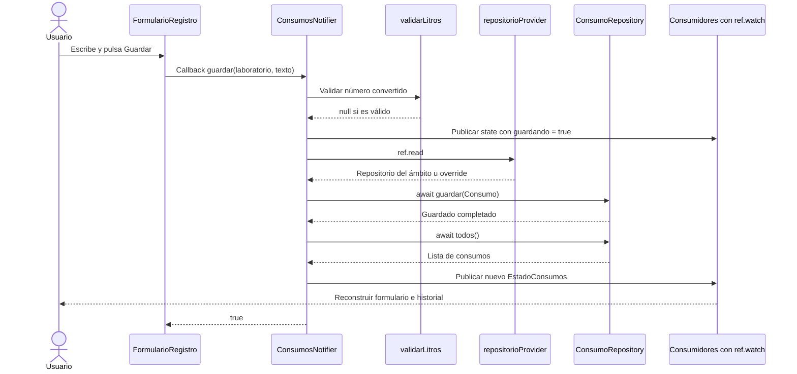
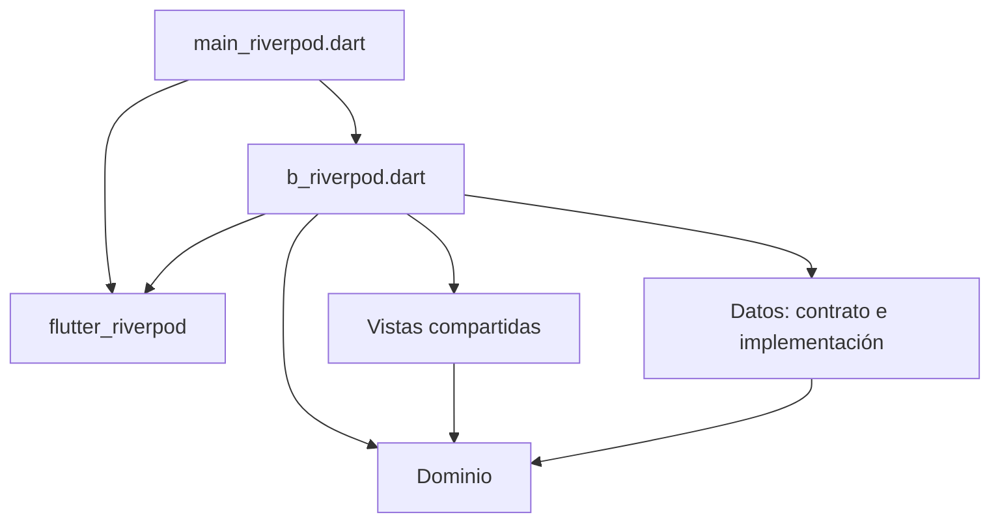

# Ecotrack_estado — Riverpod y Estado con Notifier

Esta guía estudia la variante Riverpod de [`ecotrack_estado/`](ecotrack_estado/). Las vistas compartidas, el dominio y el contrato del repositorio se conservan; la coordinación del estado se realiza con **`ConsumosNotifier`**, que publica un **`EstadoConsumos`**.

Guías relacionadas: [ChangeNotifier y Observer](Ecotrack_estado%20-%20ChangeNotifier%20y%20Observer.md), [Provider e inyección](Ecotrack_estado%20-%20Provider%20e%20inyecci%C3%B3n%20de%20dependencias.md) y [Pruebas](Ecotrack_estado%20-%20Pruebas%20de%20las%20tres%20variantes.md).

---

## Qué Cambia en la Organización

Esta variante conserva la arquitectura por capas y el patrón Repository. El Notifier cumple el papel de coordinador de presentación que el ViewModel tenía en las otras variantes.

| Responsabilidad | ChangeNotifier y Provider | Riverpod en este proyecto |
|---|---|---|
| Coordinar validación y guardado | `ConsumosViewModel` | `ConsumosNotifier` |
| Representar el estado compartido | Campos mutables del ViewModel | Objeto `EstadoConsumos` |
| Publicar cambios | `notifyListeners()` | Asignación de un nuevo valor a `state` |
| Escuchar desde la vista adaptadora | `ListenableBuilder` o `context.watch` | `ref.watch(consumosProvider)` |
| Acceder a la acción | `vm.guardar` | `ref.read(consumosProvider.notifier).guardar` |
| Obtener el repositorio | Constructor del ViewModel | `ref.read(repositorioProvider)` |

`ConsumosViewModel` no participa en esta entrada de la app. La separación sigue siendo de tipo vista → gestor de presentación → repositorio y dominio, con un flujo de acciones hacia el gestor y estado hacia la vista.

---

## Archivos y Dependencias

| Archivo | Componentes relevantes |
|---|---|
| [`main_riverpod.dart`](ecotrack_estado/lib/main_riverpod.dart) | `ProviderScope` y creación de `AppRiverpod` |
| [`variantes/b_riverpod.dart`](ecotrack_estado/lib/variantes/b_riverpod.dart) | Los dos providers, `EstadoConsumos`, `ConsumosNotifier` y los adaptadores de interfaz |
| [`presentacion/vistas.dart`](ecotrack_estado/lib/presentacion/vistas.dart) | `FormularioRegistro`, `ListaHistorial` y `DosPantallas` |
| [`dominio/consumo.dart`](ecotrack_estado/lib/dominio/consumo.dart) | `Consumo`, `laboratoriosUtez` y `validarLitros` |
| [`datos/consumo_repository.dart`](ecotrack_estado/lib/datos/consumo_repository.dart) | `ConsumoRepository` y `MemoriaConsumoRepository` |

[`pubspec.yaml`](ecotrack_estado/pubspec.yaml) declara `flutter_riverpod: ^3.4.3`. El [`pubspec.lock`](ecotrack_estado/pubspec.lock) resuelve `flutter_riverpod` y su dependencia `riverpod` en `3.4.3`.

El proyecto usa declaraciones manuales de providers. No declara un generador de Riverpod ni utiliza archivos `.g.dart` para estos componentes.

---

## ProviderScope: Ámbito de los Valores

La entrada ejecuta:

```dart
void main() {
  runApp(const ProviderScope(child: AppRiverpod()));
}
```

`ProviderScope` proporciona el entorno donde Riverpod mantiene los valores y estados de los providers. Debe envolver los widgets que los consumen. [ProviderScope y ProviderContainer](https://riverpod.dev/docs/concepts2/containers).

Los providers se declaran como variables globales `final`, pero esas variables son **definiciones para obtener y administrar valores**. No significan que exista una única lista global compartida por cualquier app o prueba. Los valores están asociados al contenedor del ámbito utilizado.

Por ejemplo, dos pruebas que montan ámbitos raíz nuevos pueden usar la misma definición `repositorioProvider` y recibir repositorios distintos.

```text
ProviderScope
└── AppRiverpod
    └── MaterialApp
        └── DosPantallas
            ├── RegistroRiverpod → FormularioRegistro
            └── HistorialRiverpod → ListaHistorial
```

---

## Los Dos Providers y Sus Responsabilidades

### repositorioProvider: suministrar la fuente de datos

```dart
final repositorioProvider = Provider<ConsumoRepository>(
  (ref) => MemoriaConsumoRepository(),
);
```

El tipo expuesto es el contrato `ConsumoRepository`. La fábrica predeterminada construye `MemoriaConsumoRepository` cuando se necesita su valor.

En esta variante, **la implementación concreta se elige dentro de `b_riverpod.dart`**, no en `main_riverpod.dart`. La entrada solo monta el ámbito y la aplicación. Esto debe distinguirse de los comentarios generales que describen la construcción del repositorio en `main` para las otras variantes.

Dentro de un mismo contenedor se reutiliza el valor suministrado por ese provider mientras se mantenga su instancia. Las pruebas pueden sustituirlo mediante un override.

### consumosProvider: exponer estado y gestor

```dart
final consumosProvider = NotifierProvider<ConsumosNotifier, EstadoConsumos>(
  ConsumosNotifier.new,
);
```

Los dos tipos genéricos tienen funciones distintas:

- `ConsumosNotifier` es el objeto que contiene acciones y modifica `state`.
- `EstadoConsumos` es el valor que reciben quienes observan `consumosProvider`.

`ConsumosNotifier.new` es una referencia a su constructor. Riverpod utiliza esa fábrica para crear el gestor cuando corresponde.

```text
ref.watch(consumosProvider)          → EstadoConsumos
ref.read(consumosProvider.notifier)  → ConsumosNotifier
ref.read(repositorioProvider)        → ConsumoRepository
```

Un provider entrega la fuente de datos; el otro organiza el estado que la interfaz observa. No son dos listas independientes de consumos.

---

## EstadoConsumos y Reemplazo del Estado

```dart
class EstadoConsumos {
  const EstadoConsumos({
    this.consumos = const [],
    this.error,
    this.guardando = false,
  });

  final List<Consumo> consumos;
  final String? error;
  final bool guardando;
}
```

Los campos `final` no pueden reasignarse después de crear el objeto. Para publicar otro error, lista o estado de guardado, el Notifier construye otro `EstadoConsumos` y lo asigna a `state`.

El estado inicial lo proporciona:

```dart
EstadoConsumos build() => const EstadoConsumos();
```

Este `build()` pertenece al Notifier: produce el estado inicial. No dibuja widgets ni consulta el repositorio. No debe confundirse con el `build()` de `RegistroRiverpod`, que construye interfaz.

### Valores por defecto

Al construir un estado sin `error`, el error queda en `null`. Si no se especifica `guardando`, queda en `false`. Estos valores explican varios cambios del flujo sin necesidad de un método `copyWith`, que no está implementado aquí.

### Inmutabilidad superficial

`final List<Consumo>` impide cambiar la referencia del campo, pero no convierte por sí solo cualquier lista recibida en una colección inmutable. En el recorrido actual, el estado inicial utiliza una lista constante y el repositorio en memoria devuelve `List.unmodifiable`.

El constructor de `EstadoConsumos` no copia ni protege una lista mutable arbitraria recibida desde otra implementación. Conviene distinguir este detalle de la práctica de **reemplazar el objeto de estado**, que sí sigue el Notifier actual.

---

## Cómo Se Conectan las Vistas con Riverpod

### RegistroRiverpod

Es un `ConsumerWidget`, cuyo `build` recibe `WidgetRef` además de `BuildContext`:

```dart
final estado = ref.watch(consumosProvider);

return FormularioRegistro(
  alGuardar: ref.read(consumosProvider.notifier).guardar,
  error: estado.error,
  guardando: estado.guardando,
);
```

Hay dos accesos diferentes:

1. `watch` obtiene el estado y registra la dependencia para reconstruir la vista adaptadora cuando cambie.
2. `read(...notifier)` obtiene el gestor y entrega la referencia al método `guardar` como callback.

La expresión `.guardar` no ejecuta el guardado al construir el widget. El formulario lo invoca después, cuando el usuario pulsa el botón.

### HistorialRiverpod

```dart
final consumos = ref.watch(consumosProvider).consumos;
return ListaHistorial(consumos: consumos);
```

La vista adaptadora observa el estado y entrega la lista al widget compartido. Extraer `.consumos` después de `watch` no significa que se haya aplicado una selección de cambios: el código no utiliza `select`.

### read y watch no son intercambiables

`read` obtiene un valor sin establecer una escucha reactiva; `watch` establece la dependencia que permite reconstruir. Las acciones del Notifier leen el repositorio con `read`, y las vistas observan el estado con `watch`. [Referencia de Ref y sus operaciones](https://riverpod.dev/docs/concepts2/refs).

Si la interfaz leyera el estado solo con `read`, no se suscribiría a sus siguientes cambios. Si el repositorio cambiara, la lectura puntual hecha desde `guardar` tampoco representa una suscripción que recargue automáticamente todos los consumos.

---

## Flujo de una Captura Inválida

`ConsumosNotifier.guardar` normaliza el texto y llama a `validarLitros` del dominio. Si obtiene un mensaje:

```dart
state = EstadoConsumos(consumos: state.consumos, error: motivo);
return false;
```

Esto conserva la lista anterior y publica un objeto con el mensaje. `guardando` queda en `false` por defecto. Los consumidores reciben el estado y el formulario muestra el mensaje mediante `errorText`.

El repositorio no se lee ni se invoca en esta rama. El formulario recibe `false`, por lo que conserva el texto y no muestra el aviso de éxito.

---

## Flujo de una Captura Válida

El recorrido válido está escrito así:

```dart
state = EstadoConsumos(consumos: state.consumos, guardando: true);
final repo = ref.read(repositorioProvider);
await repo.guardar(Consumo(laboratorio: laboratorio, litros: litros!));
state = EstadoConsumos(consumos: await repo.todos());
return true;
```

| Paso | Qué ocurre | Qué observa la interfaz |
|---|---|---|
| Publicar guardado en curso | Nuevo estado con la lista anterior y `guardando: true` | El botón pasa a estar desactivado |
| Obtener repositorio | Se lee el valor efectivo de `repositorioProvider` | No supone por sí solo otro estado visual |
| Guardar | Se espera la operación del contrato | Se conserva el estado de guardado |
| Consultar | Se espera `repo.todos()` | Se obtiene la lista de la fuente de datos |
| Publicar resultado | Nuevo estado con la lista consultada | `error` queda en `null` y `guardando` en `false` por defecto |
| Responder al formulario | Devuelve `true` | El formulario limpia el campo y muestra el SnackBar |

No se llama a `notifyListeners()` en este código. Los nuevos valores se publican mediante el setter `state` del Notifier y llegan a los widgets que observan su provider.

### Secuencia completa



Como en las otras variantes, el dominio acepta **`0 < litros <= 10000`** para valores finitos y el historial calcula el total a partir de la lista recibida.

---

## Dirección de las Dependencias de Código

Las flechas significan «importa o utiliza tipos de»:



Los componentes `EstadoConsumos`, `ConsumosNotifier`, los providers y los adaptadores están definidos en el mismo archivo `b_riverpod.dart`; no son carpetas independientes de la arquitectura.

Dentro de ese módulo:

```text
RegistroRiverpod observa consumosProvider
RegistroRiverpod obtiene ConsumosNotifier para llamar a guardar
ConsumosNotifier utiliza validarLitros y Consumo del dominio
ConsumosNotifier lee repositorioProvider
repositorioProvider expone ConsumoRepository y crea su implementación predeterminada
HistorialRiverpod observa consumosProvider y entrega la lista a ListaHistorial
```

La interfaz genérica no importa Riverpod. El dominio y el repositorio tampoco necesitan esa biblioteca. La selección del repositorio concreto queda concentrada en la fábrica del provider, y las pruebas pueden reemplazar el valor sin editar los widgets.

El contrato sigue en la carpeta `datos`; no hay una capa de casos de uso ni una separación estricta de Clean Architecture. La organización busca comparar la gestión del estado manteniendo las responsabilidades de negocio y almacenamiento.

---

## Sustitución mediante Overrides

Las pruebas utilizan:

```dart
ProviderScope(
  overrides: [repositorioProvider.overrideWithValue(repo)],
  child: const AppRiverpod(),
)
```

El override hace que las lecturas del provider en ese ámbito obtengan `repo`, suministrado por la prueba, en lugar de crear el repositorio predeterminado. Puede ser `MemoriaConsumoRepository` o `RepositorioEspia`.

`AppRiverpod`, el Notifier y las vistas permanecen iguales. La sustitución está en la configuración del ámbito. [Overrides de Riverpod](https://riverpod.dev/docs/concepts2/overrides).

El override no agrega registros por sí solo. El caso todavía debe simular el botón para que el Notifier valide y guarde.

---

## Ciclo de Vida y Límites del Ejemplo

- `ProviderScope` administra el contenedor y el ciclo de vida de sus providers. El widget raíz no crea un ViewModel al que tenga que llamar manualmente a `dispose`.
- Las declaraciones actuales no utilizan `.autoDispose`; no debe suponerse que cambiar de pestaña borra el estado.
- El formulario conserva su estado local y libera su controlador en `dispose`, independientemente de Riverpod.
- `ConsumosNotifier.build()` inicia la lista vacía. No consulta automáticamente un repositorio previamente poblado.
- El repositorio en memoria conserva los registros mientras vive su instancia; no hay persistencia en disco.
- `guardar` contiene operaciones `await`, pero el tipo utilizado es `Notifier<EstadoConsumos>`, no `AsyncNotifier` ni un estado `AsyncValue`.
- No hay manejo de excepciones del repositorio ni restablecimiento garantizado de `guardando` si una operación falla.

## Ejecución y Preguntas de Repaso

Desde `proyecto - ecotrack_estado/ecotrack_estado`:

```bash
flutter pub get
flutter run -t lib/main_riverpod.dart
```

1. ¿Qué diferencia hay entre la definición global de un provider y su valor dentro de un contenedor?
2. ¿Por qué se necesita `ProviderScope`?
3. ¿Qué devuelve `consumosProvider` y qué devuelve su propiedad `.notifier`?
4. ¿Quién sustituye al ViewModel de las otras variantes?
5. ¿Qué ocurre al asignar un nuevo `EstadoConsumos` a `state`?
6. ¿Por qué `final List<Consumo>` no garantiza inmutabilidad profunda?
7. ¿En qué se diferencian `ref.watch` y `ref.read` en el flujo real?
8. ¿Dónde se crea el repositorio concreto en esta variante?
9. ¿Cómo cambia ese repositorio durante una prueba sin modificar las pantallas?

Consulte la [guía de pruebas](Ecotrack_estado%20-%20Pruebas%20de%20las%20tres%20variantes.md) para seguir el override y la comparación de criterios paso a paso.

[Comparativa general de las variantes](Ecotrack_estado%20-%20Comparativa%20de%20gesti%C3%B3n%20de%20estado.md).

[Volver al índice de Ecotrack_estado](README.md).
