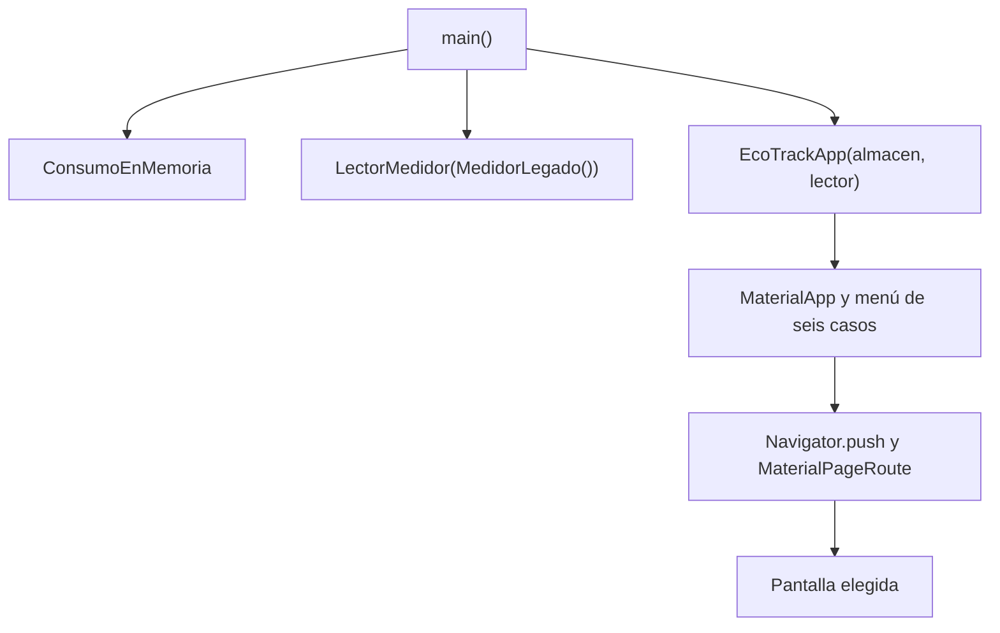
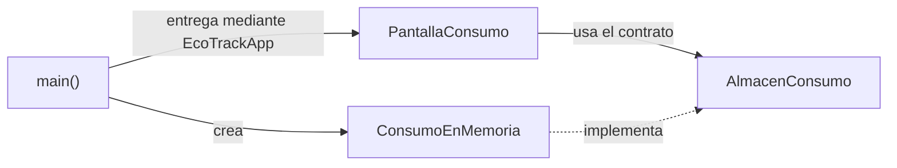

# Ecotrack_patrones — Arquitectura General y Comparativa

Esta aplicación presenta seis casos de diseño mediante seis pantallas. Cada ejemplo resuelve un problema distinto: crear avisos, entregar dependencias, traducir lecturas, almacenar consumos, notificar cambios o intercambiar reglas. Esta guía explica la organización real del código y cómo distinguirlos.

## Orden de Estudio

Después de esta visión general, siga el orden del menú de la aplicación:

| Guía | Pregunta principal |
|---|---|
| [02 · Factory](02%20-%20Ecotrack_patrones%20-%20Factory.md) | ¿Quién decide cómo construir un aviso? |
| [03 · Inyección de dependencias](03%20-%20Ecotrack_patrones%20-%20Inyecci%C3%B3n%20de%20dependencias.md) | ¿Quién entrega la fuente que utiliza la pantalla? |
| [04 · Adapter](04%20-%20Ecotrack_patrones%20-%20Adapter.md) | ¿Quién convierte el formato del medidor? |
| [05 · Repository](05%20-%20Ecotrack_patrones%20-%20Repository.md) | ¿Cómo se oculta el almacenamiento concreto? |
| [06 · Observer](06%20-%20Ecotrack_patrones%20-%20Observer.md) | ¿Cómo se enteran dos paneles del mismo cambio? |
| [07 · Strategy](07%20-%20Ecotrack_patrones%20-%20Strategy.md) | ¿Cómo cambia una regla sin cambiar el validador? |
| [08 · Pruebas](08%20-%20Ecotrack_patrones%20-%20Pruebas%20y%20dependencias.md) | ¿Qué comprueban los cinco casos de prueba? |

## Arquitectura que Se Observa en el Código

La organización es **por casos didácticos**. [`lib/main.dart`](ecotrack_patrones/lib/main.dart) compone la aplicación y construye el menú; cada archivo de [`lib/casos/`](ecotrack_patrones/lib/casos/) reúne la pantalla y las clases que necesita su ejemplo.

```text
ecotrack_patrones/
├── lib/
│   ├── main.dart
│   └── casos/
│       ├── factory.dart
│       ├── inyeccion_dependencias.dart
│       ├── adapter.dart
│       ├── repository.dart
│       ├── observer.dart
│       └── strategy.dart
├── test/casos_test.dart
└── pubspec.yaml
```

Los seis archivos de casos importan `package:flutter/material.dart`. En cada uno conviven responsabilidades de interfaz y clases de apoyo; no hay carpetas independientes de dominio, datos y presentación, ni un ViewModel por pantalla. Por ello, la interpretación del proyecto es una colección de ejemplos con separación de responsabilidades entre clases. La estructura no implementa una arquitectura completa de MVVM o Clean Architecture.

**Un patrón** describe cómo colaboran algunas piezas para resolver un problema. **La arquitectura** organiza responsabilidades y dependencias de una aplicación más amplia. Repository es un patrón de acceso a datos; la inyección de dependencias es una técnica de composición. Factory, Adapter, Observer y Strategy corresponden a problemas de creación, estructura y comportamiento, respectivamente.

## Arranque y Navegación



1. `main()` crea un almacén de consumos y un lector que envuelve al medidor legado.
2. Entrega ambos a `EcoTrackApp` mediante su constructor.
3. `EcoTrackApp.build()` prepara una lista de tuplas `(nombre, problema, pagina)`.
4. Cada `ListTile` muestra un caso. Al tocarlo, `Navigator.push` abre su widget en una ruta Material.
5. Repository recibe el almacén creado en el arranque; Adapter recibe el lector. Las otras pantallas crean o seleccionan sus colaboradores dentro de su propio caso.

El menú no encadena las seis pantallas como un proceso de negocio. Por ejemplo, leer el medidor no guarda automáticamente la lectura en Repository, y Strategy no valida lo capturado en la pantalla de Repository.

## Comparativa de los Seis Casos

| Caso | Componentes principales | Qué se desacopla | Ventaja concreta | Costo o límite actual |
|---|---|---|---|---|
| Factory | `PantallaAviso`, `Aviso.paraMeta` | La pantalla y la elección de cómo crear el aviso | Texto y condición quedan centralizados | Cada nueva alternativa exige revisar la fábrica; la pantalla todavía elige el icono |
| Inyección | `PantallaLab`, `FuenteLab`, `PantallaRegistro` | El uso de una fuente y su elección concreta | La misma pantalla puede recibir éxito o fallo | El padre sigue conociendo las implementaciones; `LabEnMemoria` no guarda nada |
| Adapter | `PantallaMedidor`, `LectorMedidor`, `MedidorLegado` | La pantalla y el formato textual del aparato | La interfaz trabaja con `double` | El lector supone un formato específico y depende del medidor concreto |
| Repository | `AlmacenConsumo`, `ConsumoEnMemoria`, `PantallaConsumo` | La pantalla y la lista interna | Permite cambiar la implementación respetando el contrato | Operaciones síncronas, sin persistencia ni validación de rango |
| Observer | `RegistroConsumo`, `PanelHistorial`, `PanelMeta` | El emisor y la identidad de cada observador | Una acción actualiza dos paneles | El estado dura lo que la pantalla; cada aviso vuelve a ejecutar ambos builders |
| Strategy | `ReglaTope`, `TopeAgua`, `TopeLuz`, `ValidadorLectura` | El validador y cada regla concreta | La misma operación delega en reglas intercambiables | La pantalla prepara la lista de estrategias; el slider no alcanza todos los límites |

Factory aquí utiliza constructores `factory` de Dart y una decisión centralizada en `Aviso.paraMeta`. No hay una jerarquía de creadores que sobrescriban un Factory Method, ni familias de productos de Abstract Factory. La guía correspondiente explica esa distinción a partir del código.

## Dirección de Dependencias y Flujo de Ejecución

Estas dos lecturas deben distinguirse:

- **Dependencia de código:** una clase necesita conocer un tipo o contrato para compilar. Por ejemplo, `PantallaConsumo` declara un campo `AlmacenConsumo`.
- **Llamada durante la ejecución:** el objeto recibido ejecuta un comportamiento concreto. La llamada `almacen.guardar(...)` llega a `ConsumoEnMemoria.guardar(...)` porque esa fue la instancia entregada.

En Repository, la dirección conceptual es:



El almacenamiento concreto implementa el contrato que consume la pantalla; la pantalla no construye una lista interna de repositorio. Sin embargo, ambos tipos se encuentran en el mismo archivo, así que esta separación conceptual no crea una barrera entre bibliotecas o capas físicas.

La misma idea aparece en `PantallaRegistro → FuenteLab` y `ValidadorLectura → ReglaTope`. En Adapter la dependencia es más concreta: `PantallaMedidor → LectorMedidor → MedidorLegado`.

## Cómo Se Combinan los Conceptos

Los nombres del menú señalan el objetivo principal de cada ejemplo. También existen combinaciones:

- Repository utiliza inyección por constructor: `main()` entrega `ConsumoEnMemoria` a través de `EcoTrackApp`.
- Adapter utiliza composición: `LectorMedidor` contiene el medidor que adapta y lo recibe por constructor.
- Observer recibe la misma instancia de `RegistroConsumo` en los dos paneles. La inyección entrega el objeto; las notificaciones comunican sus cambios.
- Strategy recibe una `ReglaTope` por constructor. La inyección entrega la estrategia; Strategy describe cómo el validador delega en ella.

Compartir una técnica de construcción no convierte esos casos en el mismo patrón. Cada uno responde a una pregunta distinta de la tabla.

## Estado y Duración de los Datos

| Estado | Propietario | Duración en esta aplicación |
|---|---|---|
| Lista de Repository | `ConsumoEnMemoria` creado en `main()` | Vida de esa instancia; se conserva al volver a abrir su pantalla durante la sesión |
| Lecturas de Adapter | `_PantallaMedidorState` | Vida de la ruta; se pierden al salir y abrir otra vez |
| Registros de Observer | `RegistroConsumo` creado por `_PantallaPanelesState` | Vida de esa pantalla; su `dispose` libera el notifier |
| Ahorro y regla seleccionada | Estado de Factory y Strategy | Vida de cada pantalla |
| Fuente de laboratorio | Seleccionada en `PantallaLab.build()` | Se vuelve a seleccionar y construir al reconstruir ese padre |

Ningún caso usa una base de datos, solicitudes HTTP o almacenamiento en disco. `MedidorLegado` genera valores seudoaleatorios: no se conecta a un dispositivo físico.

## Preguntas de Repaso

1. ¿Por qué Repository e inyección aparecen juntos en el mismo flujo?
2. ¿En qué se diferencia convertir una lectura de elegir cómo validarla?
3. ¿Por qué Observer actualiza dos paneles sin que el botón los nombre?
4. ¿Qué estado se conserva al salir de la pantalla Repository y por qué?
5. ¿Qué información permite afirmar que el proyecto está organizado por casos?

[Continuar con 02 · Factory](02%20-%20Ecotrack_patrones%20-%20Factory.md) · [Volver al índice](README.md).
