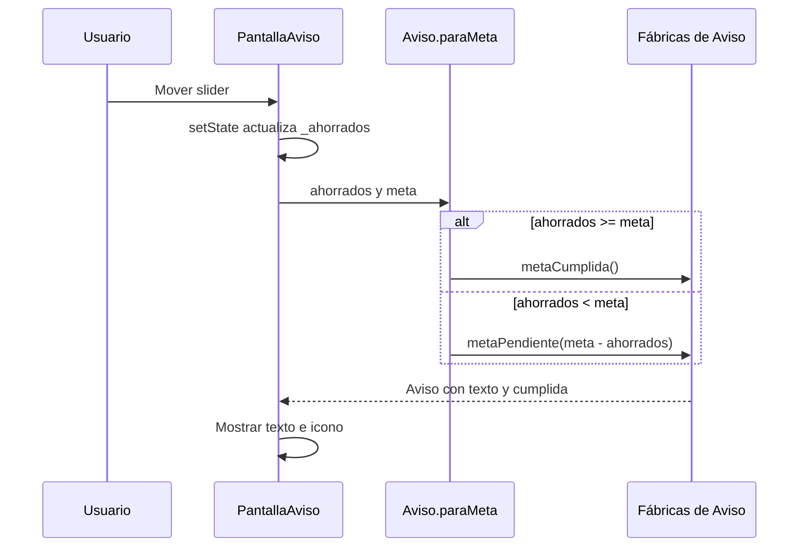

# Ecotrack_patrones — Factory

El caso de [`factory.dart`](ecotrack_patrones/lib/casos/factory.dart) centraliza la creación de un aviso según el ahorro acumulado. La pantalla pide un aviso para una meta y recibe un objeto listo para representar.

## Problema y Solución

Si cada pantalla construyera sus propios mensajes, tendría que repetir la comparación con la meta y el cálculo de litros faltantes. `Aviso.paraMeta(...)` concentra esa decisión y delega la construcción en `Aviso.metaCumplida()` o `Aviso.metaPendiente(...)`.

Este ejemplo usa **constructores de fábrica de Dart** con una decisión centralizada. El lenguaje permite que un constructor `factory` devuelva una instancia construida mediante otra ruta. [Documentación de constructores de Dart](https://dart.dev/language/constructors#factory-constructors).

La palabra `factory` por sí sola no demuestra el patrón GoF Factory Method. En este código no existen una clase creadora base y subclases que sobrescriban el método creador. Tampoco se construyen familias de productos como en Abstract Factory: todas las rutas devuelven un `Aviso`.

## Componentes

| Componente | Responsabilidad |
|---|---|
| `Aviso` | Objeto con `texto` y `cumplida`, ambos campos `final` |
| Constructor `Aviso(...)` | Inicializar esos dos valores |
| `Aviso.metaCumplida()` | Crear el mensaje de meta alcanzada con `cumplida: true` |
| `Aviso.metaPendiente(faltan)` | Formatear los litros faltantes con un decimal y marcar `false` |
| `Aviso.paraMeta(ahorrados:, meta:)` | Elegir una de las dos formas de construcción |
| `_PantallaAvisoState` | Mantener `_ahorrados`, llamar a la fábrica y representar el resultado |

## Flujo de Comunicación



Al abrir la pantalla, `_ahorrados` vale `30` y la meta fija es `50.0`. `build()` obtiene un aviso pendiente de `20.0 L`. Al mover el slider a `50`, la condición `>=` produce el aviso de meta cumplida. El slider admite valores hasta `60`.

La decisión de qué aviso crear está en `Aviso.paraMeta`; la selección del icono sigue en la pantalla mediante `aviso.cumplida ? ... : ...`. El objeto no depende de un widget ni devuelve un icono.

## Dirección de Dependencias

```text
PantallaAviso → Aviso.paraMeta → metaCumplida / metaPendiente → Aviso(...)
```

La pantalla conoce la clase `Aviso` y los datos públicos que representa. `Aviso` no conoce la pantalla, su slider ni `setState`. No hay un contrato abstracto de producto porque el caso solo necesita una clase de resultado.

En ejecución, cada reconstrucción de esta pantalla vuelve a llamar a la fábrica. El código crea un objeto nuevo; no contiene una caché ni implementa Singleton. Aunque la lógica de `Aviso` no utiliza widgets, comparte el archivo con la interfaz y su import de Material.

## Fragmento Clave

Este fragmento existe en la aplicación:

```dart
factory Aviso.paraMeta({required double ahorrados, required double meta}) {
  if (ahorrados >= meta) return Aviso.metaCumplida();
  return Aviso.metaPendiente(meta - ahorrados);
}
```

No se elige una subclase de `Aviso`: se eligen los datos con los que se construye la misma clase.

## Ventajas y Límites

| Ventaja | Límite o costo |
|---|---|
| La condición y los mensajes se centralizan | Una nueva condición requiere modificar la fábrica |
| La pantalla pide el resultado mediante un nombre expresivo | La pantalla mantiene su lógica de presentación del icono |
| El resultado se prueba sin montar widgets | El constructor público también permite crear combinaciones arbitrarias de texto y bandera |

Las entradas se comparan directamente; no hay una validación adicional de metas negativas u otros valores. La interfaz del ejemplo restringe el slider, pero eso no equivale a una validación general del constructor.

## Prueba Existente y Repaso

En [`casos_test.dart`](ecotrack_patrones/test/casos_test.dart), `la forma del aviso depende del caso` comprueba que `50/50` marca la meta cumplida y que `45.5/50` produce `Faltan 4.5 L para la meta`. Es una prueba unitaria del objeto, sin `PantallaAviso`.

Para repasar: ¿quién compara los litros con la meta?, ¿quién elige el icono?, ¿por qué estos constructores no prueban que exista Abstract Factory?

[Anterior: arquitectura general](01%20-%20Ecotrack_patrones%20-%20Arquitectura%20general%20y%20comparativa.md) · [Siguiente: inyección de dependencias](03%20-%20Ecotrack_patrones%20-%20Inyecci%C3%B3n%20de%20dependencias.md) · [Índice](README.md).
