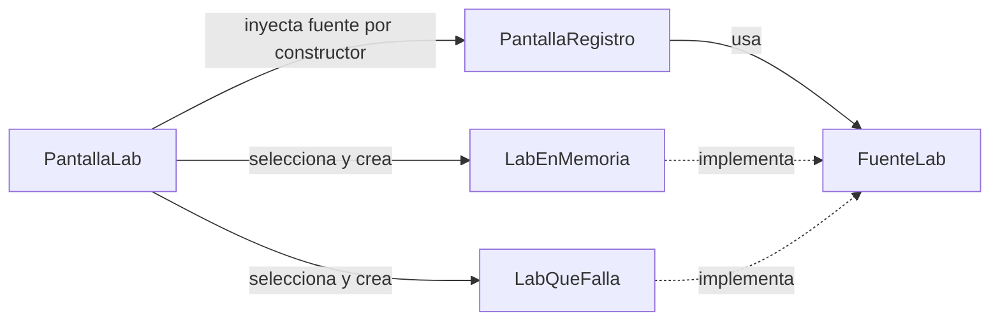
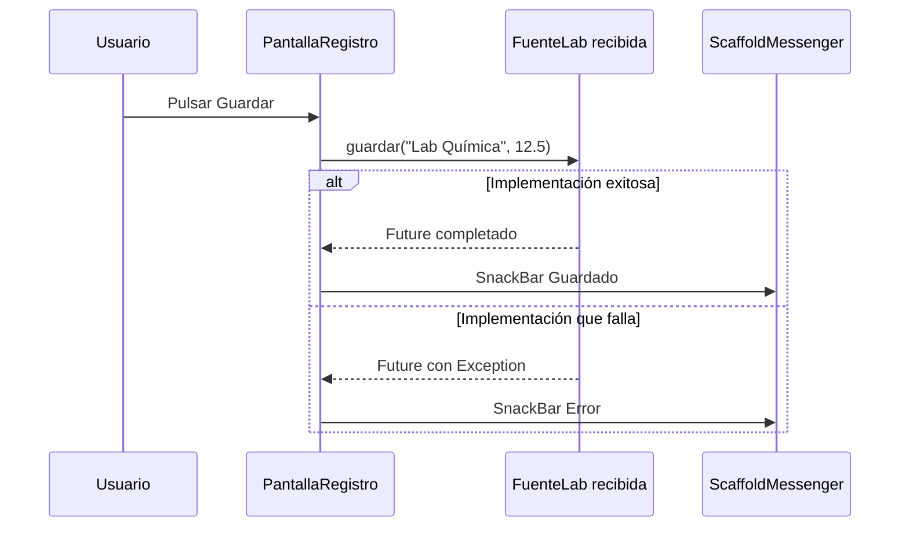

# Ecotrack_patrones — Inyección de Dependencias

En [`inyeccion_dependencias.dart`](ecotrack_patrones/lib/casos/inyeccion_dependencias.dart), la misma pantalla de registro recibe una fuente que termina con éxito o una fuente que falla. Se utiliza **inyección manual por constructor**: un objeto externo decide qué implementación entregar.

La separación entre configurar una dependencia y utilizarla es la idea central de esta técnica. No exige un contenedor o una biblioteca adicional. [Artículo de Martin Fowler sobre inyección de dependencias](https://martinfowler.com/articles/injection.html).

## Componentes

| Componente | Papel |
|---|---|
| `FuenteLab` | Contrato con `Future<void> guardar(String laboratorio, double litros)` |
| `LabEnMemoria` | Implementación que completa la operación sin lanzar un error |
| `LabQueFalla` | Implementación que lanza `Exception` con un fallo simulado |
| `PantallaLab` y su `State` | Componer el ejemplo y seleccionar la fuente con un interruptor |
| `PantallaRegistro` | Recibir `FuenteLab`, guardar los datos fijos y mostrar el resultado |
| `ScaffoldMessenger` | Presentar el SnackBar de éxito o error |

**El nombre `LabEnMemoria` no implica almacenamiento real en este caso.** Su método tiene cuerpo vacío: no conserva una lista, no devuelve registros ni persiste datos. Simula el camino exitoso de una operación asíncrona.

## Dirección de Dependencias

`PantallaRegistro` declara `final FuenteLab fuente`; no decide cuál implementación construir. Las dos clases concretas cumplen el contrato. `PantallaLab` sí conoce ambas porque es el punto de selección del ejemplo.

Esto aplica inversión de dependencias a la colaboración: el consumidor utiliza una abstracción. Todas las clases permanecen en un solo archivo; el proyecto no separa físicamente el contrato y las implementaciones en capas distintas.

## Selección y Guardado Paso a Paso

1. `_ensayarFallo` comienza en `false`.
2. En `PantallaLab.build()`, la expresión condicional construye `LabEnMemoria` o `LabQueFalla`.
3. El padre construye `PantallaRegistro(fuente: fuente)`.
4. Al pulsar el botón, `PantallaRegistro` obtiene el `ScaffoldMessenger` y llama a `await fuente.guardar('Lab Química', 12.5)`.
5. Si el `Future` completa normalmente, muestra `Guardado`.
6. Si completa con error, el `catch` muestra un SnackBar que comienza con `Error:`.

Al cambiar el interruptor, `setState` modifica `_ensayarFallo` y reconstruye el padre. Se crea y entrega otra fuente a la misma clase de pantalla. El campo `final` no se modifica en el widget existente: la reconstrucción proporciona una nueva configuración de widget.

## Por Qué la Misma Pantalla Funciona en Ambos Modos

La pantalla solo necesita que exista el método del contrato. No contiene un `if` para detectar `LabQueFalla` ni conoce sus detalles. El resultado se comunica mediante el `Future`: éxito normal o excepción.

La selección actual ocurre dentro de `build()`, así que cada reconstrucción de ese padre crea una instancia. No hay Provider, Riverpod, service locator, registro global o singleton. El [`pubspec.yaml`](ecotrack_patrones/pubspec.yaml) tampoco declara esas bibliotecas.

## Ventajas y Límites

| Ventaja | Límite actual |
|---|---|
| La misma interfaz recibe implementaciones diferentes | El padre debe conocer y elegir las clases concretas |
| Se puede ensayar un error sin servidor | Las implementaciones solo simulan resultados |
| Una prueba puede entregar directamente una fuente | No hay estado de carga, validación del formulario o bloqueo del botón durante el guardado |

El laboratorio y los litros son constantes en el botón; este caso enseña sustitución de colaboradores, no captura de un formulario completo.

## Prueba Existente y Repaso

`la misma pantalla ensaya el fallo`, en [`casos_test.dart`](ecotrack_patrones/test/casos_test.dart), monta directamente `PantallaRegistro(fuente: LabQueFalla())`, pulsa su botón y busca `Error`. Comprueba el camino de error del consumidor; no recorre el interruptor de `PantallaLab` ni comprueba el camino exitoso.

Para repasar: ¿qué clase configura y cuál utiliza?, ¿qué cambia al mover el interruptor?, ¿por qué un método que completa sin error no demuestra persistencia?

[Anterior: Factory](02%20-%20Ecotrack_patrones%20-%20Factory.md) · [Siguiente: Adapter](04%20-%20Ecotrack_patrones%20-%20Adapter.md) · [Índice](README.md).
