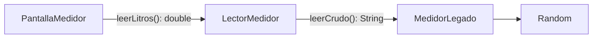

# Ecotrack_patrones — Adapter

El caso de [`adapter.dart`](ecotrack_patrones/lib/casos/adapter.dart) convierte la lectura textual de un medidor legado en el `double` que necesita la aplicación. Utiliza un **adaptador por composición**: `LectorMedidor` contiene al objeto legado y traduce su salida.

## Problema y Componentes

El medidor ofrece `leerCrudo()`, que devuelve un texto como `'12.5 L'`. La pantalla necesita números para sumarlos. Adaptar significa mantener el formato ajeno detrás de una operación apropiada para el consumidor.

| Componente | Papel en el caso |
|---|---|
| `MedidorLegado` | Objeto adaptado: expone una lectura como `String` |
| `LectorMedidor` | Adaptador: expone `double leerLitros()` y contiene `MedidorLegado legado` |
| `PantallaMedidor` | Consumidor: recibe el lector por constructor |
| `_PantallaMedidorState` | Mantiene las lecturas numéricas y calcula su suma |
| `main()` y `EcoTrackApp` | Crean y entregan la cadena de objetos |

La interfaz de destino es la operación pública `leerLitros()` de `LectorMedidor`; no existe una interfaz abstracta adicional para lectores. La pantalla depende de esa clase concreta.

## Construcción y Dirección de Dependencias

En [`main.dart`](ecotrack_patrones/lib/main.dart) se construye:

```dart
final lector = LectorMedidor(MedidorLegado());
runApp(EcoTrackApp(almacen: almacen, lector: lector));
```

El menú entrega ese lector a `PantallaMedidor(lector: lector)`.



La pantalla conoce al adaptador; el adaptador conoce al medidor. El medidor no conoce la pantalla ni necesita cambiar su formato. Esta dirección describe las dependencias; los valores de retorno viajan desde el medidor hacia la pantalla.

## Flujo de una Lectura

1. El usuario pulsa `Leer medidor`.
2. El callback llama a `widget.lector.leerLitros()` y agrega su resultado a `_lecturas` dentro de `setState`.
3. El lector obtiene `texto = legado.leerCrudo()`.
4. `texto.split(' ').first` toma la parte anterior al espacio: por ejemplo, `'12.5'`.
5. `double.parse(numero)` convierte esa parte en `12.5`.
6. Flutter reconstruye la pantalla; `fold` suma las lecturas y la interfaz muestra la lista y el total con un decimal.

```text
Medidor: "12.5 L"
    → LectorMedidor: separa "12.5"
    → double.parse: 12.5
    → PantallaMedidor: agrega a List<double>
    → fold: suma de las lecturas
```

El medidor del ejemplo es una simulación. La expresión `(nextInt(200) + 1) / 10` genera valores de `0.1` a `20.0` litros. Su constructor admite un `Random` externo, lo que permite controlar el generador desde una prueba.

## Estado y Vida de los Objetos

El lector y su medidor nacen en `main()`. La lista de lecturas pertenece al `State` de la pantalla. Al salir de la ruta, esa lista se pierde; al abrirla de nuevo comienza otra lista aunque se reutilice el lector del arranque. No se llama al almacén de Repository desde este caso.

## Ventajas y Límites

| Ventaja | Límite actual |
|---|---|
| La pantalla suma números sin procesar el texto legado | Depende de la clase concreta `LectorMedidor` |
| La traducción queda en un lugar | El parser supone que el primer segmento es un número válido |
| El medidor conserva su API textual | No se validan unidades ni se capturan errores de formato |

`double.parse` puede lanzar una excepción ante texto incompatible. El formato que genera este medidor cumple lo esperado, pero el lector no implementa tolerancia a formatos alternativos. Tampoco convierte unidades: quitar la `L` no equivale a transformar galones o mililitros a litros.

## Diferencia con Otros Casos

Adapter traduce **cómo se expresa** un dato. Strategy decide **qué regla se aplica** a un valor. Repository oculta **dónde se guarda o consulta**. Inyectar `MedidorLegado` en el lector facilita su construcción, pero la traducción es la responsabilidad que identifica al adaptador.

## Prueba Existente y Repaso

`el texto del medidor sale como double`, en [`casos_test.dart`](ecotrack_patrones/test/casos_test.dart), entrega `Random(1)` a `MedidorLegado` y comprueba `isA<double>()`. Verifica el tipo de salida en una lectura del simulador. No comprueba un valor exacto, unidades alternativas, errores de formato ni la pantalla.

Para repasar: ¿qué objeto conoce el formato legado?, ¿en qué dirección se hacen las llamadas y vuelve el dato?, ¿qué estado se pierde al cerrar la ruta?

[Anterior: inyección](03%20-%20Ecotrack_patrones%20-%20Inyecci%C3%B3n%20de%20dependencias.md) · [Siguiente: Repository](05%20-%20Ecotrack_patrones%20-%20Repository.md) · [Índice](README.md).
