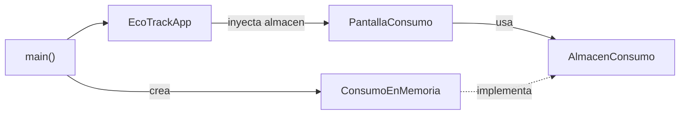
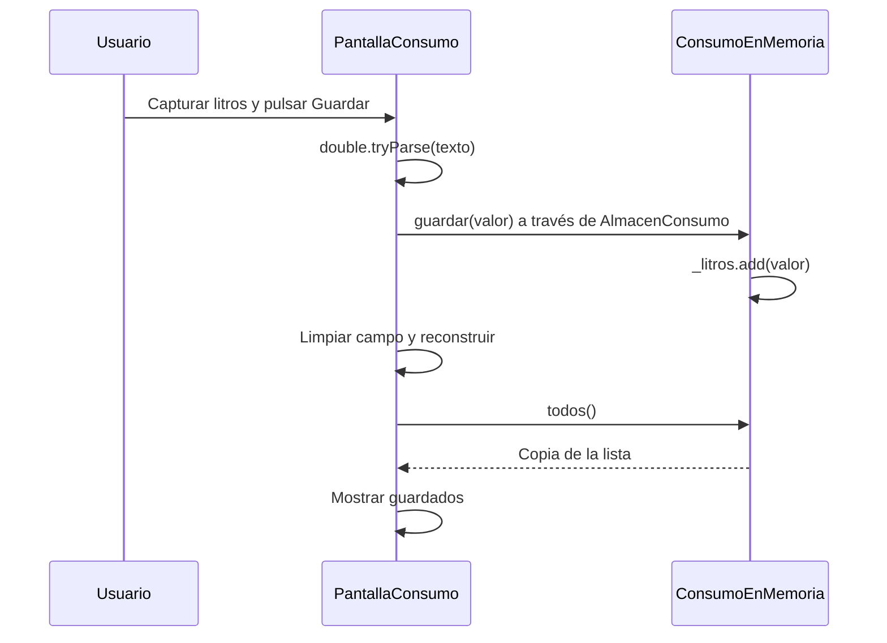

# Ecotrack_patrones — Repository

En [`repository.dart`](ecotrack_patrones/lib/casos/repository.dart), la pantalla guarda y consulta consumos mediante `AlmacenConsumo`. La implementación actual conserva los litros en una lista, oculta detrás del contrato.

Repository presenta operaciones de acceso a datos con una interfaz semejante a una colección. Este caso aplica esa idea de forma pequeña: guardar un número y consultar todos los números guardados. [Descripción de Repository de Martin Fowler](https://martinfowler.com/eaaCatalog/repository.html).

## Componentes

| Componente | Responsabilidad |
|---|---|
| `AlmacenConsumo` | Contrato: `void guardar(double litros)` y `List<double> todos()` |
| `ConsumoEnMemoria` | Implementación con la lista privada `_litros` |
| `PantallaConsumo` | Recibir un `AlmacenConsumo` por constructor |
| `_PantallaConsumoState` | Capturar el texto, convertirlo, pedir el guardado y representar los datos |
| `main()` | Elegir y crear `ConsumoEnMemoria` |
| `EcoTrackApp` | Recibir el contrato y entregarlo a la pantalla desde el menú |

La abstracción no exige que el nombre contenga `Repository`: el papel se reconoce por la colaboración entre el contrato, la implementación y el consumidor.

## Dirección de Dependencias

La pantalla depende del contrato. `ConsumoEnMemoria` implementa ese mismo contrato y no conoce los widgets. El punto de composición conoce la clase concreta para construirla.

Durante la ejecución, `widget.almacen.guardar(valor)` termina en el método de `ConsumoEnMemoria` porque esa es la instancia recibida. La flecha conceptual `ConsumoEnMemoria → AlmacenConsumo` representa implementación del contrato; no significa que la implementación llame a una pantalla.

Contrato, implementación e interfaz están en un mismo archivo. Hay separación entre responsabilidades de objetos, pero no una separación física de capas de código.

## Flujo de Guardado y Consulta

1. El usuario escribe en el campo `Litros`. Su texto vive en un `TextEditingController`.
2. `Guardar` ejecuta `_alPulsarGuardar()`.
3. `double.tryParse(_litros.text)` intenta obtener un número. Si devuelve `null`, el método termina sin guardar ni mostrar un error.
4. Dentro de `setState`, la pantalla llama a `widget.almacen.guardar(valor)`.
5. `ConsumoEnMemoria` agrega el número a su lista privada.
6. La pantalla limpia el campo. En la reconstrucción, `build()` consulta `widget.almacen.todos()` y muestra el resultado.

La actualización usa `setState`: el almacén no emite notificaciones Observer. Si otro componente cambiara el almacén, este ejemplo no dispone de una suscripción que reconstruya automáticamente la pantalla.

## Encapsulación y Duración

`todos()` devuelve `List<double>.from(_litros)`. El consumidor recibe una **copia modificable**: puede cambiar su copia sin cambiar la lista interna del almacén. Es distinto de devolver directamente `_litros` y también de entregar una lista de solo lectura.

El almacén se crea una vez en `main()`. La misma instancia llega a la pantalla, por lo que los registros sobreviven a cerrar y abrir esa ruta durante la sesión. Se pierden al terminar la aplicación o crear otro almacén; no hay persistencia en disco.

El controlador del campo pertenece al `State` de la pantalla y se libera en `dispose()`. La pantalla no destruye el almacén recibido, cuyo alcance es mayor.

## Ventajas y Límites

| Ventaja | Límite actual |
|---|---|
| La interfaz no manipula la lista interna | El contrato permite solo operaciones síncronas |
| Otra implementación puede cumplir las mismas operaciones | Una fuente remota normalmente necesitaría revisar el contrato para manejar asincronía y errores |
| La copia protege el almacenamiento frente a cambios externos | No hay validación de cantidades positivas o límites |

El caso acepta números negativos y cero si el parser los reconoce. Las reglas de Strategy no se aplican aquí: pertenecen a otro ejemplo. La pantalla tampoco muestra confirmaciones o errores de almacenamiento.

## Pruebas y Repaso

La suite [`casos_test.dart`](ecotrack_patrones/test/casos_test.dart) **no importa `repository.dart` ni prueba este caso**. Que sus cinco pruebas pasen no demuestra el guardado, la copia de `todos()` o la interacción de `PantallaConsumo`.

Para repasar: ¿quién elige el almacén concreto?, ¿por qué la pantalla puede cerrar sin perder los registros de la sesión?, ¿qué protege la copia de la lista?, ¿por qué este Repository también usa inyección por constructor?

[Anterior: Adapter](04%20-%20Ecotrack_patrones%20-%20Adapter.md) · [Siguiente: Observer](06%20-%20Ecotrack_patrones%20-%20Observer.md) · [Índice](README.md).
