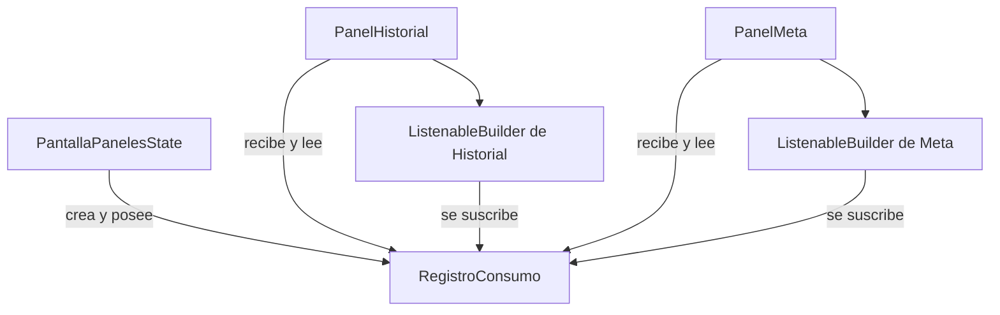

# Ecotrack_patrones — Observer

El caso de [`observer.dart`](ecotrack_patrones/lib/casos/observer.dart) muestra cómo dos paneles se actualizan al cambiar un registro compartido. **Observer es el patrón de comunicación**; `ChangeNotifier` y `ListenableBuilder` son las herramientas de Flutter utilizadas para aplicarlo.

`ChangeNotifier` proporciona una API de notificación y puede ser observado mediante widgets que escuchan un `Listenable`. `ListenableBuilder` reconstruye su subárbol cuando ese objeto emite un aviso. [API de ChangeNotifier](https://api.flutter.dev/flutter/foundation/ChangeNotifier-class.html), [API de ListenableBuilder](https://api.flutter.dev/flutter/widgets/ListenableBuilder-class.html).

## Componentes

| Componente | Responsabilidad |
|---|---|
| `RegistroConsumo extends ChangeNotifier` | Sujeto observado: conservar litros y notificar cambios |
| `_PantallaPanelesState` | Crear un registro, entregarlo a los paneles y liberarlo |
| Botón `Guardar 12.5 L` | Pedir un cambio mediante `_registro.guardar(12.5)` |
| `PanelHistorial` | Representar la cantidad de registros |
| `PanelMeta` | Sumar los litros y mostrar lo que queda de una meta de `50` |
| Un `ListenableBuilder` por panel | Escuchar al registro y ejecutar el builder cuando cambia |

Los observadores registrados en el mecanismo de notificaciones son los listeners que administra cada `ListenableBuilder`. Decir que los paneles observan es una forma de describir su función; no implementan una interfaz `Observer` propia.

## Dirección de Dependencias

Los paneles conocen `RegistroConsumo`, pero el registro no importa ni nombra `PanelHistorial` o `PanelMeta`. Hereda la gestión de listeners de `ChangeNotifier` y solo llama a `notifyListeners()`.

La entrega por constructor hace que ambos reciban **la misma instancia**. Si cada panel recibiera un registro diferente, no verían los mismos datos aunque las clases fueran idénticas.

## Flujo al Guardar

```mermaid
sequenceDiagram
    participant B as Botón
    participant R as RegistroConsumo
    participant H as Builder de Historial
    participant M as Builder de Meta
    B->>R: guardar(12.5)
    R->>R: Agregar a _litros
    R->>R: notifyListeners()
    R-->>H: Aviso de cambio
    R-->>M: Aviso de cambio
    H->>R: Leer litros.length
    M->>R: Leer litros y sumar
    H->>H: Mostrar 1 registros
    M->>M: Mostrar Quedan 37.5 L
```

1. Al abrir, la lista está vacía: el historial muestra `0 registros` y quedan `50.0 L`.
2. El botón agrega `12.5` a la lista dentro de `guardar`.
3. Después de modificar los datos, `notifyListeners()` avisa a los listeners.
4. Flutter reconstruye el contenido de los builders. Cada uno vuelve a leer el registro y calcula su propia representación.

La notificación no transporta la lista como argumento: es un aviso para que el consumidor consulte el estado. Tampoco se necesita llamar a `setState` en el botón, porque la reconstrucción de esos subárboles se conecta mediante los listeners.

## Estado, Protección y Ciclo de Vida

`RegistroConsumo` mantiene `_litros` privada y expone `List.unmodifiable(_litros)`. El consumidor no puede modificar la colección recibida; los cambios pasan por `guardar`, que además notifica.

El `State` de `PantallaPaneles` crea el registro y llama a `_registro.dispose()` en su propio `dispose()`. Los `ListenableBuilder` administran sus suscripciones durante su ciclo de vida. Los paneles reciben el registro prestado y no son sus propietarios.

Los datos pertenecen a esta ruta. Salir y volver a abrirla crea otro registro vacío. Este caso no usa `ConsumoEnMemoria` del ejemplo Repository.

## Ventajas y Límites

| Ventaja | Límite actual |
|---|---|
| Una operación informa a varios consumidores | Ambos builders reciben cada aviso, aunque necesiten datos distintos |
| El emisor desconoce los nombres de los paneles | Los paneles dependen de `RegistroConsumo` concreto |
| Cada panel calcula su presentación | No hay validación, persistencia ni tratamiento de errores |

`PanelMeta` calcula `meta - usados` directamente. Con suficientes pulsaciones el resultado puede ser negativo: no se limita a cero ni se considera una regla de rechazo. El botón siempre guarda `12.5` litros.

## Prueba Existente y Repaso

`historial y meta se enteran al guardar`, en [`casos_test.dart`](ecotrack_patrones/test/casos_test.dart), monta `PantallaPaneles`, pulsa el botón, hace `pump()` y verifica ambos textos. Es una prueba de widgets que comprueba el resultado visible de la colaboración real entre registro y paneles.

Para repasar: ¿quién posee el registro?, ¿por qué el emisor no necesita conocer a los paneles?, ¿por qué ambos deben recibir el mismo objeto?, ¿qué lee cada panel tras el aviso?

[Anterior: Repository](05%20-%20Ecotrack_patrones%20-%20Repository.md) · [Siguiente: Strategy](07%20-%20Ecotrack_patrones%20-%20Strategy.md) · [Índice](README.md).
