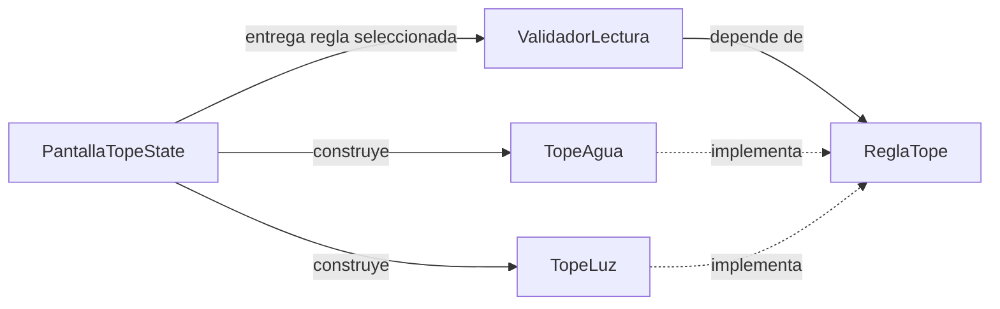
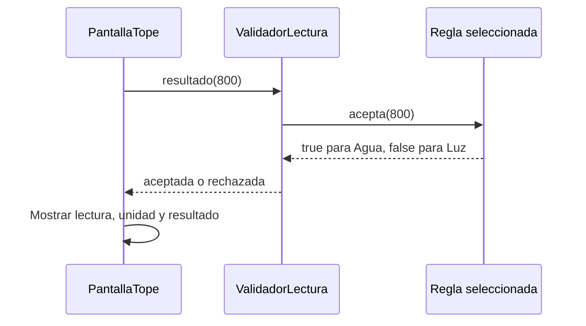

# Ecotrack_patrones — Strategy

En [`strategy.dart`](ecotrack_patrones/lib/casos/strategy.dart), el mismo validador trabaja con dos reglas: agua y luz. **Strategy** encapsula reglas intercambiables detrás de un contrato y permite al contexto delegar en la regla elegida.

## Componentes y Roles

| Componente | Papel |
|---|---|
| `ReglaTope` | Contrato de estrategia: `nombre`, `unidad` y `acepta(double valor)` |
| `TopeAgua` | Estrategia concreta: acepta `valor > 0 && valor <= 10000` |
| `TopeLuz` | Estrategia concreta: acepta `valor > 0 && valor <= 500` |
| `ValidadorLectura` | Contexto que recibe una `ReglaTope` y delega la decisión |
| `_PantallaTopeState` | Cliente: prepara las estrategias, conserva la seleccionada y el valor |
| `SegmentedButton` y `Slider` | Permitir cambiar la estrategia y la lectura desde la interfaz |

El contrato reúne la decisión y los metadatos que necesita esta pantalla para nombrar la regla y mostrar su unidad.

## Dirección de Dependencias

El validador conoce `ReglaTope`, no necesita comprobar si recibió agua o luz. Las dos estrategias implementan el contrato y desconocen a la pantalla y al validador que las usa. La pantalla conoce las clases concretas porque prepara las opciones disponibles.

El `if` de `ValidadorLectura.resultado` decide qué texto devolver según el booleano recibido. No contiene los umbrales de agua y luz ni elige estrategias por su tipo.

## Flujo de Comunicación

1. El `State` crea `_reglas = [TopeAgua(), TopeLuz()]`.
2. `_regla` comienza con la primera estrategia y `_valor` con `800`.
3. En `build()`, la pantalla construye `ValidadorLectura(_regla)` y llama a `resultado(_valor)`.
4. El validador llama a `regla.acepta(valor)`.
5. La estrategia devuelve `true` o `false`; el validador lo traduce a `aceptada` o `rechazada`.
6. El usuario cambia el segmento. `setState` actualiza `_regla` y la siguiente reconstrucción crea un validador con la nueva estrategia.
7. Mover el slider actualiza `_valor` y vuelve a evaluar la estrategia seleccionada.

La estrategia está en un campo `final` del validador. Este ejemplo no cambia la regla dentro del mismo objeto `ValidadorLectura`: crea otro durante la reconstrucción. El diseño sigue permitiendo intercambiar el comportamiento que usa la misma clase de contexto.

## Reglas Exactas

| Valor | Agua | Luz |
|---|---|---|
| `0` o negativo | Rechazada | Rechazada |
| `500` | Aceptada | Aceptada |
| `800` | Aceptada | Rechazada |
| `10000` | Aceptada | Rechazada |
| Mayor que `10000` | Rechazada | Rechazada |

Estos límites son los de **ecotrack_patrones**. No deben deducirse de otros proyectos EcoTrack del repositorio.

El slider llega a `1200`, así que permite ver el límite de luz y comparar `800`, pero no alcanza el límite de agua de `10000`. Además, la pantalla redondea el valor mostrado a cero decimales; el slider y la validación conservan el `double` real, sin redondearlo antes de comparar.

## Ventajas, Costos y Combinaciones

| Ventaja | Costo o límite |
|---|---|
| El contexto reutiliza la misma operación con reglas distintas | Cada nueva regla requiere otra implementación y agregarla a las opciones de la pantalla |
| Los umbrales viven en cada estrategia | Introduce contrato y clases para un ejemplo pequeño |
| Las reglas se prueban sin interfaz | El widget no permite recorrer todos los umbrales existentes |

La inyección por constructor permite entregar la regla. Strategy describe la delegación en esa regla intercambiable. Factory, en cambio, decide cómo construir un objeto; Adapter traduce el formato de otro componente.

## Prueba Existente y Repaso

`el mismo validador, dos reglas`, en [`casos_test.dart`](ecotrack_patrones/test/casos_test.dart), comprueba que `800` es aceptada para agua y rechazada para luz. Utiliza dos validadores de la misma clase con estrategias distintas. No monta el selector, no mueve el slider ni comprueba los límites `0`, `500` o `10000`.

Para repasar: ¿quién elige la estrategia?, ¿quién contiene el umbral?, ¿por qué el validador no cambia entre agua y luz?, ¿se reemplaza la estrategia del mismo validador o se crea otro objeto?

[Anterior: Observer](06%20-%20Ecotrack_patrones%20-%20Observer.md) · [Siguiente: pruebas](08%20-%20Ecotrack_patrones%20-%20Pruebas%20y%20dependencias.md) · [Índice](README.md).
