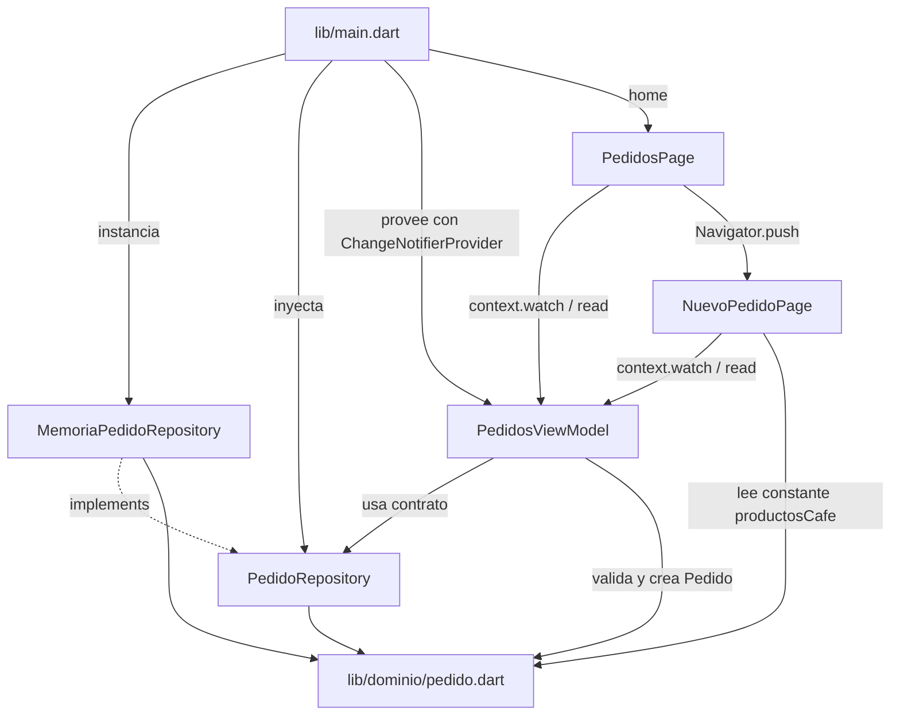
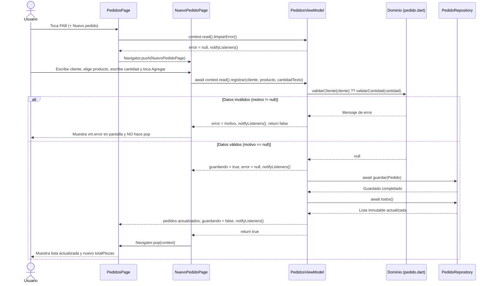

# Cafe_utez — Explicación de Componentes, Arquitectura y Flujos

La aplicación [`cafe_utez`](cafe_utez/) gestiona los pedidos pendientes de la **Cafetería UTEZ** aplicando una **arquitectura en tres capas** (`dominio`, `datos`, `presentacion`), el patrón **MVVM** en presentación, el patrón **Repository** para abstraer el almacenamiento, el patrón **Observer** mediante `ChangeNotifier` e **inyección y distribución de dependencias** en el árbol de widgets mediante el paquete `provider`.

---

## 1. Mapa General de Archivos y Responsabilidades

```text
cafe_utez/
├── lib/
│   ├── dominio/
│   │   └── pedido.dart
│   ├── datos/
│   │   ├── pedido_repository.dart
│   │   └── memoria_pedido_repository.dart
│   ├── presentacion/
│   │   ├── pedidos_view_model.dart
│   │   ├── pedidos_page.dart
│   │   └── nuevo_pedido_page.dart
│   └── main.dart
├── test/
│   └── pedidos_view_model_test.dart
├── pubspec.yaml
└── verificar_practica.sh
```

| Archivo | Capa / Rol | Responsabilidad Principal | Qué desconoce |
|---|---|---|---|
| [`lib/dominio/pedido.dart`](cafe_utez/lib/dominio/pedido.dart) | **Dominio** | Entidad inmutable `Pedido`, constantes (`productosCafe`, `cantidadMaxima`) y reglas `validarCliente` / `validarCantidad` | Flutter, widgets, `provider` y cómo se guardan los datos |
| [`lib/datos/pedido_repository.dart`](cafe_utez/lib/datos/pedido_repository.dart) | **Datos (Contrato)** | Interfaz abstracta `PedidoRepository` con `guardar`, `entregar` y `todos` | Cómo se almacenan realmente los pedidos y toda la capa de presentación |
| [`lib/datos/memoria_pedido_repository.dart`](cafe_utez/lib/datos/memoria_pedido_repository.dart) | **Datos (Implementación)** | Almacenamiento en memoria (`_pedidos`) e inmutabilidad hacia afuera (`List.unmodifiable`) | Widgets, `ChangeNotifier` y quién consume los pedidos |
| [`lib/presentacion/pedidos_view_model.dart`](cafe_utez/lib/presentacion/pedidos_view_model.dart) | **Presentación (ViewModel)** | Estado compartido (`pedidos`, `error`, `guardando`), estado derivado (`totalPiezas`), conversión de texto y coordinación | Widgets concretos (`material.dart`), `BuildContext`, `provider` y `MemoriaPedidoRepository` |
| [`lib/presentacion/pedidos_page.dart`](cafe_utez/lib/presentacion/pedidos_page.dart) | **Presentación (Vista 1)** | Mostrar totales y lista de pedidos pendientes (`watch`), entregar pedidos (`read`) y navegar al formulario (`push`) | Capa `datos/` y cómo se implementan las validaciones |
| [`lib/presentacion/nuevo_pedido_page.dart`](cafe_utez/lib/presentacion/nuevo_pedido_page.dart) | **Presentación (Vista 2)** | Capturar cliente, producto y cantidad (estado efímero), invocar `registrar` (`read`), mostrar errores (`watch`) y regresar (`pop`) | Capa `datos/` y reglas internas del dominio |
| [`lib/main.dart`](cafe_utez/lib/main.dart) | **Composición / Raíz** | Elegir `MemoriaPedidoRepository`, inyectarlo en `CafeUtezApp` y colgar `PedidosViewModel` con `ChangeNotifierProvider` arriba de `MaterialApp` | Detalles internos de validación o de los campos del formulario |
| [`test/pedidos_view_model_test.dart`](cafe_utez/test/pedidos_view_model_test.dart) | **Pruebas Unitarias** | Comprobar en aislamiento (Preparar / Actuar / Comprobar) que `registrar` guarda en el repositorio, calcula `totalPiezas` y notifica listeners | Interfaz gráfica, árbol de widgets y navegación |

---

## 2. Dirección de Dependencias de Código

En el siguiente diagrama, cada flecha continua indica `import` (conocimiento directo de código) y la flecha punteada indica cumplimiento de interfaz (`implements`):



### Reglas arquitectónicas clave que se cumplen:
1. **`dominio/` y `datos/` son Dart puro:** Ninguno importa `package:flutter/...`. Pueden ejecutarse en consola o en pruebas unitarias ultrarrápidas.
2. **Inversión de control en el ViewModel:** `PedidosViewModel` solo importa `pedido_repository.dart` (el contrato abstracto). Nunca importa `memoria_pedido_repository.dart`.
3. **Aislamiento de `main.dart`:** El único archivo de `lib/` que importa `MemoriaPedidoRepository` es `lib/main.dart`. Si mañana se cambia por una base de datos SQLite o una API REST, las vistas y el ViewModel no sufren ningún cambio.

---

## 3. Explicación Detallada Componente por Componente

### 3.1 Capa de Dominio ([`lib/dominio/pedido.dart`](cafe_utez/lib/dominio/pedido.dart))

Contiene los conceptos y reglas de negocio de la cafetería:

1. **Constantes del dominio:**
   - `productosCafe = ['Café', 'Torta', 'Jugo', 'Galletas']`: Catálogo fijo de productos. No es estado porque no muta durante la ejecución.
   - `cantidadMaxima = 5`: Límite de piezas permitidas por pedido.
2. **Entidad `Pedido`:**
   - Tiene constructor `const` y propiedades inmutables (`final String cliente`, `final String producto`, `final int cantidad`).
   - Una vez creado un `Pedido`, sus datos no pueden alterarse accidentalmente.
3. **Regla `String? validarCliente(String cliente)`:**
   - Primero limpia espacios en los extremos con `cliente.trim()`. Así evita que un texto como `' Al '` (4 caracteres con espacios, pero solo 2 letras) engañe a la validación.
   - Si queda vacío, devuelve `'Escribe el nombre del cliente'`.
   - Si tiene menos de 3 caracteres reales, devuelve `'El nombre debe tener al menos 3 letras'`.
   - Si cumple todo, devuelve `null` (en este diseño, `null` significa **ausencia de error**).
4. **Regla `String? validarCantidad(int? cantidad)`:**
   - Recibe `int?` (anulable) en vez de `String`, porque la responsabilidad de parsear el texto de la interfaz (`int.tryParse`) pertenece al ViewModel, mientras que el dominio evalúa valores numéricos o la ausencia de ellos.
   - Si recibe `null`, devuelve `'Escribe la cantidad con número'`.
   - Si es menor que `1` o mayor que `cantidadMaxima` (`5`), devuelve `'La cantidad debe ser de 1 a 5'`.
   - En caso válido, devuelve `null`.

---

### 3.2 Capa de Datos ([`pedido_repository.dart`](cafe_utez/lib/datos/pedido_repository.dart) y [`memoria_pedido_repository.dart`](cafe_utez/lib/datos/memoria_pedido_repository.dart))

Divide el almacenamiento en dos piezas:

1. **El Contrato (`abstract class PedidoRepository`):**
   - `Future<void> guardar(Pedido pedido)`: Promete almacenar un nuevo pedido al final.
   - `Future<void> entregar(int indice)`: Promete eliminar el pedido ubicado en esa posición cuando se entrega.
   - `Future<List<Pedido>> todos()`: Promete devolver la lista actual de pedidos pendientes.
   - Todos los métodos devuelven `Future` porque el contrato está preparado para fuentes asíncronas reales (red, disco, base de datos).

2. **La Implementación (`MemoriaPedidoRepository`):**
   - Mantiene la lista privada `final List<Pedido> _pedidos = []`, que actúa como la **única fuente de verdad** (*Single Source of Truth*).
   - Sus métodos están marcados con `async` para envolver automáticamente las operaciones sincrónicas de la lista en un `Future`.
   - En `todos()` devuelve `List.unmodifiable(_pedidos)`. Esto impide que el ViewModel o una vista hagan `pedidos.add(...)` o `pedidos.clear()` por fuera sin pasar por los métodos del repositorio.

---

### 3.3 El ViewModel ([`lib/presentacion/pedidos_view_model.dart`](cafe_utez/lib/presentacion/pedidos_view_model.dart))

`PedidosViewModel` extiende `ChangeNotifier` (de `package:flutter/foundation.dart`) para implementar el patrón **Observer**:

#### Propiedades de estado compartido y derivado:
- `List<Pedido> pedidos = []`: Copia de presentación de la lista de pedidos obtenida del repositorio.
- `String? error`: Mensaje de error vigente cuando falla una validación, o `null` si no hay error.
- `bool guardando = false`: Bandera para desactivar el botón **Agregar** mientras se ejecuta el guardado asíncrono.
- `int get totalPiezas => pedidos.fold(0, (suma, p) => suma + p.cantidad)`: **Estado derivado** calculado al vuelo mediante un `getter`. Nunca se almacena en una variable separada para evitar que se desincronice respecto a `pedidos`.

#### Métodos de coordinación:
1. **`cargar()`:** Consulta `_repositorio.todos()`, actualiza `pedidos` y llama a `notifyListeners()`. Se invoca en cascada (`..cargar()`) al crear el ViewModel.
2. **`registrar(String cliente, String producto, String cantidadTexto)`:**
   - Convierte `cantidadTexto.trim()` a `int?` con `int.tryParse`.
   - Encadena las reglas de validación con el operador de coalescencia nula (`??`):
     ```dart
     final motivo = validarCliente(cliente) ?? validarCantidad(cantidad);
     ```
     Si `validarCliente` falla, devuelve su mensaje inmediatamente sin evaluar `validarCantidad`. Si `validarCliente` devuelve `null` (válido), pasa a evaluar `validarCantidad`.
   - **Camino inválido (`motivo != null`):** Asigna `error = motivo`, avisa con `notifyListeners()` y retorna `false` sin tocar el repositorio.
   - **Camino válido:**
     1. Activa `guardando = true`, limpia `error = null` y hace el **primer aviso** (`notifyListeners()`) para que la vista deshabilite el botón.
     2. Espera `await _repositorio.guardar(...)` enviando `cliente.trim()` y `cantidad!`.
     3. Relee la fuente de verdad con `pedidos = await _repositorio.todos()`.
     4. Restablece `guardando = false`, hace el **segundo aviso** (`notifyListeners()`) y retorna `true`.
3. **`limpiarError()`:** Pone `error = null` y avisa con `notifyListeners()`. Se llama justo antes de abrir el formulario para limpiar errores de intentos previos.
4. **`entregar(int indice)`:** Llama a `_repositorio.entregar(indice)`, vuelve a consultar `_repositorio.todos()` y notifica a los oyentes para refrescar la lista y los totales.

---

### 3.4 Composición e Inyección en `main.dart` ([`lib/main.dart`](cafe_utez/lib/main.dart))

```dart
class CafeUtezApp extends StatelessWidget {
  const CafeUtezApp({super.key, required this.repositorio});

  final PedidoRepository repositorio;

  @override
  Widget build(BuildContext context) {
    return ChangeNotifierProvider(
      create: (_) => PedidosViewModel(repositorio)..cargar(),
      child: MaterialApp(
        title: 'Cafetería UTEZ',
        theme: ThemeData(colorSchemeSeed: Colors.brown),
        home: const PedidosPage(),
      ),
    );
  }
}
```

#### Decisiones críticas de diseño en `main.dart`:
1. **Inyección de `repositorio` en el constructor de `CafeUtezApp`:** Permite que en producción `main()` inyecte `MemoriaPedidoRepository()`, mientras que en las pruebas de widgets el docente pueda inyectar un repositorio espía o pre-poblado.
2. **Operador cascada `..cargar()`:** Ejecuta `cargar()` sobre la instancia recién creada de `PedidosViewModel` y devuelve esa misma instancia del ViewModel al callback `create` de `ChangeNotifierProvider`.
3. **`ChangeNotifierProvider` por encima de `MaterialApp`:**
   - `MaterialApp` crea internamente el `Navigator` donde se apilan todas las pantallas abiertas con `Navigator.push`.
   - Cuando `PedidosPage` hace `Navigator.push` hacia `NuevoPedidoPage`, la nueva ruta se inserta como hija del `Navigator` (hermana de `PedidosPage`, no hija de `PedidosPage`).
   - Al colocar `ChangeNotifierProvider` **arriba de `MaterialApp`**, el proveedor envuelve al `Navigator` completo y todas las rutas presentes y futuras pueden acceder al mismo `PedidosViewModel`.

---

### 3.5 Vista 1: Lista de Pedidos ([`lib/presentacion/pedidos_page.dart`](cafe_utez/lib/presentacion/pedidos_page.dart))

Es un `StatelessWidget` porque no posee estado efímero propio:

- **Lectura reactiva en `build` (`context.watch`):**
  ```dart
  final vm = context.watch<PedidosViewModel>();
  ```
  Suscribe a `PedidosPage` a los avisos del ViewModel. Cada vez que se agrega o entrega un pedido, `build` se vuelve a ejecutar automáticamente.
- **Encabezado de totales:** Muestra `'Pedidos: ${vm.pedidos.length} · Piezas: ${vm.totalPiezas}'`.
- **`Expanded` + estado vacío o `ListView.builder`:**
  - Como está dentro de un `Column`, el `ListView.builder` necesita estar envuelto en `Expanded` para recibir una altura acotada.
  - Si `vm.pedidos.isEmpty` es `true`, muestra `'Sin pedidos'` centrado.
- **Acciones en callbacks con `context.read`:**
  - En el botón de entregar (`Key('entregar_$i')`):
    ```dart
    onPressed: () => context.read<PedidosViewModel>().entregar(i),
    ```
  - En el `FloatingActionButton.extended` (`Key('nuevo')`):
    ```dart
    onPressed: () {
      context.read<PedidosViewModel>().limpiarError();
      Navigator.push(
        context,
        MaterialPageRoute(builder: (_) => const NuevoPedidoPage()),
      );
    },
    ```
    Se usa `context.read` porque dentro de un callback de evento solo se desea disparar una acción, no registrar una suscripción de reconstrucción.

---

### 3.6 Vista 2: Formulario y Navegación ([`lib/presentacion/nuevo_pedido_page.dart`](cafe_utez/lib/presentacion/nuevo_pedido_page.dart))

Es un `StatefulWidget` únicamente porque administra **estado efímero local** que no le interesa al resto de la aplicación:
- `_cliente` (`TextEditingController`)
- `_cantidad` (`TextEditingController`)
- `_producto` (`String`, inicializado en `productosCafe.first`)

#### Ciclo de vida y flujo de guardado:
1. **`dispose()`:** Libera `_cliente.dispose()` y `_cantidad.dispose()` cuando la ruta sale de la pila de navegación para evitar fugas de memoria.
2. **Método `_agregar()`:**
   ```dart
   Future<void> _agregar() async {
     final ok = await context.read<PedidosViewModel>().registrar(
       _cliente.text,
       _producto,
       _cantidad.text,
     );
     if (!ok || !mounted) return;
     Navigator.pop(context);
   }
   ```
   - Si la validación falla (`ok == false`), no hace `pop`; permanece en el formulario y el `context.watch<PedidosViewModel>()` en `build` dibuja el texto con `vm.error!`.
   - Si tuvo éxito (`ok == true`) y el widget sigue montado (`mounted`), ejecuta `Navigator.pop(context)` para desapilar el formulario. Como `PedidosPage` seguía abajo escuchando al mismo `PedidosViewModel`, ya muestra el pedido recién agregado sin necesidad de pasarle datos por `pop`.

---

## 4. Diagrama de Secuencia del Flujo Completo



---

## 5. Los Cuatro Tipos de Estado en `cafe_utez`

| Tipo de Estado | Dónde Vive | Cómo se Actualiza | Quién lo Consume |
|---|---|---|---|
| **1. Efímero (Local de UI)** | `_NuevoPedidoPageState` (`_cliente`, `_cantidad`, `_producto`) | Controladores de texto y `setState(() => _producto = p!)` | Solo `NuevoPedidoPage` |
| **2. Compartido de Presentación** | `PedidosViewModel` (`pedidos`, `error`, `guardando`) | Asignación en métodos del ViewModel + `notifyListeners()` | `PedidosPage` y `NuevoPedidoPage` vía `context.watch` |
| **3. Derivado (Calculado)** | `PedidosViewModel.totalPiezas` | Getter con `.fold(...)` sobre `pedidos` en cada lectura | `PedidosPage` en el encabezado |
| **4. Persistido (Fuente de Verdad)** | `MemoriaPedidoRepository._pedidos` | Métodos `guardar(pedido)` y `entregar(indice)` | `PedidosViewModel` a través de `todos()` |

---

## 6. Prueba Unitaria y Verificación Estática

### 6.1 Prueba Unitaria ([`test/pedidos_view_model_test.dart`](cafe_utez/test/pedidos_view_model_test.dart))
Sigue el patrón **AAA (Arrange / Act / Assert — Preparar / Actuar / Comprobar)**:
1. **Preparar:** Crea `MemoriaPedidoRepository()`, lo inyecta en `PedidosViewModel(repositorio)` y suscribe un contador de notificaciones con `vm.addListener(() => avisos++)`.
2. **Actuar:** Llama a `await vm.registrar('Ana', 'Café', '2')`.
3. **Comprobar:**
   - `expect(ok, isTrue)`: El método reportó éxito.
   - `expect(vm.error, isNull)`: No quedó ningún mensaje de error.
   - `expect(vm.pedidos, hasLength(1))`: La lista del ViewModel se actualizó con 1 pedido.
   - `expect(vm.totalPiezas, 2)`: El getter derivado calculó las 2 piezas.
   - `expect((await repositorio.todos()).single.cliente, 'Ana')`: Comprueba que el ViewModel realmente delegó el guardado en el repositorio (la fuente de verdad).
   - `expect(avisos, greaterThan(0))`: Comprueba que se invocó `notifyListeners()`.
   - Finalmente libera el recurso con `vm.dispose()`.

### 6.2 Script de Verificación ([`verificar_practica.sh`](cafe_utez/verificar_practica.sh))
Verifica mediante expresiones regulares sobre el código fuente (ignorando comentarios):
1. Que existan los 7 archivos en `lib/` y `provider` en `pubspec.yaml`.
2. Que `lib/dominio` y `lib/datos` no importen `package:flutter`, que `PedidoRepository` sea abstracto y que `MemoriaPedidoRepository` lo implemente.
3. Que `PedidosViewModel` no importe `material.dart` ni `provider`, extienda `ChangeNotifier`, llame a `notifyListeners()`, desconozca `MemoriaPedidoRepository`, use `validarCliente`/`validarCantidad` y declare `get totalPiezas`.
4. Que ambas vistas usen `context.watch<PedidosViewModel>` para mostrar y `context.read<PedidosViewModel>` para actuar, sin usar `watch` dentro de callbacks (`onPressed`), sin importar `datos/` y sin recibir el ViewModel por constructor.
5. Que `PedidosPage` navegue con `Navigator.push` a `NuevoPedidoPage`, que `NuevoPedidoPage` regrese con `Navigator.pop` y que libere sus controladores en `dispose()`.
6. Que `main.dart` defina `CafeUtezApp`, use `ChangeNotifierProvider` y sea el único archivo que importe `memoria_pedido_repository`.
7. Que exista exactamente **1 prueba** en `test/pedidos_view_model_test.dart`.

---

[Anterior: Práctica guiada pre-examen](01%20-%20Cafe_utez%20-%20Pr%C3%A1ctica%20guiada%20pre-examen.md) · [Índice](README.md).

