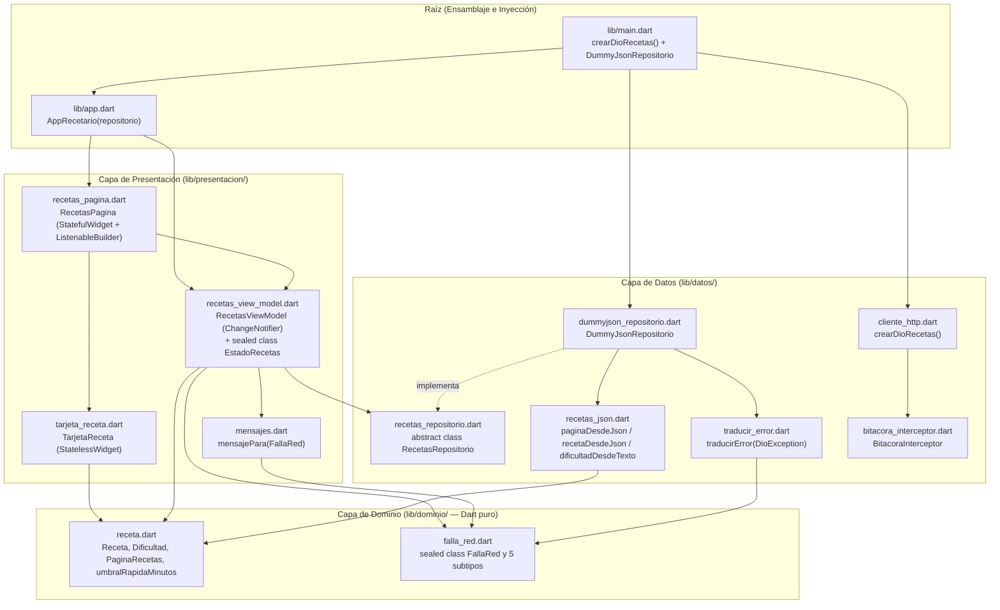
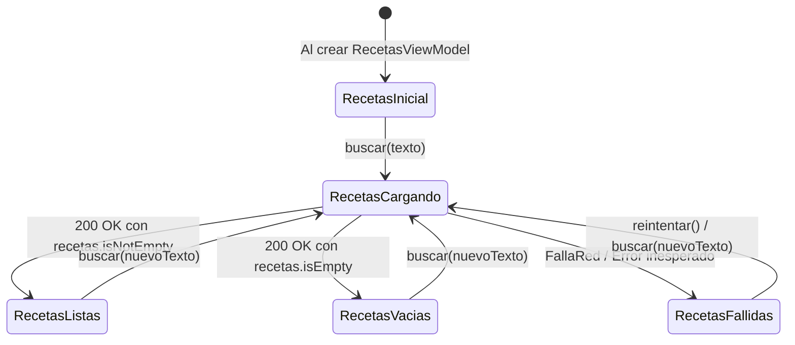
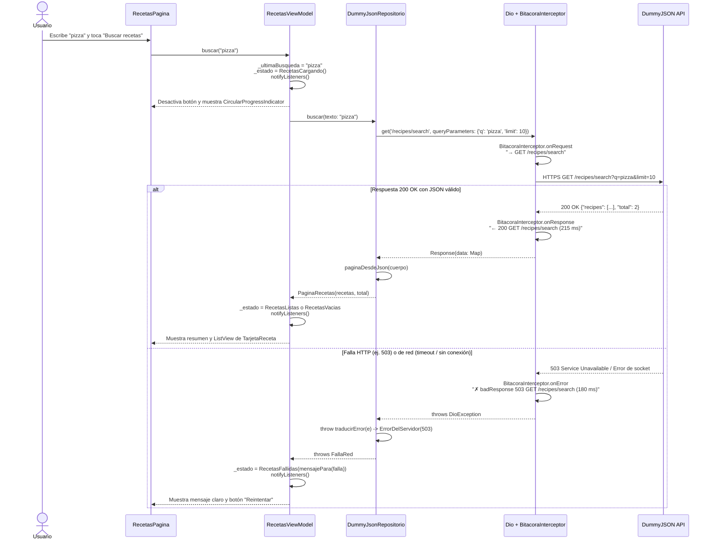

# Explicación de Componentes, Arquitectura y Flujos — `recetario_utez`

Este documento explica cómo está construido el proyecto [`recetario_utez/`](recetario_utez/), qué responsabilidad tiene cada archivo, cómo se transforma y valida el JSON de **DummyJSON Recipes**, cómo funcionan el cliente HTTP **Dio**, el interceptor de bitácora segura y el traductor de errores, y cómo la interfaz reacciona a la máquina de estados sellados del ViewModel.

---

## 1. Propósito de la Práctica y Regla de Oro de las Capas

La aplicación **Recetario UTEZ** consulta recetas reales desde el servicio público `https://dummyjson.com` por HTTPS y está organizada en tres capas estrictas (`dominio/`, `datos/` y `presentacion/`), verificadas automáticamente por [`verificar_recetario.sh`](recetario_utez/verificar_recetario.sh) y por las **55 pruebas** en [`test/`](recetario_utez/test/):

| Capa | Carpeta | Qué contiene | Qué tiene **prohibido** importar o hacer |
|---|---|---|---|
| **Dominio** | [`lib/dominio/`](recetario_utez/lib/dominio/) | Entidades (`Receta`, `PaginaRecetas`), catálogo (`Dificultad`), reglas de negocio (`tiempoTotal`, `esRapida`) y jerarquía sellada de fallas (`FallaRed`) | Prohibido importar `package:flutter/...`, `package:dio/...` o leer mapas JSON (`fromJson`, `json[...]`) |
| **Datos** | [`lib/datos/`](recetario_utez/lib/datos/) | Conversión JSON (`recetas_json.dart`), fábrica de Dio (`cliente_http.dart`), interceptor (`bitacora_interceptor.dart`), traductor de errores (`traducir_error.dart`), contrato (`recetas_repositorio.dart`) e implementación (`dummyjson_repositorio.dart`) | Prohibido importar `package:flutter/...`. Es la **única** capa donde vive `package:dio/dio.dart` |
| **Presentación** | [`lib/presentacion/`](recetario_utez/lib/presentacion/) | Traductor de fallas a mensajes humanos (`mensajes.dart`), ViewModel y estados sellados (`recetas_view_model.dart`), y widgets (`tarjeta_receta.dart`, `recetas_pagina.dart`) | El ViewModel solo usa `foundation.dart` y el contrato `RecetasRepositorio` (nunca `material.dart`, `Dio` ni `DummyJsonRepositorio`). Las vistas jamás importan `lib/datos/` ni muestran excepciones crudas |
| **Raíz / Ensamblaje** | [`lib/app.dart`](recetario_utez/lib/app.dart) y [`lib/main.dart`](recetario_utez/lib/main.dart) | `main.dart` construye `Dio` + `DummyJsonRepositorio` y los inyecta en `AppRecetario` | Ningún otro archivo fuera de `main.dart` puede importar `dummyjson_repositorio.dart` |



---

## 2. Estructura Completa del Proyecto

```text
recetario_utez/
├── pubspec.yaml                              # name: recetario_utez, dependencias: flutter y dio
├── verificar_recetario.sh                    # Verificador estático de 10 puntos (capas, cliente HTTP, bitácora y evidencias)
├── lib/
│   ├── main.dart                             # Punto de entrada: une crearDioRecetas(), DummyJsonRepositorio y AppRecetario
│   ├── app.dart                              # AppRecetario: administra el ciclo de vida de RecetasViewModel y monta MaterialApp
│   ├── dominio/
│   │   ├── receta.dart                       # umbralRapidaMinutos, enum Dificultad, Receta y PaginaRecetas
│   │   └── falla_red.dart                    # sealed class FallaRed y sus 5 subclases finales de negocio
│   ├── datos/
│   │   ├── recetas_json.dart                 # Conversión y validación con pattern matching de JSON a objetos del dominio
│   │   ├── cliente_http.dart                 # urlDummyJson y fábrica crearDioRecetas() con HTTPS, timeouts y bitácora
│   │   ├── bitacora_interceptor.dart         # Interceptor que registra método, ruta, código y ms sin filtrar parámetros
│   │   ├── traducir_error.dart               # Traduce DioException a subtipos de FallaRed
│   │   ├── recetas_repositorio.dart          # Contrato abstracto RecetasRepositorio
│   │   └── dummyjson_repositorio.dart        # Implementación con Dio que consulta /recipes o /recipes/search
│   └── presentacion/
│       ├── mensajes.dart                     # Traduce cada FallaRed en un texto amigable para el usuario
│       ├── recetas_view_model.dart           # EstadoRecetas (sealed) y RecetasViewModel (ChangeNotifier)
│       ├── tarjeta_receta.dart               # Card visual de una receta individual
│       └── recetas_pagina.dart               # Pantalla principal con buscador, estados y lista de tarjetas
├── test/
│   ├── etapa1_dominio_test.dart              # 6 pruebas unitarias del dominio
│   ├── etapa2_json_test.dart                 # 11 pruebas unitarias de parseo y validación JSON
│   ├── etapa3_datos_test.dart                # 19 pruebas del cliente Dio, bitácora, traductor y repositorio
│   ├── etapa4_viewmodel_test.dart            # 11 pruebas de mensajes y máquina de estados del ViewModel
│   ├── etapa5_vistas_test.dart               # 8 pruebas de widgets (TarjetaReceta, RecetasPagina y AppRecetario)
│   └── soporte/
│       ├── adaptador_falso.dart              # HttpClientAdapter en memoria para probar Dio sin salir a internet
│       ├── json_dummy.dart                   # Fixtures JSON de prueba (pizza, salsa, receta rara, error 503)
│       └── repositorio_falso.dart            # Implementación en memoria de RecetasRepositorio con Completer y error inyectable
└── docs/
    ├── evidencias.md                         # Tabla del JSON, los 5 escenarios reales y las 4 preguntas de reflexión
    └── capturas/                             # Capturas reales de los escenarios
```

---

## 3. Análisis Detallado por Capa y Archivo

### 3.1 Capa de Dominio (`lib/dominio/`)

#### [`lib/dominio/receta.dart`](recetario_utez/lib/dominio/receta.dart)

Modela los conceptos centrales del negocio en **Dart puro**:

1. **Constante de regla de negocio (`umbralRapidaMinutos`)**:
   ```dart
   const umbralRapidaMinutos = 30;
   ```
   Evita números mágicos al decidir si una receta es rápida.

2. **Enumeración con etiqueta [`Dificultad`](recetario_utez/lib/dominio/receta.dart#L5-L13)**:
   ```dart
   enum Dificultad {
     facil('Fácil'),
     media('Media'),
     dificil('Difícil'),
     desconocida('Sin dato');

     const Dificultad(this.etiqueta);
     final String etiqueta;
   }
   ```
   Incluye el caso `desconocida('Sin dato')` para tolerar valores nuevos o ausentes del servidor sin romper la lectura de una receta.

3. **Entidad inmutable [`Receta`](recetario_utez/lib/dominio/receta.dart#L15-L43)**:
   - Todos sus campos son `final` y su constructor es `const`.
   - `etiquetas` e `ingredientes` tienen valor por defecto `const []`.
   - **Propiedades calculadas (estado derivado del modelo)**:
     - `int get tiempoTotal => minutosPreparacion + minutosCoccion;`
     - `bool get esRapida => tiempoTotal <= umbralRapidaMinutos;`

4. **Contenedor paginado [`PaginaRecetas`](recetario_utez/lib/dominio/receta.dart#L45-L50)**:
   - Guarda la lista `List<Receta> recetas` devuelta en la página actual y el conteo `int total` reportado por el servidor (por ejemplo, mostrando 3 de 50 recetas).

#### [`lib/dominio/falla_red.dart`](recetario_utez/lib/dominio/falla_red.dart)

Define una jerarquía cerrada (`sealed class`) que implementa `Exception` para representar **qué salió mal en términos del dominio**, ocultando por completo a `DioException`:

```dart
sealed class FallaRed implements Exception {
  const FallaRed();
}
```

| Subclase (`final class`) | Cuándo se produce | Datos que conserva |
|---|---|---|
| [`SinConexion`](recetario_utez/lib/dominio/falla_red.dart#L8-L10) | Falla de socket, DNS, modo avión, certificado o cancelación | Ninguno |
| [`TiempoAgotado`](recetario_utez/lib/dominio/falla_red.dart#L12-L14) | Se vence `connectTimeout`, `sendTimeout` o `receiveTimeout` | Ninguno |
| [`ErrorDelServidor`](recetario_utez/lib/dominio/falla_red.dart#L17-L20) | Respuesta HTTP con código `>= 500` (ej. `500`, `503`) | `final int codigo` |
| [`PeticionRechazada`](recetario_utez/lib/dominio/falla_red.dart#L22-L25) | Respuesta HTTP con código `< 500` (ej. `404`) | `final int codigo` |
| [`RespuestaInvalida`](recetario_utez/lib/dominio/falla_red.dart#L27-L29) | El servidor respondió `200`, pero el cuerpo no es un objeto JSON válido o incumple el contrato de tipos | Ninguno |

Al ser `sealed`, el compilador obliga a que cualquier `switch (falla)` en la capa de presentación cubra exhaustivamente los 5 casos.

---

### 3.2 Capa de Datos (`lib/datos/`)

#### [`lib/datos/recetas_json.dart`](recetario_utez/lib/datos/recetas_json.dart)

Convierte mapas JSON (`Map<String, dynamic>`) en objetos del dominio diferenciando entre **datos tolerables** y **datos obligatorios**:

- **Tolerancia en [`dificultadDesdeTexto`](recetario_utez/lib/datos/recetas_json.dart#L6-L11)**:
  ```dart
  Dificultad dificultadDesdeTexto(Object? valor) => switch (valor) {
    'Easy' => Dificultad.facil,
    'Medium' => Dificultad.media,
    'Hard' => Dificultad.dificil,
    _ => Dificultad.desconocida,
  };
  ```
  Si el servidor envía `'Extreme'`, `null` o `3`, devuelve `Dificultad.desconocida` sin lanzar excepción.

- **Validación con patrón de mapa en [`recetaDesdeJson`](recetario_utez/lib/datos/recetas_json.dart#L13-L42)**:
  En lugar de hacer casts inseguros (`json['id'] as int`), utiliza un `switch (json)` con desestructuración y tipos exactos:
  ```dart
  switch (json) {
    case {
      'id': int id,
      'name': String nombre,
      'cuisine': String cocina,
      'prepTimeMinutes': int preparacion,
      'cookTimeMinutes': int coccion,
      'servings': int porciones,
      'rating': num calificacion,
    }:
      return Receta(
        ...
        calificacion: calificacion.toDouble(),
        etiquetas: _listaDeTextos(json['tags'], 'tags'),
        ingredientes: _listaDeTextos(json['ingredients'], 'ingredients'),
      );
    default:
      throw const FormatException(
        'Receta con campos obligatorios ausentes o de tipo equivocado',
      );
  }
  ```
  - `'rating': num calificacion` acepta tanto enteros (`5`) como decimales (`4.6`) y luego los normaliza con `.toDouble()`.
  - [`_listaDeTextos`](recetario_utez/lib/datos/recetas_json.dart#L61-L74) permite que `tags` o `ingredients` vengan ausentes (`null` → `const []`), pero si el campo existe exige que sea `List<dynamic>` y que cada elemento sea `String`.

- **Conversión de página ([`paginaDesdeJson`](recetario_utez/lib/datos/recetas_json.dart#L44-L58))**:
  Verifica con el patrón `case {'recipes': List<dynamic> lista, 'total': int total}:` que existan ambas llaves y que cada elemento de `recipes` sea un `Map<String, dynamic>` antes de invocar `recetaDesdeJson`. Si `recipes` viene vacía (`[]`), retorna `PaginaRecetas(recetas: [], total: 0)` sin error.

#### [`lib/datos/cliente_http.dart`](recetario_utez/lib/datos/cliente_http.dart)

Configura una instancia prudente de `Dio`:

```dart
const urlDummyJson = 'https://dummyjson.com';

Dio crearDioRecetas({List<Interceptor> interceptores = const []}) {
  final dio = Dio(
    BaseOptions(
      baseUrl: urlDummyJson,
      connectTimeout: const Duration(seconds: 10),
      receiveTimeout: const Duration(seconds: 15),
    ),
  );
  dio.interceptors
    ..add(BitacoraInterceptor())
    ..addAll(interceptores);
  return dio;
}
```

- Usa exclusivamente **HTTPS** (`https://dummyjson.com`).
- Define `connectTimeout` (10 s) y `receiveTimeout` (15 s) para que la app jamás se quede esperando indefinidamente.
- Registra primero `BitacoraInterceptor()` y después los `interceptores` adicionales.

#### [`lib/datos/bitacora_interceptor.dart`](recetario_utez/lib/datos/bitacora_interceptor.dart)

Extiende `Interceptor` de Dio para registrar el tráfico HTTP **sin filtrar información sensible ni términos de búsqueda**:

- Si no recibe el callback `escribir`, usa `developer.log(linea, name: 'recetario')` de `dart:developer`.
- **En `onRequest`**: guarda un `Stopwatch()..start()` en `options.extra['bitacora_cronometro']`, escribe `'→ ${options.method} ${options.path}'` y llama `handler.next(options)`.
- **En `onResponse`**: lee los milisegundos del `Stopwatch`, escribe `'← ${response.statusCode} ${pedido.method} ${pedido.path} (${_milisegundos(pedido)} ms)'` y llama `handler.next(response)`.
- **En `onError`**: extrae `err.response?.statusCode` (si existe lo incluye, si no lo omite), escribe `'✗ ${err.type.name}${codigo == null ? '' : ' $codigo'} ${pedido.method} ${pedido.path} (${_milisegundos(pedido)} ms)'` y llama `handler.next(err)`.
- **Privacidad por diseño**: nunca accede a `options.uri`, `options.queryParameters`, `options.headers` ni `response.data`. Así, cuando alguien busca `'enchiladas'`, en la bitácora solo aparece `→ GET /recipes/search`, nunca el parámetro `q`.

#### [`lib/datos/traducir_error.dart`](recetario_utez/lib/datos/traducir_error.dart)

Función pura [`FallaRed traducirError(DioException e)`](recetario_utez/lib/datos/traducir_error.dart#L5-L26) que inspecciona `e.type` con un `switch` exhaustivo:

- Timeouts (`connectionTimeout`, `sendTimeout`, `receiveTimeout`, `transformTimeout`) → `const TiempoAgotado()`.
- `badResponse`:
  - `codigo >= 500` → `ErrorDelServidor(codigo)`
  - otro código → `PeticionRechazada(codigo)`
- `unknown`: si `e.error is FormatException` (por ejemplo, cuando Dio falla al decodificar JSON mal formado) → `const RespuestaInvalida()`; en otro caso → `const SinConexion()`.
- `connectionError`, `badCertificate`, `cancel` → `const SinConexion()`.

#### [`lib/datos/recetas_repositorio.dart`](recetario_utez/lib/datos/recetas_repositorio.dart) y [`lib/datos/dummyjson_repositorio.dart`](recetario_utez/lib/datos/dummyjson_repositorio.dart)

- `RecetasRepositorio` define el contrato abstracto `Future<PaginaRecetas> buscar({String texto = ''});`.
- `DummyJsonRepositorio` implementa el contrato usando `_dio`:
  1. Limpia el texto con `final limpio = texto.trim();`.
  2. Decide ruta y `queryParameters` sin concatenar strings en la URL:
     - Si `limpio.isEmpty`: ruta `'/recipes'`, `queryParameters: {'limit': recetasPorPagina}`.
     - Si tiene texto: ruta `'/recipes/search'`, `queryParameters: {'q': limpio, 'limit': recetasPorPagina}`.
  3. Valida que `respuesta.data` sea `Map<String, dynamic>` y delega en `paginaDesdeJson`.
  4. Captura `DioException` (y lanza `traducirError(e)`) y `FormatException` (y lanza `const RespuestaInvalida()`).

---

### 3.3 Capa de Presentación (`lib/presentacion/`)

#### [`lib/presentacion/mensajes.dart`](recetario_utez/lib/presentacion/mensajes.dart)

Separa los textos de interfaz de la lógica del ViewModel mediante un `switch` exhaustivo sobre `FallaRed`:

```dart
const mensajeInesperado = 'Algo salió mal. Intenta de nuevo.';

String mensajePara(FallaRed falla) => switch (falla) {
  SinConexion() => 'Sin conexión. Revisa tu red e intenta de nuevo.',
  TiempoAgotado() =>
    'El recetario tardó demasiado en responder. Intenta de nuevo.',
  ErrorDelServidor(:final codigo) =>
    'El recetario no está disponible ($codigo). Intenta más tarde.',
  PeticionRechazada() =>
    'No pudimos hacer esa búsqueda. Avisa al equipo de desarrollo.',
  RespuestaInvalida() => 'Las recetas llegaron con un formato inesperado.',
};
```

#### [`lib/presentacion/recetas_view_model.dart`](recetario_utez/lib/presentacion/recetas_view_model.dart)

Modela los estados de la pantalla con una **jerarquía sellada (`EstadoRecetas`)** en lugar de banderas booleanas sueltas (`bool cargando`, `String? error`, `List? datos`), haciendo imposible caer en estados contradictorios:



Puntos clave de [`RecetasViewModel`](recetario_utez/lib/presentacion/recetas_view_model.dart#L37-L86):
- **Estado único**: `EstadoRecetas _estado = const RecetasInicial();`.
- **Estado derivado**:
  - `bool get cargando => _estado is RecetasCargando;`
  - `int get rapidas`: usa `switch (_estado)` para contar `recetas.where((r) => r.esRapida).length` cuando está en `RecetasListas`, y `0` en cualquier otro estado.
- **Protección contra doble toque**: al inicio de `buscar`, `if (cargando) return;` ignora llamadas concurrentes mientras una petición sigue en vuelo.
- **Exactamente dos notificaciones por búsqueda** (y protección tras `dispose()` con `if (!_liberado) notifyListeners();`).

#### [`lib/presentacion/tarjeta_receta.dart`](recetario_utez/lib/presentacion/tarjeta_receta.dart) y [`lib/presentacion/recetas_pagina.dart`](recetario_utez/lib/presentacion/recetas_pagina.dart)

- **[`TarjetaReceta`](recetario_utez/lib/presentacion/tarjeta_receta.dart#L5-L41)**: `StatelessWidget` que recibe una `Receta` y dibuja un `Card` con su nombre, subtítulo `'${receta.cocina} · ${receta.dificultad.etiqueta}'`, tiempo total y porciones, calificación formateada a un decimal (`receta.calificacion.toStringAsFixed(1)`) y `Chip(label: Text('Rápida'))` condicional (`if (receta.esRapida)`).
- **[`RecetasPagina`](recetario_utez/lib/presentacion/recetas_pagina.dart#L6-L98)**: `StatefulWidget` que administra únicamente el `TextEditingController` del campo `Key('busqueda')` (liberándolo en `dispose()`) y escucha al ViewModel con `ListenableBuilder(listenable: vm, ...)`, desactivando el botón `Key('buscar')` cuando `vm.cargando` es `true` y construyendo el contenido con un `switch (vm.estado)` exhaustivo sobre los 5 subtipos de `EstadoRecetas`.

---

## 4. Flujo Completo de una Búsqueda y Manejo de Errores



---

## 5. Suite de 55 Pruebas Automatizadas (`test/`)

El proyecto incluye las 55 pruebas del kit oficial divididas en las 5 etapas:

| Archivo de prueba | Qué verifica | Pruebas |
|---|---|---|
| [`test/etapa1_dominio_test.dart`](recetario_utez/test/etapa1_dominio_test.dart) | Constructor de `Receta`, listas por defecto vacías, `tiempoTotal`, umbral de `esRapida` (30 sí, 31 no), etiquetas en español de `Dificultad`, `PaginaRecetas` y las 5 subclases de `FallaRed` | 6 |
| [`test/etapa2_json_test.dart`](recetario_utez/test/etapa2_json_test.dart) | `dificultadDesdeTexto` (valores conocidos y desconocidos), `recetaDesdeJson` (completa, `rating` entero como `double`, sin `tags`/`ingredients`, dificultad rara, campos obligatorios faltantes → `FormatException`, tipos erróneos → `FormatException`) y `paginaDesdeJson` | 11 |
| [`test/etapa3_datos_test.dart`](recetario_utez/test/etapa3_datos_test.dart) | `crearDioRecetas` (HTTPS, timeouts, interceptores), `BitacoraInterceptor` (formato `→`, `←`, `✗` y que no filtre `enchiladas` ni `limit`), y `DummyJsonRepositorio` con `AdaptadorFalso` (rutas `/recipes` y `/recipes/search`, `trim`, códigos 200, 503, 500, 404, `connectionError`, timeouts y JSON malformado) | 19 |
| [`test/etapa4_viewmodel_test.dart`](recetario_utez/test/etapa4_viewmodel_test.dart) | `mensajePara` para cada `FallaRed`, estado inicial sin búsqueda automática, transición `Inicial → Cargando → Listas` con exactamente 2 avisos, limpieza de espacios, protección contra doble búsqueda simultánea, `reintentar()` y cálculo derivado de `rapidas` | 11 |
| [`test/etapa5_vistas_test.dart`](recetario_utez/test/etapa5_vistas_test.dart) | `TarjetaReceta` (textos exactos, redondeo a 1 decimal, insignia `Rápida`), `RecetasPagina` (estado inicial, indicador de carga y botón desactivado, mensajes de vacío con y sin texto, error + botón `Reintentar`, búsqueda con `TextInputAction.search`) y `AppRecetario` | 8 |

---

## 6. Verificación de Cumplimiento

Desde [`recetario_utez/`](recetario_utez/):

```bash
bash verificar_recetario.sh
flutter analyze
flutter test -r expanded
```

- **`verificar_recetario.sh`**: los 10 bloques de revisión arquitectónica (archivos del contrato, dominio puro, Dio aislado en `lib/datos`, cliente HTTP prudente, bitácora sin fuga de datos, ViewModel desacoplado, vistas limpias, `main.dart` como único punto de ensamblaje, permiso `INTERNET` en Android y evidencias completas en `docs/`) reportan **`Resultado: todo OK`**.
- **`flutter analyze`**: `No issues found!`.
- **`flutter test -r expanded`**: `All 55 tests passed!`.
