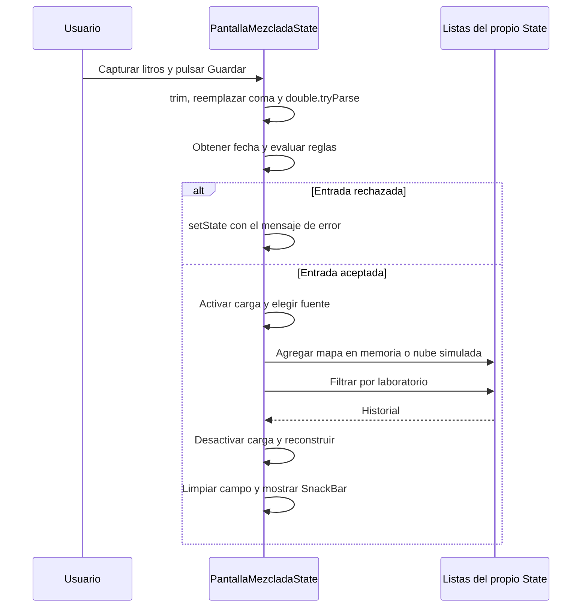

# Ecotrack_reto — Antes del Refactor

El archivo [`lib/main_mezclado.dart` del original](proyectos/ecotrack_reto%20-%20original/lib/main_mezclado.dart) implementa toda la aplicación en `PantallaMezclada` y `_PantallaMezcladaState`. Funciona, pero el mismo objeto representa la interfaz, conserva los datos, valida el negocio y simula una conexión remota.

## Cómo Arranca

```dart
void main() => runApp(
  MaterialApp(
    title: 'EcoTrack',
    theme: ThemeData(colorSchemeSeed: Colors.green),
    home: const PantallaMezclada(),
  ),
);
```

No hay un `lib/main.dart` en el punto de partida. Desde la carpeta original, la entrada se indica expresamente:

```bash
flutter pub get
flutter run -t lib/main_mezclado.dart
```

Estos comandos sirven para estudiar el punto de partida. Su estructura no está preparada para satisfacer las pruebas de las cuatro etapas hasta que se extraigan las capas.

## Qué Posee el State

| Grupo | Campos o métodos |
|---|---|
| Elección de fuente | `_usarNube` |
| Almacenamiento | `_memoria` y `_servidor`, listas de mapas |
| Reglas y catálogo | `_laboratorios` y `_topeLitros` |
| Estado de presentación | `_laboratorio`, `_cargando`, `_error`, `_historial` |
| Control de interfaz | `_litros`, un `TextEditingController` |
| Operaciones | `_guardar`, `_cambiarLaboratorio`, `_recargarHistorial` y `build` |

La misma pantalla debe saber que la memoria conserva `fecha` como `DateTime`, mientras que la nube utiliza una cadena ISO 8601. También escribe y lee las llaves `laboratorio`, `litros` y `fecha` de los mapas.

## Las Seis Marcas MEZCLA

| Marca | Responsabilidad encontrada | Destino al separar |
|---|---|---|
| MEZCLA 1 | Listas de almacenamiento dentro del `State` | Repositorio en memoria y servicio simulado en `datos/` |
| MEZCLA 2 | Catálogo, ausencia de una entidad tipada y reglas dentro del botón | `Consumo`, `laboratoriosUtez` y `ReglaConsumo` en `dominio/` |
| MEZCLA 3 | Demoras y conversión de mapas dentro de la pantalla | Servicio y repositorio de nube en `datos/` |
| MEZCLA 4 | Aviso de guardado | Se conserva en la vista |
| MEZCLA 5 | Decisión entre lista y nube dentro del widget | `main.dart` |
| MEZCLA 6 | Estado, orquestación y consulta del reloj dentro del `State` | `RegistroViewModel` |

MEZCLA 4 muestra que separar no significa mover todo fuera de la pantalla. Un aviso visual necesita el contexto de la vista y pertenece a ella.

## Flujo Original al Guardar



### Conversión y Reglas

La conversión está al principio de `_guardar()`:

```dart
final litros = double.tryParse(_litros.text.trim().replaceAll(',', '.'));
```

Si no se obtiene un número, aparece `Escribe los litros con número`. Después se consulta `DateTime.now()` y se evalúan, en orden:

1. Laboratorio vacío: `El laboratorio es obligatorio`.
2. Litros menores o iguales a cero: `Los litros deben ser mayores que cero`.
3. Litros mayores que `10000`: `Los litros superan el tope de 10000`.
4. Fecha posterior al reloj de referencia: `La fecha no puede ser futura`.

El primer motivo encontrado impide guardar. Es importante conservar el orden porque una entrada puede incumplir más de una condición.

### Almacenamiento

En memoria, el mapa se agrega directamente a `_memoria` con su `DateTime`. En nube, se esperan `600 ms` y se agrega un mapa con `fecha.toIso8601String()` a `_servidor`.

Al consultar la nube se esperan `400 ms`, se filtra por laboratorio y se vuelve a construir una representación con `DateTime.parse(...)`. Todo esto sucede en el mismo archivo y objeto que dibuja el formulario.

La nube es una simulación mediante una lista. No hay HTTP, servidor externo ni persistencia después de cerrar la aplicación.

## Cambio de Laboratorio e Historial

`_cambiarLaboratorio(nuevo)` actualiza la selección, elimina el error y llama a `_recargarHistorial()`. La recarga activa el estado de carga, obtiene las filas del laboratorio actual y actualiza la pantalla.

`build()` suma el historial con `fold`. El encabezado muestra un decimal; los elementos se recorren con `reversed` y muestran la hora con los minutos completados a dos dígitos.

El selector de laboratorio permanece habilitado durante la carga; solo se desactiva `Guardar`. Esta interacción también forma parte de la comparación con la versión separada.

## Qué Dificulta Esta Organización

- Las reglas no se pueden invocar sin acceder a la lógica de la pantalla.
- Cambiar la fuente exige editar un widget.
- Las llaves de los mapas y la representación de fechas llegan hasta la interfaz.
- El reloj del sistema está incrustado en la operación y no puede sustituirse directamente.
- Las listas duran lo que el `State`; otra pantalla no recibe un contrato para compartirlas.

El problema no es usar `State`, `setState` o un controlador. El problema es asignarles también las responsabilidades de dominio, datos y composición.

[Anterior: actividad](01%20-%20Ecotrack_reto%20-%20Actividad%20y%20criterios.md) · [Siguiente: resolución](03%20-%20Ecotrack_reto%20-%20Resoluci%C3%B3n%20paso%20a%20paso.md) · [Índice](README.md).
