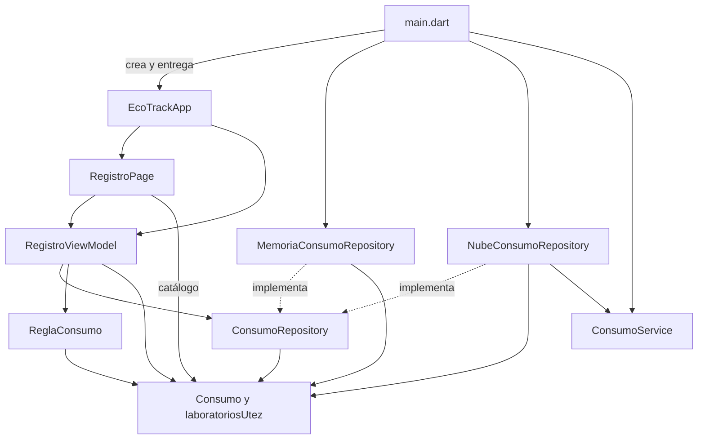
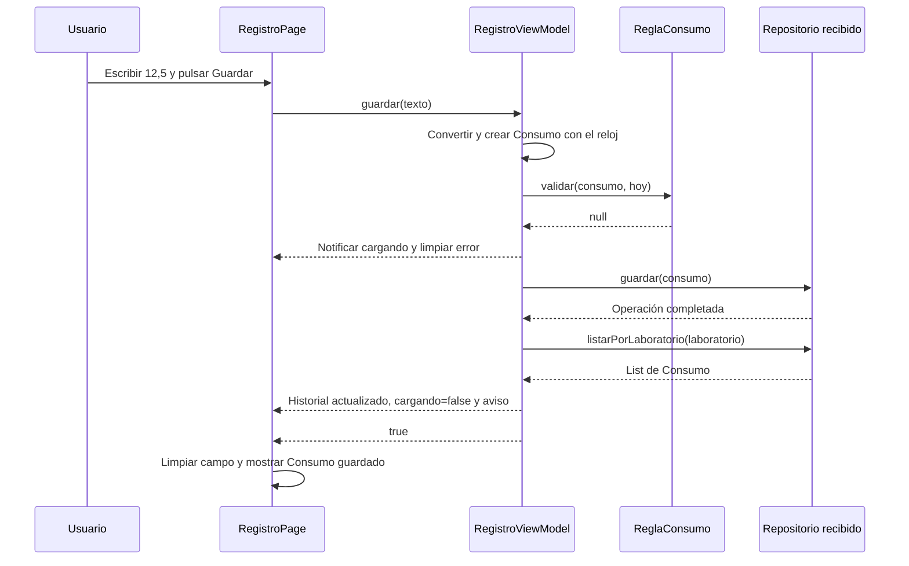

# Ecotrack_reto — Arquitectura Final y Flujos

La solución de [`ecotrack_reto - final`](proyectos/ecotrack_reto%20-%20final/) utiliza **tres capas con MVVM en presentación**, un contrato Repository, inyección manual por constructor y notificaciones Observer mediante `ChangeNotifier`.

Estos conceptos trabajan juntos: las capas distribuyen responsabilidades, MVVM separa la vista de su coordinación, Repository oculta el almacenamiento, la inyección entrega los colaboradores y Observer comunica cambios a la interfaz.

## Mapa Final de Archivos

```text
lib/
├── dominio/
│   ├── consumo.dart
│   └── regla_consumo.dart
├── datos/
│   ├── consumo_repository.dart
│   ├── memoria_consumo_repository.dart
│   ├── consumo_service.dart
│   └── nube_consumo_repository.dart
├── presentacion/
│   ├── registro_view_model.dart
│   └── registro_page.dart
├── main.dart
└── main_mezclado.dart
```

`main_mezclado.dart` permanece como referencia y no participa en el arranque normal con `flutter run`.

| Archivo de la solución | Responsabilidad |
|---|---|
| [`consumo.dart`](proyectos/ecotrack_reto%20-%20final/lib/dominio/consumo.dart) | Entidad inmutable y catálogo de laboratorios |
| [`regla_consumo.dart`](proyectos/ecotrack_reto%20-%20final/lib/dominio/regla_consumo.dart) | Orden, límites y mensajes de validación |
| [`consumo_repository.dart`](proyectos/ecotrack_reto%20-%20final/lib/datos/consumo_repository.dart) | Operaciones de almacenamiento requeridas por el ViewModel |
| [`memoria_consumo_repository.dart`](proyectos/ecotrack_reto%20-%20final/lib/datos/memoria_consumo_repository.dart) | Colección local de entidades |
| [`consumo_service.dart`](proyectos/ecotrack_reto%20-%20final/lib/datos/consumo_service.dart) | Colección de mapas y demoras de la API simulada |
| [`nube_consumo_repository.dart`](proyectos/ecotrack_reto%20-%20final/lib/datos/nube_consumo_repository.dart) | Traducción entre entidades y mapas |
| [`registro_view_model.dart`](proyectos/ecotrack_reto%20-%20final/lib/presentacion/registro_view_model.dart) | Estado, conversión, validación delegada y orquestación |
| [`registro_page.dart`](proyectos/ecotrack_reto%20-%20final/lib/presentacion/registro_page.dart) | Controles y representación del estado |
| [`main.dart`](proyectos/ecotrack_reto%20-%20final/lib/main.dart) | Elección de fuente y composición de objetos |

## MVVM en Esta Aplicación

| Papel | Implementación |
|---|---|
| Model | `Consumo`, `ReglaConsumo` y el acceso a datos mediante el contrato |
| ViewModel | `RegistroViewModel`, con estado y acciones de presentación |
| View | `RegistroPage`, con el formulario, historial y confirmación visual |

La vista entrega el texto al gestor; el gestor publica datos y estados que la vista representa. El catálogo de laboratorios se importa directamente del dominio para construir las opciones. Esa dependencia no da acceso a la fuente de datos ni coloca reglas en la vista.

El contrato del repositorio está en `datos/`, como exige el reto. Esta organización no corresponde a una variante estricta de Clean Architecture que coloque todas las interfaces de repositorio dentro del dominio.

## Dirección de Dependencias de Código



Una flecha continua representa conocimiento o uso de un tipo; una discontinua indica implementación del contrato. El diagrama no significa que todas esas piezas ejecuten sus operaciones al mismo tiempo.

El servicio no conoce `Consumo`; solo recibe y devuelve mapas. El dominio no conoce datos o presentación. El ViewModel conoce la abstracción, y las implementaciones concretas cumplen esa abstracción.

## Flujo Completo de un Guardado



La llamada al contrato llega a la implementación que se entregó en el arranque. El ViewModel no necesita preguntar qué tipo concreto recibió.

### Camino Inválido

Si no se obtiene un número, el ViewModel publica el error de conversión. Si se obtiene, consulta las reglas del dominio. En ambos rechazos se notifica el cambio y se devuelve `false`: no se guarda, no se limpia el campo y no aparece la confirmación de éxito.

### Camino de Memoria

```text
RegistroViewModel
    → ConsumoRepository.guardar(consumo)
    → MemoriaConsumoRepository agrega Consumo
    → listarPorLaboratorio filtra la colección
    → historial del ViewModel
```

### Camino de Nube

```text
Consumo
    → NubeConsumoRepository lo convierte a mapa
    → ConsumoService.post: espera 600 ms y guarda
    → ConsumoService.get: espera 400 ms y filtra
    → NubeConsumoRepository convierte mapas a Consumo
    → historial del ViewModel
```

El mapa incluye fecha ISO 8601; la entidad vuelve a recibir un `DateTime`. La nube sigue siendo una simulación local y pierde sus datos cuando se destruye su servicio.

## Observer y Estado

`RegistroViewModel extends ChangeNotifier` permite publicar cambios. La vista recibe el mismo objeto mediante su constructor y `ListenableBuilder` escucha sus avisos. El ViewModel no conoce al builder ni llama a métodos de la pantalla.

La notificación comunica que el estado cambió; los valores se obtienen leyendo `laboratorio`, `cargando`, `error`, `historial` y `totalLitros`. El aviso no contiene una copia del historial como argumento.

El controlador y el SnackBar permanecen en la vista. Son responsabilidades visuales; no se trasladan al repositorio ni al dominio.

## Cambio de Laboratorio

1. El selector llama a `vm.cambiarLaboratorio(nuevo)`.
2. El ViewModel cambia el laboratorio y limpia el error.
3. `_recargarHistorial` activa carga y consulta el repositorio.
4. El resultado reemplaza el historial; el total se deriva de ese historial.
5. Una notificación actualiza la representación de la vista.

El selector conserva su interacción durante la carga, como en el original. El botón `Guardar` permanece deshabilitado mientras `cargando` sea `true`.

### Cambiar de Laboratorio Durante un Guardado

Hay una diferencia concreta de concurrencia que no debe confundirse con una equivalencia total:

| Secuencia | Original mezclado | Solución con el contrato del reto |
|---|---|---|
| Pulsar guardar en Química y cambiar a Redes antes de los `600 ms` de la nube | El mapa lee `_laboratorio` después de esperar; los litros terminan asignados a Redes | El ViewModel ya creó un `Consumo` de Química antes de llamar al repositorio; los litros quedan en Química |

La solución sigue el orden obligatorio de la actividad: convertir, construir la entidad, validar y entregar esa entidad al repositorio. Una selección posterior no modifica sus campos `final`. El cambio evita que una operación ya iniciada cambie de laboratorio por una lectura tardía del estado de la vista.

Este caso se reprodujo expresamente durante la revisión. Los recorridos secuenciales de registro, validación, filtrado y total conservan su comportamiento; no se afirma equivalencia para cualquier combinación de operaciones simultáneas. No se agregó bloqueo del selector para ocultar la diferencia.

## Propiedad y Duración

| Objeto o estado | Propietario y duración |
|---|---|
| Repositorio | Creado en `main()` y entregado a la aplicación; conserva datos durante la vida de su instancia |
| Servicio simulado | Creado junto al repositorio de nube; mantiene la lista de mapas |
| ViewModel | Creado para la página por `EcoTrackApp`; la página asume su liberación |
| Controlador de texto | Creado y liberado por el `State` de `RegistroPage` |
| Historial visible | Estado del ViewModel con el resultado de la última consulta |
| `Consumo` | Entidad con propiedades finales; su formato no depende del almacenamiento |

Ninguna implementación añade persistencia después de cerrar la aplicación. El arranque mantiene un historial visible vacío, sin carga automática inicial.

## Ventajas y Costos de la Separación

| Ventaja | Costo o límite |
|---|---|
| Cambiar memoria por nube exige una sola elección en `main.dart` | Se necesitan contrato, implementaciones y composición explícita |
| El dominio se prueba con fechas fijas | El código debe recibir la fecha de referencia |
| El ViewModel se prueba con un repositorio espía | Hay que publicar correctamente los cambios de estado |
| La vista conserva sus controles sin conocer el almacenamiento | Se debe definir quién libera el gestor recibido |
| Las traducciones quedan en datos | La nube continúa siendo simulada y no hay recuperación ante errores de un servidor real |

El ejercicio conserva el alcance de la aplicación original: no introduce HTTP, autenticación, base de datos, nuevas reglas o bibliotecas de gestión de estado.

[Anterior: resolución](03%20-%20Ecotrack_reto%20-%20Resoluci%C3%B3n%20paso%20a%20paso.md) · [Siguiente: pruebas y verificación](05%20-%20Ecotrack_reto%20-%20Pruebas%20y%20verificaci%C3%B3n.md) · [Índice](README.md).
